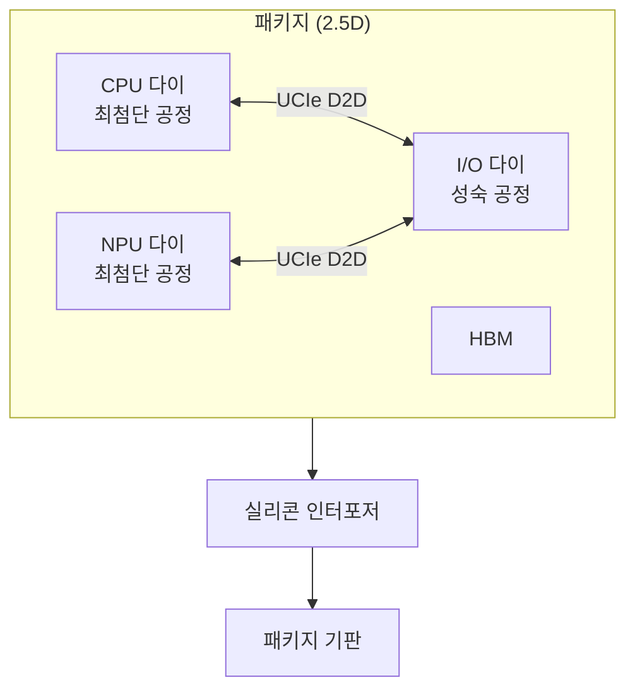

# 시스템 반도체 (비메모리 반도체)

---

## I. 정보 처리를 맡는 반도체, 시스템 반도체의 개요

### 가. 정의

- 정보를 저장하는 메모리를 제외하고 **연산·제어·변환·신호 처리 등 정보 처리를 수행하는 반도체**의 총칭 (로직 IC, 마이크로프로세서, 아날로그, 센서 등)

### 나. 특징

| 구분 | 내용 |
| --- | --- |
| 다품종 소량 | 용도(PC·모바일·차량·가전)별 맞춤 설계 |
| 설계 역량 중심 | 아키텍처·IP 설계가 경쟁력, 팹리스·파운드리·OSAT 분업 |
| 시장 규모 | 반도체 시장의 약 70%로 메모리보다 크고 경기 변동이 상대적으로 작음 |
| 최근 과제 | 미세공정 비용·수율 한계 → 칩렛·첨단 패키징으로 대응 |

---

## II. 구조 및 구성요소

### 가. 칩렛 기반 시스템 반도체 구성

- 기능별로 나눈 다이를 공정별로 따로 만들고, 다이 간 인터페이스와 인터포저로 한 패키지에 통합

### 나. 구성요소

| 구분 | 요소 | 설명 |
| --- | --- | --- |
| 제품군 | 마이크로컴포넌트 | [[CPU]], [[GPU]], [[NPU]], MCU, AP |
| | 로직 IC | ASIC, FPGA, 통신 모뎀, 디스플레이 구동칩(DDI) |
| | 아날로그 IC | 전력관리(PMIC), 데이터 변환(ADC·DAC), RF |
| | 광·센서 | 이미지 센서(CIS), MEMS 센서 |
| 산업 구조 | 팹리스 / 파운드리 / OSAT | 설계 / 위탁 생산 / 패키징·테스트 분업 |
| 설계 기술 | [[칩렛\|칩렛 (Chiplet)]] | 큰 칩을 작은 다이로 나눠 수율·비용 개선 |
| | UCIe | 다이 간 연결(D2D) 개방형 표준 |
| 패키징 | 2.5D / 3D | 인터포저 위 수평 배치(예: CoWoS) / 수직 적층(예: Foveros), TSV·하이브리드 본딩 |

---

## III. 비교 및 동향

### 가. 시스템 반도체 vs 메모리 반도체

| 비교 항목 | 시스템 반도체 | [[메모리 반도체]] |
| --- | --- | --- |
| 기능 | 연산·제어·변환 | 저장 |
| 대표 제품 | CPU, GPU, NPU, AP, CIS | DRAM, NAND, [[HBM]] |
| 생산 방식 | 다품종 소량 | 소품종 대량 |
| 산업 구조 | 팹리스·파운드리 분업 | IDM 중심 |
| 경쟁력 | 설계·IP·생태계 | 미세공정·적층·원가 |
| 경기 민감도 | 상대적으로 낮음 | 높음 (가격 변동 큼) |

### 나. 동향

- **AI 가속기 수요**: GPU·NPU·맞춤형 ASIC 수요 급증, 빅테크의 자체 칩 설계 확대
- **첨단 패키징 경쟁**: TSMC CoWoS·SoIC, 인텔 Foveros, 삼성 I-Cube·X-Cube 등 2.5D·3D 패키징과 UCIe 칩렛 생태계 확대

---

### 🔗 연관 토픽

- **소속 도메인**: [[00_컴퓨터구조_MOC|💻 컴퓨터구조]]
- **세부 분류**: `1. CPU 프로세서 & 마이크로아키텍처`
- **핵심 연관 토픽**:
  - [[메모리 반도체|메모리 반도체 (Memory Semiconductor)]]
  - [[칩렛|칩렛 (Chiplet)]]
  - [[지능형 반도체]]
  - [[NPU|NPU(Neural Processing Unit)]]
  - [[HBM|HBM (High Bandwidth Memory)]]
