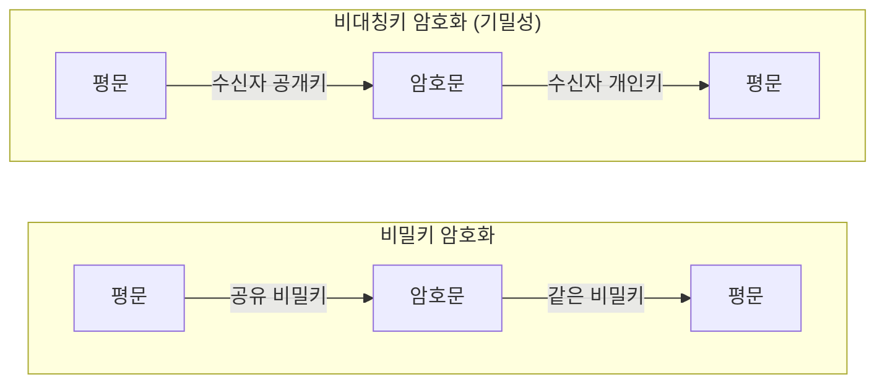

# 비밀키 암호화와 비대칭키 암호화 비교

---

## I. 속도의 비밀키, 키 분배의 공개키, 두 암호 방식의 개요

### 가. 정의

- **비밀키(대칭키) 암호화**: 암호화와 복호화에 **같은 비밀키**를 사용하는 방식 ([[대칭키 암호화]])
- **비대칭키(공개키) 암호화**: **공개키·개인키 쌍**을 사용해 한 키로 암호화한 것을 다른 키로만 복호화하는 방식 ([[비대칭키 암호화]])

### 나. 특징

| 구분 | 내용 |
| --- | --- |
| 비밀키 장점 | 연산이 빠르고 암호문 크기 증가가 작아 대용량 데이터에 적합 |
| 비밀키 한계 | 키 사전 공유 필요, n명 통신 시 $\frac{n(n-1)}{2}$개 키 |
| 비대칭키 장점 | 키 사전 공유 불필요, 전자서명으로 인증·부인방지 제공 |
| 비대칭키 한계 | 연산이 느려 대용량 데이터 직접 암호화에 부적합 |
| 상호 보완 | 공개키로 세션키 교환, 비밀키로 데이터 암호화 (하이브리드) |

---

## II. 동작 구조 및 구성요소

### 가. 동작 비교

- 비밀키는 사전에 공유한 하나의 키로, 비대칭키는 수신자 공개키로 암호화하고 수신자 개인키로 복호화 (서명은 송신자 개인키로 생성)

### 나. 구성요소

| 구분 | 요소 | 설명 |
| --- | --- | --- |
| 비밀키 | [[AES]] | SPN 구조, 128비트 블록, 128/192/256비트 키 (미국 표준) |
| | ARIA, SEED | 국내 표준 블록 암호 (ARIA: 국가보안기술연구소 주도, SEED: KISA) |
| | ChaCha20 | ARX 기반 스트림 암호, TLS 1.3 지원 |
| 비대칭키 | [[RSA (Rivest Shamir Adleman)\|RSA]] | 소인수분해 난제 기반, 암호화·서명 |
| | [[ECC]] | 타원곡선 이산대수 기반, 256비트로 RSA 3072비트 수준 강도 |
| 키 관리 | KDC | 대칭키 환경의 중앙 키 분배 센터 (Kerberos) |
| | PKI | 인증서로 공개키 소유자 보증 |
| 응용 | 하이브리드 암호 | TLS·[[IP Sec\|IPsec]]에서 공개키(또는 DH)로 세션키 합의 후 대칭키로 데이터 암호화 |
| | [[전자봉투]] | 데이터는 비밀키로, 비밀키는 수신자 공개키로 암호화 |

---

## III. 비교 및 동향

### 가. 상세 비교

| 비교 항목 | 비밀키 암호화 | 비대칭키 암호화 |
| --- | --- | --- |
| 키 관계 | 암호화 키 = 복호화 키 | 암호화 키 ≠ 복호화 키 |
| 안전성 근거 | 혼돈·확산 설계, 전수조사 비용 | 수학적 난제 (소인수분해, 이산대수) |
| 속도 | 빠름 | 대칭키 대비 수백~수천 배 느림 |
| 키 수 (n명) | $\frac{n(n-1)}{2}$ | $2n$ |
| 보안 서비스 | [[기밀성]] (AEAD 시 무결성 포함) | 기밀성, 인증, 부인방지, 키 교환 |
| 활용 | DB·디스크·통신 데이터 암호화 | 인증서, 전자서명, 세션키 교환 |
| 양자 위협 | Grover: 키 길이 2배로 대응 | Shor: 알고리즘 교체 필요 |

### 나. 동향

- **[[양자내성암호]] 전환**: NIST FIPS 203(ML-KEM)·204(ML-DSA)·205(SLH-DSA) 확정(2024), 공개키 체계부터 교체
- **하이브리드 키 교환**: TLS에서 X25519와 ML-KEM을 함께 쓰는 하이브리드 방식 적용 확대
- **AEAD 표준화**: AES-GCM, ChaCha20-Poly1305로 기밀성과 무결성을 동시 제공

---

### 🔗 연관 토픽

- **소속 도메인**: [[00_보안_MOC|🛡️ 보안]]
- **세부 분류**: `1. 정보보안 원칙 & 거버넌스 · 인증`
- **핵심 연관 토픽**:
  - [[대칭키 암호화]]
  - [[비대칭키 암호화]]
  - [[전자봉투|전자봉투(Digital Envelope)]]
  - [[암호 알고리즘]]
  - [[양자내성암호]]
