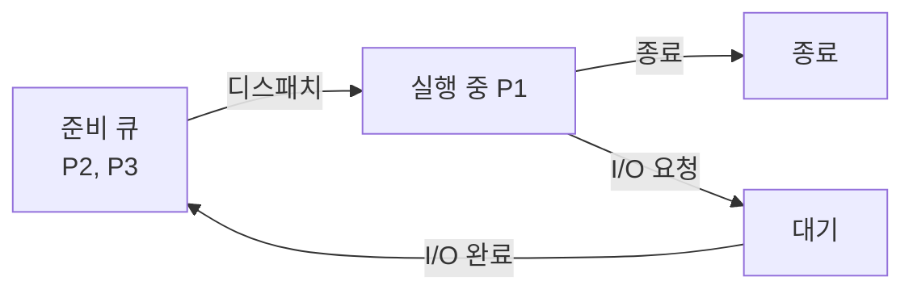

# 비선점형 스케줄링 (Non-preemptive Scheduling)

---

## I. 스스로 내놓을 때까지, 비선점형 스케줄링의 개요

### 가. 정의

- [[CPU]]를 할당받은 [[프로세스]]가 **종료하거나 I/O 등으로 스스로 대기 상태가 될 때까지 다른 프로세스가 CPU를 빼앗을 수 없는** [[스케줄링]] 방식

### 나. 특징

| 구분 | 내용 |
| --- | --- |
| 예측성 | 실행 중 중단이 없어 응답시간 예측이 쉬움 |
| 낮은 오버헤드 | [[문맥 교환]] 횟수가 적음 |
| 호위 효과 (Convoy Effect) | 긴 작업 뒤에 짧은 작업들이 줄줄이 대기 |
| 낮은 응답성 | 긴급 작업도 실행 중인 작업이 끝날 때까지 대기 → 대화형·실시간 시스템에 부적합 |

---

## II. 동작 구조 및 알고리즘 유형

### 가. 동작 개념도

- 실행 중인 P1은 타이머 만료나 우선순위 높은 작업 도착으로 중단되지 않고, 종료·I/O 요청 시에만 CPU 반환

### 나. 알고리즘 유형

| 구분 | 요소 | 설명 |
| --- | --- | --- |
| 도착 순서 | FCFS (First Come First Served) | 준비 큐 도착 순서대로 실행, 구현이 가장 단순하나 호위 효과 발생 |
| 실행시간 | SJF (Shortest Job First) | 실행시간이 가장 짧은 작업 우선, 평균 대기시간 최소 / 긴 작업 [[기아\|기아(Starvation)]] 가능 |
| 응답률 | HRN (Highest Response-ratio Next) | 우선순위 = (대기시간 + 서비스시간) / 서비스시간, 오래 기다릴수록 우선순위 상승 → SJF의 기아 보완 |
| 우선순위 | 우선순위 스케줄링 | 우선순위가 높은 작업부터 실행, 선점형으로도 구현 가능 / 에이징으로 기아 방지 |
| 기한 | [[기한부 스케줄링]] | 정해진 기한 안에 끝내도록 할당, 기한 내 불가 시 작업 포기 |
| 평가 지표 | 반환시간 (Turnaround Time) | 제출부터 완료까지 걸린 시간 |
| | 대기시간 (Waiting Time) | 준비 큐에서 기다린 시간의 합 |

---

## III. 비교 및 동향

### 가. 비선점형 vs 선점형

| 비교 항목 | 비선점형 | [[선점 스케줄링\|선점형]] |
| --- | --- | --- |
| CPU 반환 | 프로세스가 자발적으로 반환 | OS가 강제로 회수 가능 |
| 문맥 교환 | 적음 | 많음 |
| 응답시간 | 느리지만 예측 쉬움 | 빠르지만 예측 어려움 |
| 적합 환경 | 일괄 처리(Batch) | 시분할, 대화형, 실시간 |
| 대표 알고리즘 | FCFS, SJF, HRN, 기한부 | RR, SRT, MLQ, MLFQ |

### 나. 동향

- **범용 OS는 선점형**: Linux·Windows는 선점형이 기본, 다만 짧은 임계 구역(스핀락 보유, 인터럽트 비활성 구간)은 선점 금지로 처리
- **배치·HPC 작업 스케줄러**: Slurm 등은 계산 노드를 작업 단위로 끝까지 배정하는 비선점 할당과 백필(Backfill)을 결합해 활용률 확보
- **협력형 경량 스레드**: 코루틴·이벤트 루프는 작업이 스스로 양보(await)할 때만 전환하는 비선점 방식

---

### 🔗 연관 토픽

- **소속 도메인**: [[00_운영체제_MOC|⚙️ 운영체제]]
- **세부 분류**: `1. 프로세스 & 스레드 관리`
- **핵심 연관 토픽**:
  - [[선점 스케줄링|선점 방식(선비)]]
  - [[스케줄링]]
  - [[기한부 스케줄링|기한부(Deadline) 스케줄링]]
  - [[기아|기아(Starvation)]]
  - [[문맥 교환|문맥 교환 (Context Switching)]]
