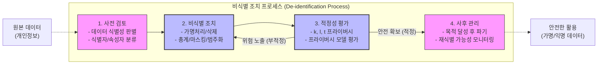

# 비식별화 (De-identification)

---

## I. 안전한 데이터 활용, 비식별화의 개요

비식별화(De-identification)는 데이터셋에서 특정 개인을 식별할 수 없도록 개인정보의 일부 또는 전부를 삭제하거나 변형하여 프라이버시 침해를 방지하면서도 데이터의 통계적·산업적 유용성을 보존하는 일련의 기술 및 관리적 조치 과정이다.

| 구분 | 내용 |
| :--- | :--- |
| **정의** | 개인 식별성을 제거·변형하여 프라이버시를 보호하면서 통계적 유용성을 유지하는 기술적·관리적 조치 |
| **추진 배경** | 데이터 3법 개정에 따른 가명정보 활용 활성화, AI 학습 데이터 수요 급증 및 GDPR 규제 대응 |
| **핵심 원칙** | 프라이버시 보호와 데이터 유용성 간 균형 최적화, 정량적 프라이버시 모델(k-익명성, l-다양성, t-근접성) 검증 |

---

## II. 비식별화 처리 프로세스 및 핵심 기술 요소

### 가. 비식별화 처리 프로세스 (KISA 가이드라인 기준)

* 원본 데이터에서 직접 식별자와 준식별자를 분리한 후 비식별 조치 기법 적용
* 조치된 데이터는 프라이버시 모델(k, l, t)을 통해 정량적으로 안전성을 평가한 후 통과 시 활용

### 나. 비식별화 핵심 기술 요소

| 구분 | 요소기술(키워드) | 세부 설명 |
| --- | --- | --- |
| **조치 기법** | **가명처리 (Pseudonymization)** | - 직접 식별자를 다른 값으로 대체하여 식별력 하향 (휴리스틱, [[암호화]], 교환 방법 등) |
| **조치 기법** | **총계처리 (Aggregation)** | - 개별 데이터 값을 총합, 평균 값 등으로 변환하여 특정 개인 식별 방지 (부분합, 라운딩) |
| **조치 기법** | **데이터 삭제 (Deletion)** | - 식별성이 높은 단일 데이터 값이나 레코드 자체를 삭제 (식별자 삭제, 특정 레코드 삭제) |
| **조치 기법** | **데이터 범주화 (Suppression)** | - 특정 데이터 값을 범주(구간)화 하여 정확한 값을 은닉 (상/하단 코딩, 범위 방법) |
| **조치 기법** | **데이터 마스킹 (Masking)** | - 데이터의 일부 또는 전체를 '*', 공백 등 대체 문자로 가림 처리 (주민번호 뒷자리 마스킹 등) |
| **평가 모델** | **k-익명성 (k-Anonymity)** | - 주어진 데이터셋에서 동일한 준식별자(QI) 집단을 가진 레코드가 최소 k개 이상 존재하도록 보장 |
| **평가 모델** | **l-다양성 (l-Diversity)** | - k-익명성 군집 내에서 민감 정보(Sensitive Attribute)가 최소 l개 이상의 다양한 값을 갖도록 보장 |
| **평가 모델** | **t-근접성 (t-Closeness)** | - 특정 군집 내 민감 정보의 분포와 전체 데이터셋의 민감 정보 분포 차이를 t 이하로 유지 |

---

## III. 데이터 활용 관점의 비식별화 수준 비교 및 향후 동향

### 가. 가명정보와 익명정보 비교

| 비교 항목 | 가명정보 (Pseudonymized Data) | 익명정보 (Anonymized Data) |
| --- | --- | --- |
| **정의** | 추가 정보의 사용/결합 없이는 특정 개인을 알아볼 수 없도록 조치한 정보 | 시간, 비용, 기술 등을 합리적으로 고려할 때 어떠한 방법으로도 특정 개인을 알아볼 수 없는 정보 |
| **재식별 가능성** | 추가 정보(매핑 테이블 등) 접근 시 재식별 **가능** | 어떠한 경우라도 재식별 **불가능** (완전한 비식별) |
| **법적 지위** | [[개인정보보호법]] 상 **개인정보의 일종으로 취급됨** | 개인정보보호법의 **적용을 받지 않음** (비규제 대상) |
| **활용 범위** | 동의 없이 통계작성, 과학적 연구, 공익적 기록 보존 목적 활용 | 상업적 목적, 외부 공개 등 제약 없이 자유로운 활용 |

### 나. 비식별화 기술의 한계점 극복 및 향후 발전 동향
- **고차원 데이터의 차원 저주 극복 및 [[합성 데이터]] 활용**: 고차원 정형 및 비정형 데이터에서 k-익명성 적용 시 유용성이 급감하는 한계를 극복하기 위해, 생성형 AI([[GAN (Generative Adversarial Network)|GAN]], Diffusion) 기반 합성 데이터(Synthetic Data) 생성 확산.
- **수학적 프라이버시 보증 체계([[차분 프라이버시]])로의 패러다임 전환**: 배경 지식 공격에 취약한 휴리스틱 비식별화의 한계를 보완하기 위해 질의 응답에 엄밀한 라플라스/가우시안 노이즈를 주입하는 차분 프라이버시(Differential Privacy) 적용 가속화.
- **프라이버시 강화 기술(PET)의 다계층 융합**: 원본 데이터 이동 없이 협업하는 [[연합 학습]](Federated Learning), 암호화된 상태로 연산하는 [[동형 암호|동형암호]], 하드웨어 기반 [[기밀컴퓨팅]]을 결합한 통합 개인정보 보호 아키텍처 정립.

---

### 🔗 연관 토픽

- **소속 도메인**: [[00_보안_MOC|🛡️ 보안]]
- **세부 분류**: `6. 개인정보보호 & 프라이버시 강화 기술`
- **핵심 연관 토픽**:
  - [[차분 프라이버시]]
  - [[데이터 3법|데이터 3법 (Data 3 Acts)]]
  - [[개인정보보호법]]
  - [[ISO IEC 20889|ISO/IEC 20889]]
  - [[동형 암호|동형 암호 (Homomorphic Encryption)]]
