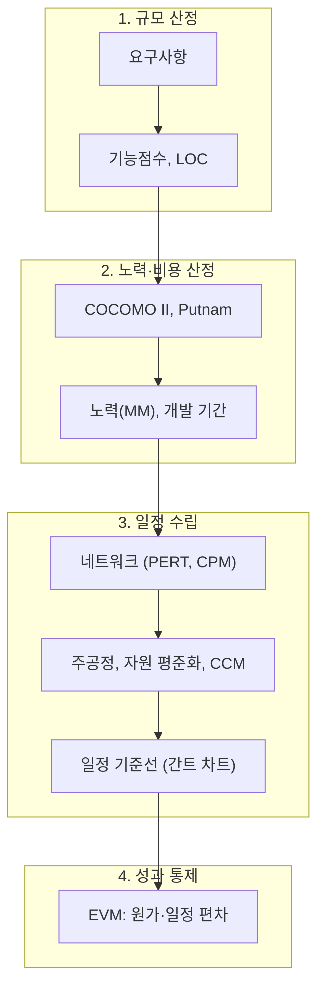

# 비용산정 및 일정관리 모델

---

## I. 규모에서 일정까지, SW 비용산정·일정관리 모델의 개요

### 가. 정의

- 요구사항으로부터 **SW 규모·노력(비용)을 정량 예측**하고, 이를 바탕으로 **작업 순서·기간을 수립·통제**하는 모델과 기법의 묶음

### 나. 필요성 및 특징

| 구분 | 내용 |
| --- | --- |
| 불확실성 축소 | 불확실성의 원뿔(Cone of Uncertainty), 초기 추정 오차가 크므로 단계별 재산정 |
| 예산·납기 관리 | 근거 있는 예산 확보, 납기 지연 위험 사전 식별 |
| 연계 흐름 | 규모 산정 → 노력·비용 산정 → 일정 수립 → 성과 통제 |
| 공공 기준 | 국내 공공 SW 사업은 기능점수 기반 대가 산정 ([[SW사업 대가산정 가이드]]) |

---

## II. 연계 흐름과 핵심 모델

### 가. 개념도

- 기능 규모를 비용 모델에 넣어 노력(MM)을 구하고, 이를 활동에 배분해 [[CPM]] 네트워크로 일정을 확정한 뒤 EVM으로 통제

### 나. 핵심 모델

| 구분 | 요소 | 설명 |
| --- | --- | --- |
| 규모 산정 | [[Function Point]] | 데이터·트랜잭션 기능으로 논리적 규모 측정, 국내 공공 대가 산정 기준 |
| | LOC | 원시 코드 라인 수, 언어 의존적 |
| 비용 산정 | COCOMO II | 규모(KSLOC, FP 환산)와 규모 인자·노력 승수로 노력(PM) 산출, 3단계 모델 |
| | Putnam (SLIM) | Rayleigh-Norden 곡선으로 기간에 따른 인력 분포 추정 |
| 일정 수립 | PERT | 낙관·최빈·비관 3점 추정의 확률적 네트워크 ([[3점 산정]]) |
| | CPM | 여유가 0인 최장 경로(주공정) 산출, 결정론적 |
| | [[CCM]] | 자원 제약과 버퍼로 납기 관리 (Goldratt) |
| | 간트 차트 | 작업 일정을 시간 축 막대로 시각화 |
| 통제 | [[EVM(Earned Value Management, 획득 가치 관리)\|EVM]] | PV·EV·AC로 원가·일정 편차와 완료 시점 예측 |

---

## III. 비교 및 동향

### 가. 예측형 vs 애자일 산정·일정

| 비교 항목 | 예측형 | 애자일 |
| --- | --- | --- |
| 철학 | 사전 분석, 확정 일정·예산 준수 | 불확실성 수용, 반복 인도 |
| 규모·노력 | FP, COCOMO II | 스토리 포인트, 플래닝 포커 |
| 일정 도구 | WBS, PERT, CPM, 간트 차트 | 백로그, 스프린트 타임박스, 릴리스 계획 |
| 진척 통제 | EVM | [[번다운차트\|번다운·번업 차트]], 칸반 보드 |

### 나. 동향

- **데이터 기반 추정**: 이슈 트래커 실적(사이클 타임, Velocity)으로 추정 모델 보정
- **AI 개발비 산정**: AI 사업은 데이터 구축·학습 비용을 별도 산정하는 기준 등장 ([[AI 개발비 산정]])
- **하이브리드**: 상위 일정·예산은 WBS·EVM, 실행은 스프린트·칸반

---

### 🔗 연관 토픽

- **소속 도메인**: [[00_프로젝트관리_MOC|📋 프로젝트관리]]
- **세부 분류**: `2. 프로젝트 범위 & 일정 관리 (Scope & Schedule)`
- **핵심 연관 토픽**:
  - [[SW 규모산정]]
  - [[Function Point]]
  - [[CPM|CPM (Critical Path Method)]]
  - [[EVM(Earned Value Management, 획득 가치 관리)]]
  - [[SW사업 대가산정 가이드]]
