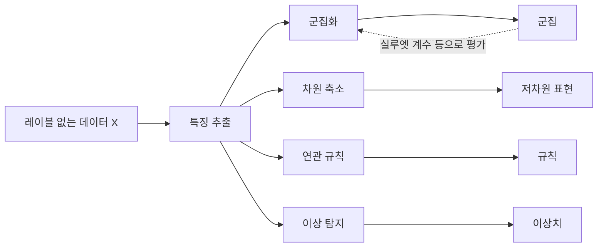

# 비지도 학습 (Unsupervised Learning)

---

## I. 정답 없이 구조를 찾는, 비지도 학습의 개요

### 가. 정의

- **정답 레이블 없이 입력 데이터만으로 유사성·분포·잠재 구조를 찾아내는** 기계학습 방식

### 나. 필요성 및 특징

| 구분 | 내용 |
| --- | --- |
| 필요성 | 레이블링 비용 없이 대량의 비정형 데이터 분석 |
| 목적 | 예측이 아닌 구조 발견 (군집, 저차원 표현, 규칙, 이상) |
| 목적 함수 | 군집 내 응집도·군집 간 분리도, 재구성 오차, 우도 등 |
| 활용 | [[EDA]], [[지도학습]] 전 특징 추출·전처리 |
| 한계 | 정답이 없어 성능 평가·결과 해석이 주관적 |

---

## II. 동작 구조 및 핵심 알고리즘

### 가. 개념도

- 레이블 없는 데이터에서 그룹, 저차원 표현, 항목 간 규칙, 이상 패턴을 도출

### 나. 핵심 알고리즘

| 구분 | 요소 | 설명 |
| --- | --- | --- |
| 군집화 | [[K-평균 알고리즘\|K-Means]] | k개 중심과의 거리로 할당·갱신 반복, 구형 군집에 적합 |
| | [[DBSCAN(밀도 기반 클러스터링)\|DBSCAN]] | 밀도 기반, 임의 모양 군집과 노이즈 처리 가능 |
| | 계층적 군집 | 병합·분할로 덴드로그램 생성, k 사전 지정 불필요 |
| [[차원 축소]] | [[PCA(Principal Component Analysis)\|PCA]] | 분산을 최대로 보존하는 직교 축으로 선형 투영 |
| | t-SNE·UMAP | 이웃 관계를 보존하는 비선형 축소, 주로 시각화 |
| 연관 규칙 | Apriori | [[지지도]]·신뢰도·향상도 기준 빈발 항목집합 탐색 |
| | FP-Growth | FP-Tree로 후보 생성 없이 빈발 항목 탐색 |
| 생성·표현 | 오토인코더·[[VAE]]·[[GAN (Generative Adversarial Network)\|GAN]] | 데이터 분포·잠재 표현 학습 |
| 평가 | 실루엣 계수 | 응집도와 분리도로 군집 품질을 -1~1로 평가 |

---

## III. 비교 및 동향

### 가. 지도 학습 vs 비지도 학습

| 비교 항목 | [[지도학습]] | 비지도 학습 |
| --- | --- | --- |
| 데이터 | 입력 X + 정답 Y | 입력 X만 |
| 목적 | 값·클래스 예측 | 구조·패턴 발견 |
| 태스크 | 분류, 회귀 | 군집화, 차원 축소, 연관 분석, 이상 탐지 |
| 대표 알고리즘 | [[서포트 벡터 머신\|SVM]], [[랜덤 포레스트]], [[CNN]] | K-Means, PCA, Apriori, 오토인코더 |
| 평가 | 정확도, F1, RMSE | 실루엣 계수, WCSS (간접 평가) |
| 비용 | 레이블링 비용 큼 | 해석·평가 어려움 |

### 나. 동향

- **자기지도 학습**: 데이터 일부를 가리고 예측하는 사전 과제로 레이블 없이 표현을 학습하며 [[파운데이션 모델]] 사전학습의 기반이 됨 ([[자기지도학습]])
- **이상 탐지**: 정상 데이터만 학습해 Isolation Forest·오토인코더 재구성 오차로 제조 결함, 금융 사기, 침입 탐지 ([[이상 감지]])

---

### 🔗 연관 토픽

- **소속 도메인**: [[00_인공지능_MOC|🤖 인공지능]]
- **세부 분류**: `1. 수학 · 통계학 & 데이터 전처리`
- **핵심 연관 토픽**:
  - [[지도학습]]
  - [[준지도학습]]
  - [[K-평균 알고리즘]]
  - [[차원 축소|차원 축소(Dimensionality Reduction)]]
  - [[자기지도학습]]
