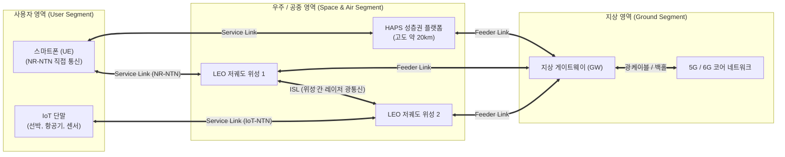

# 비지상네트워크 (NTN, Non-Terrestrial Networks)

---

## I. 6G 초공간 통신을 위한 핵심 인프라, NTN의 개요

지상 기지국 대신 저궤도(LEO)·정지궤도(GEO) 인공위성과 성층권 통신 플랫폼(HAPS)을 활용하여 지상, 해상, 공중 전역에 걸친 3차원 입체 통신 커버리지를 제공하는 차세대 이동통신 네트워크 기술이다.

| 구분 | 주요 내용 |
| --- | --- |
| **개념** | 우주 및 성층권에 배치된 비행체를 기지국 또는 무선 중계기로 활용하여 지상망의 지리적 한계를 극복하는 3차원 통신 시스템 |
| **등장 배경** | 사막, 해양, 극지, 공중 등 지상망 음영 지역 해소, 대규모 지진·전쟁 등 재난 상황 시 통신 생존성(Resilience) 확보 필요 |
| **핵심 특징** | 3GPP Rel-17/18 기반 5G/6G 표준 통신 규격(NR-NTN, IoT-NTN), 긴 전파 지연 및 극심한 도플러 효과 보상 기술 적용 |

---

## II. NTN의 아키텍처 및 핵심 기술 요소

### 가. NTN의 시스템 구성도 및 신호 전달 경로

사용자 단말이 서비스 링크(Service Link)를 통해 위성이나 성층권 비행체에 무선 접속하고, 위성 간 광링크(ISL) 및 피더 링크(Feeder Link)를 거쳐 지상 게이트웨이 및 5G/6G 코어망과 연동된다.

### 나. NTN의 핵심 기술 요소

| 분류 | 요소기술 (키워드) | 세부 설명 |
| --- | --- | --- |
| **접속 규격** | NR-NTN | 5G NR 표준을 위성 환경에 맞춰 확장하여 스마트폰과 직접 음성·데이터 통신을 제공하는 기술 |
| **접속 규격** | IoT-NTN | NB-IoT 및 eMTC 프로토콜을 기반으로 해상 컨테이너, 오지 센서 등 저전력 광역 사물인터넷 지원 |
| **동기화 제어** | 타이밍 어드밴스 (TA) 보정 | 수백~수천 km에 달하는 먼 거리로 인해 발생하는 막대한 전파 전파 지연(Propagation Delay)을 정밀 보상 |
| **주파수 제어** | 도플러 천이 (Doppler Shift) 보상 | 시속 2~3만 km로 초고속 이동하는 LEO 위성으로 인한 주파수 왜곡을 단말 및 기지국에서 사전 추정·보상 |
| **재전송 최적화** | HARQ 최적화 | 긴 왕복 지연 시간(RTT)으로 인한 성능 저하를 방지하기 위해 HARQ 프로세스 확장 또는 비활성화 기법 적용 |
| **비행 인프라** | HAPS (성층권 플랫폼) | 고도 약 20km 성층권에 장기 체공하는 태양광 무인기로, 정지 상태에서 저지연 광역 통신 커버리지 제공 |
| **위성 인프라** | LEO ([[저궤도 위성]]) | 고도 300~1,500km에서 운용되어 지연 시간을 수십 ms 수준으로 단축한 차세대 광대역 통신 위성 |
| **우주 백홀** | ISL (Inter-Satellite Link) | 지상 기지국을 거치지 않고 위성 간 직접 레이저 광통신으로 데이터를 라우팅하는 글로벌 우주 백홀망 |

---

## III. NTN과 TN(지상망) 비교 및 최신 동향

### 가. NTN (비지상 네트워크) vs TN (지상 네트워크) 비교

| 비교 항목 | NTN (Non-Terrestrial Network) | TN (Terrestrial Network) |
| --- | --- | --- |
| **핵심 인프라** | 저궤도/정지궤도 인공위성, HAPS 비행체 | 지상 기지국(gNB/eNB), 스몰셀, 광선로 |
| **커버리지** | 글로벌 전역 (해상, 사막, 산악, 고공 3차원 공간) | 인구 밀집 지역 중심 2차원 평면 커버리지 |
| **전파 지연 (RTT)** | LEO 20~40ms, GEO 500ms 이상 | 1~10ms 이내 극초저지연 (URLLC 지원) |
| **도플러 효과** | 위성의 고속 이동으로 매우 큼 (사전 보정 필수) | 단말 이동 수준으로 상대적으로 미미함 |
| **활용 주파수** | S-Band, L-Band, Ku/Ka-Band 등 위성 전용 대역 | Sub-6GHz 대역, mmWave(28GHz) 등 |
| **표준화 기반** | 3GPP Rel-17/18 이후 공식 표준화 반영 | 3GPP Rel-15/16 표준 성숙 완료 |

### 나. 최신 기술 동향 및 발전 방향

* **지상-비지상 완전 통합(3D Seamless Network)**: 6G 시대에는 지상 셀룰러망과 위성망이 단일 코어 네트워크 아래에서 유기적으로 결합되어, 사용자가 망 전환을 의식하지 않고 글로벌 로밍을 제공받는 초연결 환경으로 발전함.
* **스마트폰 직결(Direct-to-Cell) 상용화**: 별도의 위성 전용 단말기 없이 일반 상용 스마트폰으로 저궤도 위성과 직접 문자·음성·데이터를 주고받는 D2D(Device-to-Device) 서비스가 본격 상용화 단계에 진입함.

---

### 🔗 연관 토픽

- **소속 도메인**: [[00_네트워크_MOC|🌐 네트워크]]
- **세부 분류**: `4. 무선 및 차세대 이동통신 (5G/6G/Wi-Fi)`
- **핵심 연관 토픽**:
  - [[저궤도 위성]]
  - [[6G]]
  - [[게이트웨이]]
  - [[신뢰성]]
  - [[프로세스]]
