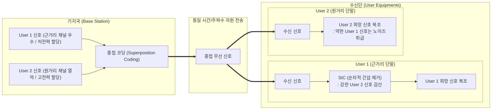

# 비직교 다중접속 (NOMA)

---

## I. 주파수 효율 극대화, 비직교 다중접속(NOMA)의 개요

동일한 시간, 주파수, 공간 무선 자원 상에 서로 다른 송신 전력(Power) 또는 비직교 코드(Code)를 중첩 할당하여 복수의 사용자가 동시에 통신할 수 있도록 지원하는 차세대 다중 접속 기술이다.

| 구분 | 주요 내용 |
| --- | --- |
| **개념** | 직교성(Orthogonality) 원칙을 깨고 동일 무선 자원에 다중 사용자 신호를 겹쳐 전송한 뒤 수신단에서 간섭을 제거하여 신호를 복원하는 방식 |
| **등장 배경** | 기존 직교 다중 접속(OMA/OFDMA)의 제한된 직교 자원 분할 한계 극복, 5G/6G 초연결 IoT(mMTC) 환경의 대규모 동시 접속 수용 필요 |
| **핵심 특징** | 송신단 중첩 코딩(SC) 및 수신단 순차적 간섭 제거(SIC) 적용, 스펙트럼 효율(Spectral Efficiency) 극대화, 셀 경계 사용자 공평성(Fairness) 향상 |

---

## II. NOMA의 아키텍처 및 핵심 기술 요소

### 가. NOMA의 동작 개념도 (전력 기반 NOMA)

기지국은 채널 환경이 열악한 원거리 단말에 높은 전력을, 채널이 양호한 근거리 단말에 낮은 전력을 할당해 중첩 전송하며, 근거리 단말은 간섭 제거(SIC)를 통해 타인 신호를 발라낸 후 자신의 신호를 복조한다.

### 나. NOMA의 핵심 기술 요소

| 분류 | 요소기술 (키워드) | 세부 설명 |
| --- | --- | --- |
| **송신 기술** | 중첩 코딩 (Superposition Coding) | 복수 사용자의 데이터 스트림을 서로 다른 전력 레벨로 가중 합산하여 단일 무선 자원에 실어 송출 |
| **수신 기술** | 순차적 간섭 제거 (SIC) | 수신단에서 전력이 가장 강한 신호부터 차례대로 디코딩하여 원본에서 빼낸(감산) 후 희망 신호 복원 |
| **자원 할당** | 동적 전력 할당 ([[알고리즘]]) | 채널 상태가 열악한 단말에 높은 전력을 분배하여 서비스 공평성을 유지하고 전송 용량을 최적화 |
| **사용자 군집** | 사용자 페어링 (User Pairing) | SIC 디코딩 성공률을 극대화하기 위해 채널 이득 차이가 현격한 근거리-원거리 단말을 쌍으로 결합 |
| **구현 도메인** | 전력 영역 (Power-Domain NOMA) | 송신 전력의 차이를 활용하여 신호를 다중화하는 방식으로 주로 기지국 다운링크에 적용 |
| **구현 도메인** | 코드 영역 (Code-Domain NOMA) | 성긴 코드(SCMA) 등 비직교 확산 코드를 활용하여 다중 사용자를 구분하는 방식으로 업링크에 적용 |
| **채널 피드백** | 채널 상태 정보 (CSI) 획득 | 기지국이 최적의 사용자 페어링과 전력 분배 행렬을 계산하기 위해 단말로부터 정밀 채널 정보 수집 |

---

## III. NOMA와 OMA의 비교 및 최신 동향

### 가. 비직교 다중접속(NOMA)과 직교 다중접속(OMA) 비교

| 비교 항목 | 비직교 다중접속 (NOMA) | 직교 다중접속 (OMA / OFDMA) |
| --- | --- | --- |
| **자원 할당 방식** | 동일 시간·주파수 자원을 **비직교 중첩 사용** | 시간, 주파수, 부반송파를 **직교 분할 할당** |
| **다중 사용자 간섭** | 의도적으로 간섭을 발생시킨 후 단말에서 제거 | 상호 간섭이 발생하지 않도록 물리적 격리 |
| **수신단 복잡도** | **높음** (단말에 고성능 SIC 연산 회로 필요) | **낮음** (자신에게 할당된 자원 블록만 복조) |
| **스펙트럼 효율** | 매우 높음 (주파수 당 전송 용량 극대화) | 상대적으로 낮음 (직교 자원 슬롯 한계 종속) |
| **공평성 (Fairness)** | 셀 경계 음영 지역 단말에 높은 전력 배분 가능 | 채널 상태가 나쁜 단말의 전송률 급락 |

### 나. 최신 기술 동향 및 발전 방향

* **MIMO-NOMA 결합 연구**: 대규모 다중 안테나(Massive MIMO)의 공간 다중화와 NOMA의 전력 도메인 중첩을 융합하여 무선 채널 용량을 한계치까지 확장하는 6G 물리 계층 표준 연구가 진행됨.
* **수신단 프로세서 발전과 SIC 한계 극복**: NOMA의 가장 큰 장애물이었던 단말의 복잡한 연산 부하와 배터리 소모 문제가 모바일 NPU 및 고효율 신호 처리 반도체 발전에 따라 점진적으로 완화됨.

---

### 🔗 연관 토픽

- **소속 도메인**: [[00_네트워크_MOC|🌐 네트워크]]
- **세부 분류**: `4. 무선 및 차세대 이동통신 (5G/6G/Wi-Fi)`
- **핵심 연관 토픽**:
  - [[6G]]
  - [[알고리즘]]
  - [[QAM(Quadrature Amplitude Modulation)--|QAM]]
  - [[비지상네트워크]]
  - [[OFDM (Orthogonal Frequency Division Multiplexing)|OFDM]]
