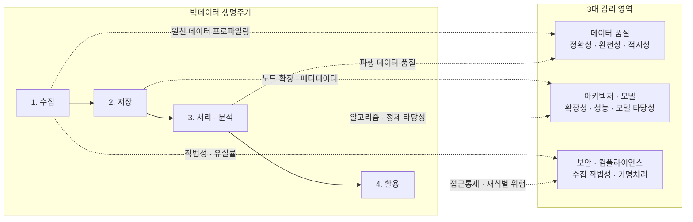

# 빅데이터 감리 (빅데이터 정보화 사업 감리)

---

## I. 데이터 신뢰성과 규제 준수 확보, 빅데이터 감리의 개요

### 가. 정의

- 빅데이터 생명주기(수집·저장·처리/분석·활용) 전반에서 **분산 아키텍처, 데이터 품질, 분석 모델의 타당성, 법·제도 준수 여부를 제3자가 점검**하여 사업 성공과 데이터 신뢰성을 확보하는 활동

### 나. 필요성

| 구분 | 내용 |
| --- | --- |
| 규제 강화 | [[데이터 3법]] 개정으로 가명정보 활용이 허용되면서 [[비식별화]]·적법 수집 검증 필요 |
| AI 품질 | AI 학습 데이터의 Garbage In, Garbage Out 방지를 위한 원천 데이터 품질 보증 |
| 아키텍처 복잡성 | [[하둡]]·데이터 레이크 등 분산 환경의 확장성·[[HA(High Availability)\|가용성]]·성능 검증 |

---

## II. 감리 프레임워크 및 점검 항목

### 가. 생명주기 × 감리 영역

### 나. 단계별 점검 항목

| 단계 | 점검 항목 | 점검 내용 |
| --- | --- | --- |
| 수집 | 수집 적법성 | 개인정보 수집 동의, 크롤링 시 저작권·robots.txt 준수 |
| | 수집 정합성 | Kafka·Flume 등 배치·스트리밍 수집의 누락·중복, 원천과의 건수 대사 |
| 저장 | 분산 아키텍처 | [[HDFS]]·[[NoSQL (CAP 이론 BASE 속성)\|NoSQL]] 노드 증설 시 선형 확장, 복제본·장애 복구 |
| | 데이터 레이크 통제 | 메타데이터·데이터 카탈로그 관리로 데이터 스웜프(Swamp)화 방지 |
| 처리·분석 | 정제·변환 | [[결측치]]·[[이상치]] 처리 규칙의 적정성, 변환 과정의 왜곡 여부 |
| | 모델 적합성 | 분석 목적에 맞는 모델 선정, 교차 검증, 과적합 여부 |
| 품질 | 품질 진단 | 완전성·유효성·일관성·정확성·적시성 프로파일링, 품질 지표 달성 |
| 보안 | 비식별 조치 | [[가명처리 기법\|가명·익명처리]] 적정성, k-익명성·l-다양성·t-근접성, 재식별 위험 평가 |
| | 접근 통제 | 결합·분석 환경의 권한 관리, 반출 심사 |

---

## III. 비교 및 동향

### 가. 전통적 정보시스템 감리 vs 빅데이터 감리

| 비교 항목 | 전통적 [[정보시스템 감리]] | 빅데이터 감리 |
| --- | --- | --- |
| 목적 | 업무 요건 충족, 기능·성능 보장 | 데이터 가치 창출, 분석 타당성, 규제 준수 |
| 대상 | RDBMS 정형 데이터, 응용 프로그램 | 정형·비정형 데이터, 데이터 레이크, 분산 처리 플랫폼 |
| 기준 | [[SDLC]] 단계별 산출물 | 데이터 생명주기 기반 파이프라인과 데이터 자체 |
| 품질 초점 | 정규화, 참조 무결성, ERD 정합성 | 5V 특성, [[데이터 클렌징]] 규칙, 메타데이터 |
| 보안 | 접근통제, DB [[암호화]], 네트워크 보안 | 가명·익명처리, 프라이버시 보호 모델 |

### 나. 동향

- **AI 감리와의 융합**: 데이터 품질을 넘어 모델의 편향·공정성·설명 가능성([[XAI]])까지 점검하는 [[인공지능 감리]]·[[AI 거버넌스]]로 확장
- **데이터 패브릭 감리**: 멀티클라우드에 흩어진 데이터를 논리적으로 연결하는 환경에서 통합 카탈로그와 분산 접근 통제 점검
- **품질 진단 자동화**: ML이 정상 패턴을 학습해 이상 데이터를 탐지하는 Auto DQM 도구 도입

---

### 🔗 연관 토픽

- **소속 도메인**: [[00_소프트웨어공학_MOC|🏗️ 소프트웨어공학]]
- **세부 분류**: `3. 요구사항 공학 & UML 객체지향 분석/설계`
- **핵심 연관 토픽**:
  - [[정보시스템 감리]]
  - [[인공지능 감리]]
  - [[비식별화]]
  - [[데이터 3법|데이터 3법 (Data 3 Acts)]]
  - [[데이터 거버넌스|데이터 거버넌스 (Data Governance)]]
