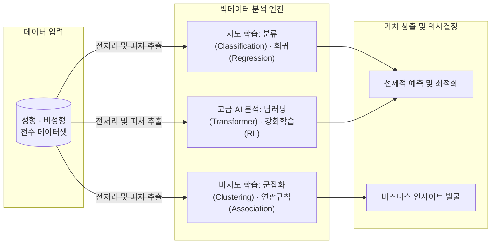

# 빅데이터 분석 기법 (Big Data Analytics)

---

## I. 대규모 데이터 기반 가치 창출, 빅데이터 분석 기법의 개요

### 가. 정의

- 대규모·고속·다양성을 갖는 정형 및 비정형 빅데이터로부터 **통계학, 기계학습, 딥러닝, 분산 처리 알고리즘을 활용하여 유의미한 패턴, 상관관계, 통찰을 발굴하고 미래를 예측하는 기술 체계**

### 나. 특징 및 필요성

| 구분 | 내용 |
| --- | --- |
| 패러다임 전환 | 과거 원인 파악 중심의 설명적(Descriptive) 분석에서 미래 예측(Predictive) 및 처방적(Prescriptive) 분석으로 진화 |
| 전수 데이터 분석 | 표본 조사 기반 통계의 한계를 넘어 대규모 로그, 소셜, IoT 센서 등 전수 데이터 실시간 분석 |
| 비정형 데이터 처리 | 텍스트(NLP), 이미지/비디오(Vision), 음성 등 비정형 데이터의 의미론적 임베딩 및 심층 분석 |
| 분산 병렬 인프라 | 하둡(HDFS), 스파크(Spark), GPU 가속기를 기반으로 대용량 분산 병렬 연산 수행 |

---

## II. 개념도 및 핵심 구성요소

### 가. 개념도 (분석 아키텍처 및 흐름)

- 수집된 원시 데이터를 분산 파이프라인에서 전처리한 후 분석 목적에 따라 지도/비지도/딥러닝 모델을 적용하여 의사결정 인사이트 및 최적화 실행

### 나. 핵심 분석 기법 및 알고리즘

| 구분 | 기법 | 설명 | 대표 알고리즘 |
| --- | --- | --- | --- |
| 지도학습 | 분류 (Classification) | 과거 정답 레이블을 기반으로 신규 데이터의 범주(Class) 예측 | [[의사결정나무]], [[배깅]](Random Forest), [[부스팅]](XGBoost) |
| | 회귀 (Regression) | 독립변수와 종속변수 간의 인과관계를 함수로 모델링하여 수치 예측 | 선형 회귀, 다항 회귀, 릿지/라쏘 |
| 비지도학습 | 군집화 (Clustering) | 정답 없이 데이터 간 거리·유사도 기반으로 유사 그룹 형성 | K-Means, [[DBSCAN(밀도 기반 클러스터링)\|DBSCAN]], 계층적 군집화 |
| | 연관분석 (Association) | 트랜잭션 내 항목 간 동시 발생 확률 규칙 도출 (장바구니 분석) | Apriori, FP-Growth |
| 시계열 | 시계열 분석 (Time Series) | 시간 흐름에 따른 추세, 계절성, 주기성을 분석하여 미래 추이 예측 | ARIMA, Prophet, LSTM |
| 텍스트 | 텍스트 마이닝 / NLP | 비정형 문서에서 키워드, 감성, 토픽을 추출하는 언어 처리 | [[TF-IDF (Term Frequency - Inverse Document Frequency)\|TF-IDF]], 토픽 모델링(LDA), BERT |
| 심층신경망 | 딥러닝 (Deep Learning) | 다층 인공신경망으로 복잡한 비선형 패턴 및 고차원 특징 자동 추출 | CNN(영상), Transformer(언어·시퀀스) |
| 최적화 | [[강화학습]] (RL) | 환경과의 상호작용 및 시행착오를 통해 누적 보상을 최대화하는 정책 학습 | Q-Learning, DQN, PPO |

---

## III. 분석 패러다임 비교 및 동향

### 가. 전통적 통계 분석 vs 빅데이터 AI 분석

| 비교 항목 | 전통적 통계 분석 | 빅데이터 AI 기반 분석 |
| --- | --- | --- |
| 데이터 규모 | 정형 데이터 중심, 표본(Sample) 추출 기반 | 정형 + 비정형, 대규모 전수(Population) 데이터 |
| 분석 접근법 | 가설 검정 중심(Top-Down), 연역적 추론 | 데이터 주도 패턴 발견(Bottom-Up), 귀납적 탐색 |
| 분석 목적 | 과거/현재 상태의 사후 진단 및 원인 규명 | 미래 위험/기회 선제 예측 및 자율 실행(처방) |
| 분석 도구 | 단일 서버(R, SPSS, SAS), RDBMS 통계 쿼리 | 분산 병렬 프레임워크(Spark), GPU 클러스터, Python |
| 주 모델 | 회귀분석, t-검정, 분산분석(ANOVA) | 앙상블 머신러닝, 딥러닝, 파운데이션 모델 |

### 나. 동향

- **생성형 AI 결합 인지 분석(Cognitive Analytics)**: 자연어 프롬프트를 통해 사내 정형·비정형 데이터를 질의하고 분석 코드를 자동 생성·실행하는 Code Interpreter 도입
- **AutoML을 통한 분석 대중화**: 피처 엔지니어링부터 모델 탐색, 앙상블 결합까지 분석 전 과정을 자동화하여 시민 데이터 과학자(Citizen Data Scientist)의 활용도 제고
- **설명 가능한 AI([[XAI]]) 필수화**: 딥러닝 분석 결과의 블랙박스를 해소하기 위해 SHAP, [[LIME]] 등을 연계하여 규제 준수 및 결과 신뢰성 확보

---

### 🔗 연관 토픽

- **소속 도메인**: [[00_데이터베이스_MOC|🗄️ 데이터베이스]]
- **세부 분류**: `6. SQL 표준 문법 & 쿼리 성능 튜닝`
- **핵심 연관 토픽**:
  - [[분류화]]
  - [[회귀분석]]
  - [[분석 모델 평가 방법]]
  - [[하둡]]
  - [[AutoML (Automated Machine Learning)|AutoML]]
