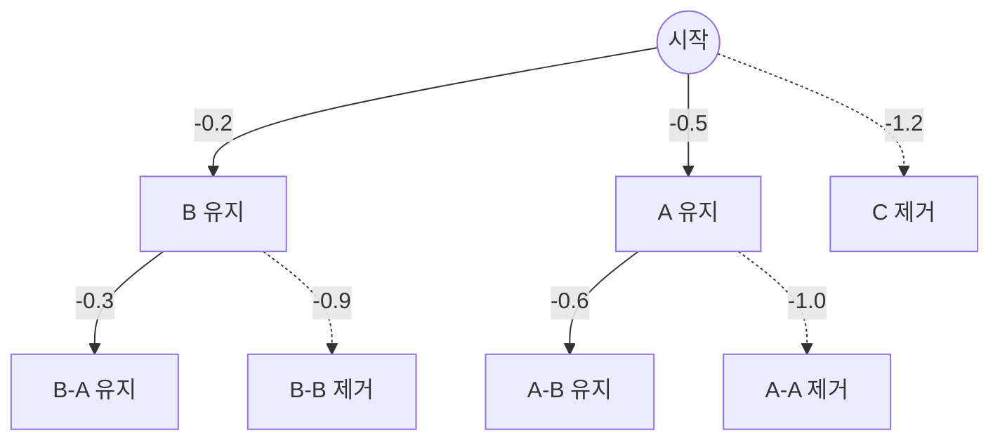

# 빔 탐색 (Beam Search)

---

## I. 상위 K개 후보만 남기는 디코딩, 빔 탐색의 개요

### 가. 정의

- 시퀀스 생성 시 **매 단계 누적 확률 상위 K개(Beam Width) 후보만 유지하며 확장**하는 휴리스틱 탐색 기법

### 나. 등장 배경 및 특징

| 구분 | 내용 |
| --- | --- |
| 배경 | 완전 탐색은 $\lvert V \rvert^{L}$(어휘 크기의 길이 제곱)로 불가능, 탐욕 탐색은 초반 선택에 갇혀 최적에서 벗어남 |
| 탐색 공간 제한 | 단계당 K × 어휘 크기 후보만 평가 |
| 트레이드오프 | K가 클수록 품질↑·연산↑, K=1이면 탐욕 탐색 |
| 근사 해 | 전역 최적을 보장하지 않음 |

---

## II. 동작 원리 및 구성요소

### 가. 동작 예 (K = 2)

- 숫자는 누적 로그 확률, 매 단계 상위 2개 시퀀스만 다음 단계로 확장하고 나머지는 가지치기

### 나. 구성요소

| 구분 | 요소 | 설명 |
| --- | --- | --- |
| 파라미터 | Beam Width (K) | 단계마다 유지하는 후보 수 |
| 점수 | 로그 확률 합 | 확률 곱 대신 로그 합으로 언더플로 방지 |
| 보정 | Length Penalty | 길수록 점수가 낮아지는 편향 보정, 예: $score / length^{\alpha}$ |
| 제어 | Pruning | 상위 K개 외 경로 폐기 |
| | 종료 조건 | `<EOS>` 생성 시 완성 후보로 이동, K개 완성 또는 최대 길이에서 종료 |
| 반복 억제 | n-gram 반복 금지 | 같은 n-gram 재생성 차단 |
| 변형 | Diverse Beam Search | 후보를 그룹으로 나눠 다양성 벌점 부여 |

---

## III. 비교 및 동향

### 가. 디코딩 기법 비교

| 비교 항목 | 탐욕 탐색 | 빔 탐색 | Top-p (Nucleus) 샘플링 |
| --- | --- | --- | --- |
| 방식 | 매 단계 최고 확률 1개 | 누적 확률 상위 K개 경로 | 누적 확률 p까지의 후보에서 무작위 추출 |
| 결정성 | 결정적 | 결정적 | 확률적 |
| 연산량 | 최소 | 약 K배 | 탐욕과 비슷 |
| 단점 | 반복·근시안적 선택 | 획일적·짧은 문장 선호, 반복 | 일관성 저하 가능 |
| 활용 | 짧은 출력, 분류형 생성 | 기계 번역, 요약, 음성 인식 | LLM 챗봇, 창작 |

### 나. 동향

- **LLM 디코딩**: 개방형 대화에서는 빔 탐색이 단조로운 문장을 만드는 경향이 있어 Temperature·Top-k·Top-p 샘플링이 기본, 빔 탐색은 번역·요약·ASR에서 유지
- **추론 시 탐색**: 단계별 보상 모델로 후보 추론 경로를 평가하며 빔처럼 상위 경로만 확장하는 기법이 [[테스트 타임 스케일링]]에 활용

---

### 🔗 연관 토픽

- **소속 도메인**: [[00_인공지능_MOC|🤖 인공지능]]
- **세부 분류**: `1. 수학 · 통계학 & 데이터 전처리`
- **핵심 연관 토픽**:
  - [[seq2seq]]
  - [[자연어처리|자연어처리 (NLP)]]
  - [[초거대 언어 모델|초거대 언어 모델(Large Language Model)]]
  - [[테스트 타임 스케일링|테스트 타임 스케일링(Test-Time Scaling, TTS)]]
  - [[ToT|tot Tree of thought]]
