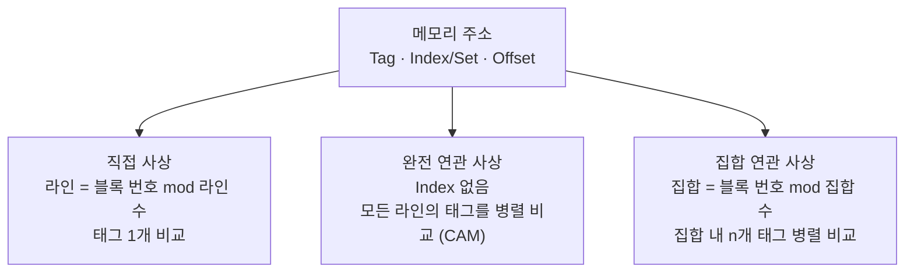

# 주기억장치와 캐시 메모리 간의 사상 기법

---

## I. 블록을 어느 라인에 둘 것인가, 캐시 사상 기법의 개요

### 가. 정의

- 주기억장치의 블록을 [[캐시 메모리]]의 **어느 라인에 적재하고 어떻게 찾을지 결정하는 주소 대응 방식** (직접·연관·집합 연관 사상)

### 나. 필요성 및 특징

| 구분 | 내용 |
| --- | --- |
| 필요성 | 캐시는 주기억장치보다 훨씬 작아 블록 위치를 정하는 규칙 필요 |
| 주소 분할 | 메모리 주소를 Tag · Index(Set) · Offset(Word)으로 나눠 적중 판별 |
| 트레이드오프 | 연관도가 높을수록 충돌 미스 감소, 대신 비교기·전력·탐색 지연 증가 |

---

## II. 동작 원리 및 구성요소

### 가. 기법별 동작

- 직접 사상은 위치가 하나로 고정, 완전 연관은 어디든 가능, n-way 집합 연관은 정해진 집합 안의 n곳 중 하나

### 나. 구성요소

| 구분 | 요소 | 설명 |
| --- | --- | --- |
| 직접 사상 | 위치 계산 | i = j mod m (j: 블록 번호, m: 캐시 라인 수) |
| | 충돌 미스 | 같은 라인에 대응하는 두 블록을 번갈아 참조하면 계속 교체 (스래싱) |
| 완전 연관 사상 | CAM (연관 메모리) | 내용(태그)으로 모든 라인을 동시에 검색, 고비용 |
| | 교체 정책 필요 | 빈 라인이 없으면 [[LRU]] 등으로 교체 대상 선택 |
| 집합 연관 사상 | n-way | 캐시를 v개 집합으로 나누고 집합마다 n개 라인, i = j mod v |
| | 교체 정책 | 집합 내에서만 LRU·의사 LRU 적용 |
| 공통 | 주소 필드 | Tag(블록 식별), Index(라인·집합 선택), Offset(블록 내 위치) |
| | 적중률 | 같은 용량이면 일반적으로 완전 연관 ≥ 집합 연관 ≥ 직접 사상 |

---

## III. 비교 및 동향

### 가. 세 기법 비교

| 비교 항목 | 직접 사상 | 완전 연관 사상 | 집합 연관 사상 |
| --- | --- | --- | --- |
| 배치 위치 | 1곳 고정 | 모든 라인 | 집합 내 n곳 |
| 비교기 수 | 1개 | 라인 수만큼 | n개 |
| 하드웨어 비용 | 낮음 | 높음 | 중간 |
| 탐색 속도 | 빠름 | 느림 (대용량일수록) | 중간 |
| 충돌 미스 | 많음 | 없음 (용량 미스만) | 적음 |
| 교체 정책 | 불필요 | 필요 | 필요 |
| 적용 | 단순 임베디드 캐시 | TLB 등 소용량 구조 | 현대 CPU L1~L3 |

### 나. 동향

- **계층별 연관도 차등**: 현대 CPU는 L1 8~12-way, 대용량 L2·L3(LLC)는 12~16-way 이상의 집합 연관 사상 사용
- **의사 LRU·적응형 교체**: 고연관도 캐시에서 완전한 LRU 대신 Tree-PLRU, RRIP 계열 교체 정책 채택

---

### 🔗 연관 토픽

- **소속 도메인**: [[00_컴퓨터구조_MOC|💻 컴퓨터구조]]
- **세부 분류**: `1. CPU 프로세서 & 마이크로아키텍처`
- **핵심 연관 토픽**:
  - [[캐시 메모리의 사상 방식|캐시(Cache) 메모리의 사상 방식(Mapping Scheme)]]
  - [[캐시 메모리]]
  - [[캐시 메모리의 쓰기 정책]]
  - [[LRU]]
  - [[페이지 교체 알고리즘]]
