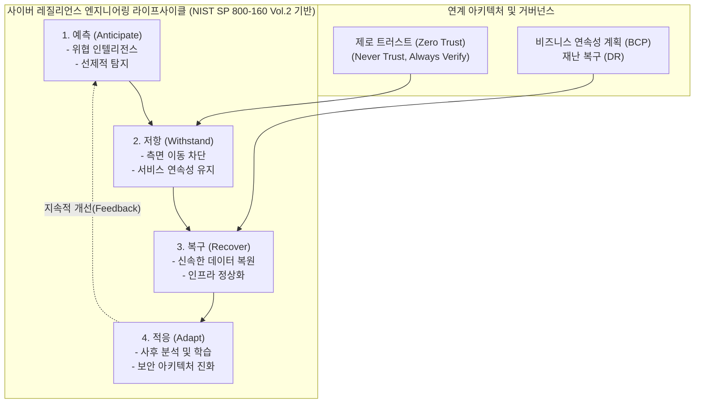

# 사이버 레질리언스 (Cyber Resilience)

---
## I. 디지털 생존 전략, 사이버 레질리언스의 개요

사이버 레질리언스(Cyber Resilience)는 사이버 공격, 내부 위협, 시스템 오류 등 불가피한 침해 상황을 전제로, 위협을 사전에 예측하고 견디며 신속하게 복구 및 적응하여 핵심 비즈니스 연속성을 중단 없이 유지하는 전사적 회복탄력성 엔지니어링 전략이다.

| 구분 | 내용 |
| :--- | :--- |
| **정의** | 침해 사고 발생을 기정사실화하고 예측·저항·복구·적응을 통해 비즈니스 연속성을 보장하는 회복 전략 |
| **등장 배경** | 경계 방어 중심의 한계 노출, 지능형 지속 위협(APT) 및 랜섬웨어 고도화에 따른 다운타임 피해 극대화 |
| **4대 목표** | 예측(Anticipate) $\rightarrow$ 저항(Withstand) $\rightarrow$ 복구(Recover) $\rightarrow$ 적응(Adapt) (NIST SP 800-160 Vol.2) |

---

## II. 사이버 레질리언스의 개념도 및 핵심 기술 요소

### 가. 사이버 레질리언스의 프레임워크 및 동작 원리

### 나. 사이버 레질리언스의 핵심 기술 및 구성 요소

| 구분 | 요소기술(키워드) | 세부 설명 |
| :--- | :--- | :--- |
| **목표/전략** | 예측 (Anticipate) | 위협 인텔리전스([[CTI]]) 및 위협 헌팅을 통해 잠재적 공격 TTPs를 사전에 인지하고 대비 상태 유지 |
| **목표/전략** | 저항 (Withstand) | 제로 트러스트 기반 인증과 마이크로 세그멘테이션을 적용하여 침해 발생 시 피해 범위(Blast Radius) 격리 |
| **목표/전략** | 복구 (Recover) | 불변(Immutable) 백업 및 자동화된 DR 오케스트레이션을 통해 핵심 비즈니스 기능을 최단 시간에 복원 |
| **목표/전략** | 적응 (Adapt) | 침해 사고 후 포렌식 분석 결과를 바탕으로 보안 정책 및 인프라 구조를 지속적으로 재평가하고 강화 |
| **[[프레임워크]]** | NIST SP 800-160 Vol. 2 | 시스템 엔지니어링 관점에서 사이버 레질리언스 시스템 구축을 위한 목표, 객체, 설계 원칙을 제시하는 표준 |
| **프레임워크** | MITRE CREF | 사이버 레질리언스 엔지니어링 프레임워크로, ATT&CK과 맵핑하여 방어 전술 및 기만(Deception) 기술 적용 |
| **복구 기술** | 에어 갭 (Air-Gap) 백업 | 물리적/논리적으로 운영망과 분리된 백업 환경을 구축하여 랜섬웨어 감염 시에도 백업본의 [[무결성]] 보장 |
| **거버넌스** | IT/보안-BCP 융합 | 단일 IT 부서의 책임을 넘어 이사회 중심의 전사적 리스크 관리(ERM) 및 비즈니스 연속성(BCP) 체계와 통합 |

---

## III. 전통적 사이버 보안과의 비교 및 최신 컴플라이언스 동향

### 가. 전통적 사이버 보안 vs 사이버 레질리언스 비교

| 비교 항목 | 전통적 사이버 보안 (Cyber Security) | 사이버 레질리언스 (Cyber Resilience) |
| :--- | :--- | :--- |
| **기본 가정** | 침해는 사전에 예방 및 차단 가능함 | 침해 발생은 불가피함 (Compromise is Inevitable) |
| **핵심 목표** | 악성코드 및 외부 침입 차단 (기밀성·무결성) | 침해 중에도 핵심 비즈니스 기능 지속 및 신속 복구 (가용성·생존성) |
| **접근 방식** | 경계 방어, 시그니처 차단 (방어적) | 분산 설계, 신속 복원, 적응형 진화 (회복탄력적) |
| **주요 메트릭** | 침입 시도 차단율, 취약점 패치율 | 평균 복구 시간(MTTR), 최대 허용 다운타임(MTD), RTO/RPO |

### 나. 최신 동향 및 거버넌스 발전 전망
- **글로벌 사이버 복원력 법제화 가속**: EU 사이버 복원력법(CRA) 및 금융 부문 디지털 운영 탄력성법(DORA) 발효에 따라 하드웨어/소프트웨어 전 생애주기 복원력 검증 의무화.
- **불변 스토리지 및 클라우드 격리 DR(Cyber Recovery) 도입**: 랜섬웨어의 백업본 파괴 공격에 대응하여 WORM(Write Once Read Many) 불변 스토리지 및 에어갭 격리 클라우드 복구 센터 구축 보편화.
- **[[카오스 엔지니어링]]과 통합된 사이버 모의 침해 훈련**: 무작위 장애 주입 기법을 보안 영역으로 확장하여 악의적 랜섬웨어 감염 및 계정 탈취 상황에서의 자율 복구 절차를 상시 검증.

---

### 🔗 연관 토픽

- **소속 도메인**: [[00_보안_MOC|🛡️ 보안]]
- **세부 분류**: `5. 사이버 공격 기법 & 침해사고 대응`
- **핵심 연관 토픽**:
  - [[BCP|BCP (Business Continuity Planning)]]
  - [[CTI]]
  - [[사이버전|사이버전(Cyber Warfare)]]
  - [[랜섬웨어]]
