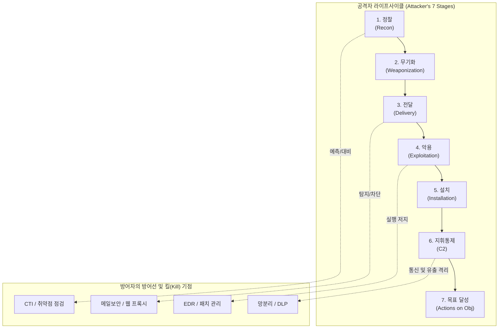

# 사이버 킬 체인 (Cyber Kill Chain)

---

## I. 지능형 위협 선제 방어 프레임워크, 사이버 킬 체인의 개요

사이버 킬 체인(Cyber Kill Chain)은 군사적 타격 순환 체계 개념을 사이버 보안에 적용하여, 지능형 지속 위협(APT) 공격자가 침투하여 목표를 달성하기까지의 일련의 과정을 7단계 선형 라이프사이클로 모델링하고, 어느 한 단계라도 사전 차단(Kill)하여 전체 공격을 무력화하는 방어 프레임워크이다.

| 구분 | 내용 |
| :--- | :--- |
| **정의** | 공격자의 침투~목표 달성 과정을 7단계로 모델링하여 각 단계별 연결 고리를 차단하는 보안 프레임워크 |
| **등장 배경** | 록히드 마틴(Lockheed Martin)이 제안, 단일 접점 방어의 한계를 극복하고 공격자-방어자 비대칭성 역이용 |
| **7단계 체계** | 정찰(Recon) $\rightarrow$ 무기화 $\rightarrow$ 전달 $\rightarrow$ 악용(Exploit) $\rightarrow$ 설치 $\rightarrow$ C2 $\rightarrow$ 행동(Actions on Objectives) |

---

## II. 사이버 킬 체인의 개념도 및 핵심 기술 요소

### 가. 사이버 킬 체인의 단계별 동작 개념도

* 공격의 진행 과정을 7단계로 시각화하여 특정 단계에서 공격의 연결 고리를 끊어내는 선제적 방어 체계로 동작함

### 나. 사이버 킬 체인의 단계별 핵심 구성 요소

| 구분 | 요소기술(키워드) | 세부 설명 |
| --- | --- | --- |
| **1. 정찰** | OSINT 스캐닝 분석 | 공격 대상의 네트워크, 이메일, 직원 정보 등 취약점을 수집하는 단계 (방어: 가시성 확보) |
| **2. 무기화** | 악성 페이로드 제작 | 수집된 취약점을 타격하기 위해 익스플로잇([[Exploit]])과 원격 접속 트로이목마(RAT) 등을 결합함 |
| **3. 전달** | 스피어 피싱 / 워터홀 | 제작된 악성코드를 이메일, 악성 URL, USB 등을 통해 타겟 사용자에게 전달함 (방어: 메일/웹 필터링), |
| **4. 악용** | 제로데이 공격 실행 | 전달된 페이로드가 시스템이나 애플리케이션의 취약점을 이용해 악성 코드를 실행하는 단계 |
| **5. 설치** | 백도어 / [[루트킷]] | 시스템 재부팅 후에도 지속적인 접근(Persistence)이 가능하도록 악성코드를 은닉 및 설치함 |
| **6. C2** | DGA(도메인 생성) | 침해된 시스템과 공격자 서버(C2) 간의 암호화된 통신 채널을 구축하여 원격 제어를 수행함 |
| **7. 목표 달성** | [[랜섬웨어]] / 유출 | 공격자의 최종 목표인 데이터 [[암호화]], 파괴, 기밀 정보 유출(Exfiltration)을 실행하는 최종 단계, |
| **대응 체계** | 통합 보안 오케스트레이션 | 각 단계를 끊어내기 위해 [[SIEM]], [[SOAR (Security Orchestration, Automation and Response)\|SOAR]], [[EDR(Endpoint Detection and Response)\|EDR]] 등 이기종 보안 솔루션을 상호 연동하여 자동 대응 |

---

## III. 위협 대응 프레임워크 비교 및 향후 전망

### 가. 사이버 킬 체인과 MITRE ATT&CK 프레임워크 비교

| 비교 항목 | 사이버 킬 체인 (Cyber Kill Chain) | [[MITRE ATT&CK (Adversarial Tactics, Techniques & Common Knowledge)\|MITRE ATT&CK]] 프레임워크 |
| --- | --- | --- |
| **개발 주체** | 록히드 마틴 (Lockheed Martin) | 마이터 (MITRE Corporation) |
| **관점 및 구조** | **공격의 진행 순서(선형적 7단계)** 모델, | **전술과 세부 기법(TTPs) 중심의 매트릭스** 구조 |
| **주요 목적** | 공격 흐름의 직관적 이해 및 조기 차단 지점 도출 | 실제 관측된 공격 기법을 기반으로 실무적 방어 전략 수립 |
| **활용 분야** | 고위 경영진 보고 및 보안 전략 수립의 거시적 프레임 | SOC(보안 관제 센터), [[위협 헌팅]], 보안 솔루션 탐지 룰 매핑 |
| **상호 보완** | 큰 틀에서의 킬 체인 단계 식별용으로 활용 | 킬 체인의 각 단계 내에서 발생하는 구체적 기법으로 매핑 |

### 나. 사이버 킬 체인의 최신 동향 및 진화
- **클라우드 킬 체인(Cloud Kill Chain)으로의 모델 확장**: 전통적 악성코드 다운로드 과정을 건너뛰고 자격 증명 탈취 및 API/IAM 취약점을 악용하는 [[클라우드 네이티브]] 공격 특성을 반영하여 정찰-침투-권한상승-수익화로 모델 재정의.
- **LotL(Living off the Land) 회피 공격 대응 강화**: 파일리스 악성코드와 OS 정상 관리 도구(PowerShell, WMI)를 악용하는 최신 APT에 대응하여 행위 기반 엔드포인트 탐지([[EDR(Endpoint Detection and Response)|EDR]]) 및 [[XDR]] 연계 심화.
- **[[SOAR (Security Orchestration, Automation and Response)|SOAR]] 기반의 킬 체인 차단 자동화**: 킬 체인 각 단계에서 탐지된 위협 텔레메트리를 플레이북과 연동하여 침해 호스트의 네트워크 격리 및 C2 통신 차단을 수초 내에 자율 수행.

---

### 🔗 연관 토픽

- **소속 도메인**: [[00_보안_MOC|🛡️ 보안]]
- **세부 분류**: `5. 사이버 공격 기법 & 침해사고 대응`
- **핵심 연관 토픽**:
  - [[루트킷|루트킷(Rootkit)]]
  - [[랜섬웨어]]
  - [[EDR(Endpoint Detection and Response)]]
  - [[XDR|XDR(eXtended Detection Response)]]
  - [[SIEM]]
