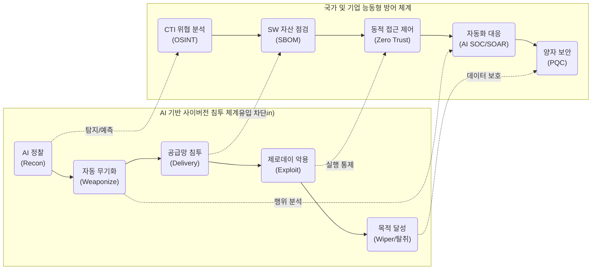

# 사이버전 (Cyber Warfare)

---

## I. 초연결 사회의 하이브리드 위협, 사이버전의 개요

사이버전(Cyber Warfare)은 국가 또는 적대적 위협 행위자(Nation-State Actor)가 군사적·정치적 목적을 달성하기 위해 상대국의 정보통신망, 국방 시스템, 금융 및 에너지 등 국가 핵심 기반시설(OT/ICS)을 겨냥하여 파괴·교란·정보 탈취를 자행하는 고도화된 비대칭 전쟁이다.

| 구분 | 내용 |
| :--- | :--- |
| **정의** | 국가 또는 해커 조직이 적국의 핵심 인프라망을 침투·파괴·교란하는 지능형 비대칭 사이버 전쟁 |
| **등장 배경** | 물리적 전면전 대비 저비용·고효율의 비대칭 타격성, 공격자 귀인(Attribution) 회피 용이성, 하이브리드전 확산 |
| **핵심 양상** | 파괴형 와이퍼(Wiper), SW 공급망 오염, 딥페이크 인지전, 국가 전력·통신 기반시설(OT/ICS) 마비 |

---

## II. 사이버전의 공격/방어 개념도 및 핵심 기술 요소

### 가. 사이버전의 개념도 및 대응 아키텍처

### 나. 사이버전의 핵심 기술 및 구성 요소

| 구분 | 핵심 기술 요소 | 세부 설명 및 특징 |
| :--- | :--- | :--- |
| **공격 기술** | **AI 자율 공격 시스템** | 피싱, 취약점 스캐닝, [[다형성]] 페이로드 빌드 등 공격 체인의 전 과정을 AI가 자동화 |
| **공격 기술** | **Wiper 악성코드** | 금전 요구([[랜섬웨어]])가 아닌, MBR 파괴 등 시스템 복구 불가 및 파괴를 목적으로 하는 전략적 무기 |
| **공격 기술** | **SW [[공급망 공격]]** | 오픈소스 레지스트리, [[형상 관리 도구]](CI/CD) 등에 침투하여 연쇄적 대규모 감염 유발 |
| **공격 기술** | **HNDL 전략** | 'Harvest Now, Decrypt Later', 향후 [[양자컴퓨터]] 도입 시 해독을 목적으로 현재 암호화된 데이터를 선제 수집 |
| **방어 기술** | **[[제로 트러스트 보안모델\|Zero Trust]] Architecture** | 'Never Trust, Always Verify', 식별된 주체에 대해 CARTA 기반의 지속적이고 동적인 최소 권한 부여 체계 |
| **방어 기술** | **SBOM (SW Bill of Materials)** | 소프트웨어 내포 오픈소스 및 서드파티 라이브러리 구성 명세서 작성으로 취약점 선제 대응 |
| **방어 기술** | **[[SOAR (Security Orchestration, Automation and Response)\|SOAR]] 및 AI SOC** | 이기종 보안 솔루션 간 연동(Orchestration) 및 Playbook 기반 위협 탐지·분석·대응(Response) 자동화 |
| **방어 기술** | **[[양자내성암호]] (PQC)** | 격자, 다변수, 해시 기반 수학적 난제를 활용하여 양자 컴퓨팅의 쇼어(Shor) [[알고리즘]] 해독 방어 |

---

## III. 전통적 전쟁과의 비교 및 향후 기술 동향

### 가. 전통적 물리전 vs 사이버전 비교

| 비교 항목 | 전통적 물리전 (Kinetic Warfare) | 사이버전 (Cyber Warfare) |
| :--- | :--- | :--- |
| **전장 영역** | 육·해·공·우주 등 물리적 4대 도메인 | 디지털 네트워크 및 사이버 공간(5대 도메인) |
| **공격 주체** | 국가 군대 (식별 명확) | 국가, 프록시 해커 그룹, 용병 (익명성 및 귀인 난해) |
| **무기 체계** | 미사일, 전투기, 포격 등 물리 무기 | 제로데이 익스플로잇, 와이퍼, 딥페이크, 공급망 악성코드 |
| **전쟁 비용** | 천문학적 군사비 소요 (대칭 전력) | 상대적 저비용·고효율의 비대칭 타격 |
| **파급 피해** | 인명 살상 및 물리적 시설 파괴 | 전력망/상하수도/금융망 마비, 사회적 패닉 유발 |

### 나. 향후 기술 동향 및 발전 전망
- **복합 하이브리드전 및 인지전(Cognitive Warfare) 심화**: 물리적 군사 작전 개시 전 통신망 마비와 [[딥페이크]] 기반의 가짜뉴스 유포를 병행하여 국민 심리와 지휘 통제 체계를 교란하는 복합전 확산.
- **폐쇄망(Air-Gap) 및 OT/ICS 기반시설 공격 표면 확대**: 스카다(SCADA) 및 산업제어시스템을 표적으로 하는 우회 악성코드(Stuxnet, Industroyer) 고도화에 대응해 하드웨어 일방향 전송 장비 및 물리적 보안 연계 필수화.
- **사이버 복원력([[사이버 레질리언스]]) 및 국가 CTI 공조 체계**: 침해를 기정사실화(Assume Breach)하고 정부-민간-국방 간 실시간 위협 인텔리전스([[CTI]]) 공유와 [[SOAR (Security Orchestration, Automation and Response)|SOAR]] 기반 자율 방어 체계 구축.

---

### 🔗 연관 토픽

- **소속 도메인**: [[00_보안_MOC|🛡️ 보안]]
- **세부 분류**: `5. 사이버 공격 기법 & 침해사고 대응`
- **핵심 연관 토픽**:
  - [[MITRE ATT&CK (Adversarial Tactics, Techniques & Common Knowledge)]]
  - [[제로 트러스트 보안모델|제로 트러스트 (Zero Trust) 보안모델]]
  - [[랜섬웨어]]
  - [[CTI]]
  - [[공급망 공격|공급망 공격(Supply Chain Attack)]]
