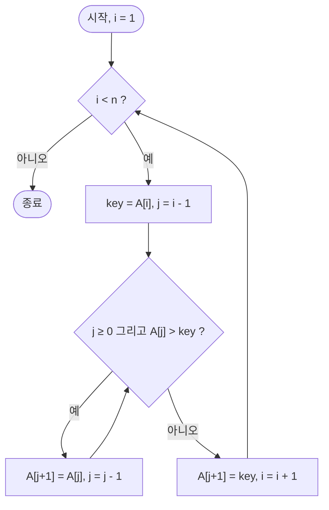

# 삽입 정렬 (Insertion Sort)

---

## I. 정렬된 부분에 하나씩 끼워 넣는, 삽입 정렬의 개요

### 가. 정의

- 두 번째 원소부터 차례로 꺼내 **앞쪽의 이미 정렬된 부분에서 알맞은 위치를 찾아 삽입**하는 정렬 [[알고리즘]]

### 나. 특징

| 구분 | 내용 |
| --- | --- |
| 제자리 정렬 | 추가 메모리 O(1) |
| 안정 정렬 | 같은 값의 원래 순서 유지 |
| 적응성 | 거의 정렬된 입력에서 O(n)에 가깝게 동작 |
| 온라인 정렬 | 데이터가 하나씩 들어와도 바로 정렬 유지 |

---

## II. 동작 및 구성요소

### 가. 동작 원리

- key보다 큰 원소를 한 칸씩 오른쪽으로 밀고 빈자리에 key를 넣음 (예: [5, 2, 4] → [2, 5, 4] → [2, 4, 5])

### 나. 구성요소

| 구분 | 요소 | 설명 |
| --- | --- | --- |
| 복잡도 | 최악 O(n²) | 역순 입력, 비교·이동 약 n²/2회 |
| | 평균 O(n²) | 무작위 입력, 약 n²/4회 이동 |
| | 최선 O(n) | 이미 정렬된 입력, 원소마다 비교 1회 |
| | 공간 O(1) | 제자리 정렬 |
| 안정성 | 비교 조건 A[j] > key | 같은 값은 넘지 않으므로 순서 유지 |
| 동작 | key 임시 보관 | 밀어내기 중 덮어쓰기로 인한 값 유실 방지 |
| | Shift 연산 | 교환(Swap) 대신 대입으로 이동, 연산 횟수 절감 |
| 변형 | 이진 삽입 정렬 | 삽입 위치를 이진 탐색으로 찾아 비교 횟수 O(n log n), 이동은 여전히 O(n²) |
| | 셸 정렬 | 간격을 두고 삽입 정렬을 반복해 평균 성능 개선 |

---

## III. 비교 및 동향

### 가. O(n²) 기본 정렬 비교

| 비교 항목 | 삽입 정렬 | 선택 정렬 | [[버블 정렬]] |
| --- | --- | --- | --- |
| 방식 | 알맞은 위치에 삽입 | 최솟값을 찾아 앞으로 교환 | 인접 원소 비교·교환 |
| 최선 | O(n) | O(n²) | O(n) (교환 없음 플래그 사용 시) |
| 안정성 | 안정 | 불안정 | 안정 |
| 교환·이동 | 역순 쌍(Inversion) 수만큼 이동 | 최대 n-1회 교환 | 역순 쌍 수만큼 교환 |
| 실제 성능 | 셋 중 가장 빠른 편 | 쓰기 횟수 적음 | 가장 느린 편 |

### 나. 동향

- **하이브리드 정렬의 부품**: Timsort(Python, Java 객체 정렬)는 작은 run을 이진 삽입 정렬로 만들고, Introsort(C++ std::sort)는 작은 구간(예: 16개 이하)을 삽입 정렬로 마무리
- **소규모 배열에 유리**: 작은 입력에서는 재귀·분할 오버헤드가 없고 [[캐시 메모리|캐시]] 지역성이 좋아 [[퀵 정렬]]·[[병합 정렬]]보다 빠름

---

### 🔗 연관 토픽

- **소속 도메인**: [[00_컴퓨터구조_MOC|💻 컴퓨터구조]]
- **세부 분류**: `2. 캐시 & 메모리 계층 구조 · 스토리지`
- **핵심 연관 토픽**:
  - [[버블 정렬|버블 정렬 (Bubble Sort)]]
  - [[퀵 정렬|퀵 정렬 (Quick Sort)]]
  - [[병합 정렬|병합 정렬 (Merge Sort)]]
  - [[알고리즘 성능평가]]
  - [[O-Notation (O-표기법)]]
