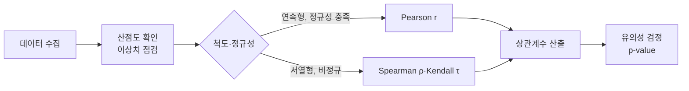

# 상관분석 (Correlation Analysis)

---

## I. 두 변수가 함께 움직이는 정도, 상관분석의 개요

### 가. 정의

- 두 변수 사이 **선형 또는 단조 관계의 방향과 강도를 상관계수(-1 ~ +1)로 측정**하고 유의성을 검정하는 통계 기법

### 나. 특징

| 구분 | 내용 |
| --- | --- |
| 정량화 | +1 완전 양의 상관, -1 완전 음의 상관, 0 선형 상관 없음 |
| 대칭성 | 두 변수의 역할 구분 없음 ($r_{XY} = r_{YX}$) |
| 활용 | [[EDA]], [[다중공선성]] 진단, 피처 선택 |
| 한계 | 상관 ≠ 인과, 비선형 관계는 $r \approx 0$이어도 존재 가능, [[이상치]]에 민감(피어슨) |

---

## II. 분석 절차 및 핵심 요소

### 가. 분석 절차

- 산점도로 관계 형태를 먼저 보고, 척도와 정규성에 맞는 계수를 선택해 산출·검정

### 나. 핵심 요소

| 구분 | 요소 | 설명 |
| --- | --- | --- |
| 계수 | Pearson $r$ | 공분산을 두 표준편차 곱으로 나눈 값, 연속형 변수의 선형 관계 |
| | Spearman $\rho$ | 순위에 대한 피어슨 상관, 단조 관계·이상치에 강건 (비모수) |
| | Kendall $\tau$ | 일치·불일치 쌍 비율 기반 순위 상관, 소표본·동순위에 적합 |
| 시각화 | 산점도 | 선형성, 군집, 이상치 확인 |
| | 상관 히트맵 | 다변수 상관행렬을 색으로 표현 |
| 검정 | [[유의확률\|p-value]] | $H_0: \rho = 0$이 참일 때 관측값 이상의 상관이 나올 확률, 통상 0.05 미만이면 유의 |
| ML 활용 | 다중공선성 진단 | 독립변수 간 높은 상관 탐지 → VIF로 확인 |
| | 필터 방식 피처 선택 | 목표 변수와 상관 높은 변수 우선 선별 |

---

## III. 비교 및 동향

### 가. 상관분석 vs 회귀분석

| 비교 항목 | 상관분석 | [[회귀분석]] |
| --- | --- | --- |
| 목적 | 관계의 방향·강도 파악 | 영향 크기 추정, 예측 |
| 변수 역할 | 대등 | 독립변수 X → 종속변수 Y |
| 지표 | 상관계수 $r$ | 회귀계수 $\beta$, 결정계수 $R^2$ |
| 단위 변환 | 계수 불변 | 계수 값 변함 |
| 인과 | 판단 불가 | 회귀만으로도 인과 판단 불가 (실험 설계·인과 추론 필요) |

- 단순회귀에서는 $R^2 = r^2$

### 나. 동향

- **비선형 연관 지표**: 피어슨이 놓치는 관계를 찾기 위해 상호정보량, MIC, 거리 상관(Distance Correlation) 활용
- **임베딩 유사도와의 관계**: 피어슨 $r$은 평균을 뺀 두 벡터의 코사인 [[유사도]]와 같음, 임베딩 검색 평가에서는 사람 평가와의 Spearman 상관을 지표로 사용
- **자동화**: [[AutoML (Automated Machine Learning)|AutoML]] 전처리에서 고상관 피처 자동 제거, [[PCA(Principal Component Analysis)|PCA]]로 축소

---

### 🔗 연관 토픽

- **소속 도메인**: [[00_인공지능_MOC|🤖 인공지능]]
- **세부 분류**: `1. 수학 · 통계학 & 데이터 전처리`
- **핵심 연관 토픽**:
  - [[관계검정|관계검정 (Relationship Test)]]
  - [[회귀분석|회귀분석(Regression Analysis)]]
  - [[다중공선성|다중공선성 (Multicolinearity)]]
  - [[유사도|유사도(Similarity)]]
  - [[가설 검정]]
