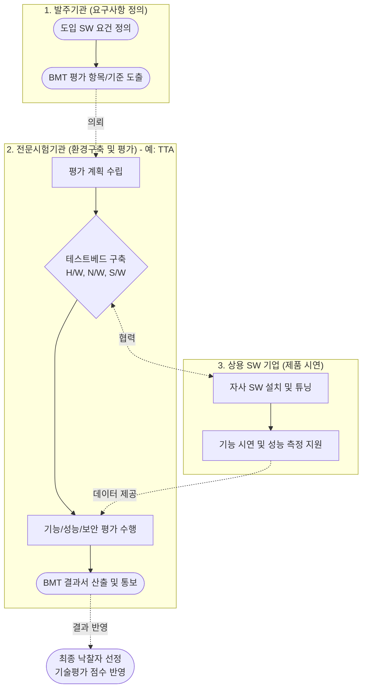

# 상용 소프트웨어 품질성능 평가 시험 (BMT)

---

## I. 객관적 기술 평가의 척도, 상용 소프트웨어 품질성능 평가 시험(BMT)의 개요

### 가. 정의

- 발주기관이 도입하려는 상용 소프트웨어를 실제 운영 환경과 유사한 테스트베드에서 기능, 성능, 보안성 등을 정량적으로 비교·평가하는 시험 (Benchmark Test)

### 나. 필요성 및 특징

| 구분 | 내용 |
| --- | --- |
| 기술 평가의 실효성 | 서면 제안서 중심의 주관적 평가에서 탈피하여 실제 구동 성능 기반 객관적 검증 |
| 도입 위험 사전 차단 | 상용SW 간 상호운용성, 시스템 부하 시 성능 저하 및 보안 취약점을 도입 전 사전 검출 |
| 공공 조달 법적 의무화 | 「소프트웨어 진흥법」에 따라 5천만 원 이상 상용SW 경쟁 입찰 시 BMT 의무 시행 |
| 평가 공정성 확보 | 전문시험기관(TTA 등)의 표준 테스트베드 및 블라인드 테스트 방식으로 공정성 보장 |

---

## II. 상용SW BMT의 수행 체계 및 핵심 평가 요소

### 가. 상용SW BMT의 수행 절차 및 아키텍처

* 발주기관의 요구사항을 바탕으로 TTA 등 국가 지정 전문시험기관이 주관하여 공정한 테스트베드를 구축함
* 경쟁 참여 기업들의 SW를 동일한 환경에서 구동시키고, 모니터링/부하 테스트 도구를 통해 산출된 정량적 결과서를 기술평가에 반영함

### 나. 상용SW BMT의 핵심 평가 및 기술 요소

| 구분 | 요소기술(키워드) | 세부 설명 |
| --- | --- | --- |
| **평가 기준** | **기능 적합성 (Functional Suitability)** | 명세된 요구사항(RFP) 기능의 정상 동작 여부, 데이터 정합성 및 정확성 검증 |
| **평가 기준** | **성능 효율성 (Performance Efficiency)** | 특정 부하 상태에서의 [[응답시간]](Response Time), [[처리량]](TPS), 자원 사용률 측정 |
| **평가 기준** | **보안성 및 [[신뢰성]] (Security & Reliability)** | 접근 통제, [[암호화]] 적용 여부 및 장시간 부하 시 결함률, 시스템 복구력(Resilience) 평가 |
| **시험 환경** | **Testbed (테스트베드)** | 실제 운영망과 물리적/논리적으로 동일하게 구성된 H/W, OS, [[DBMS]] 독립 평가 환경 |
| **성능 도구** | **Load Generator (부하 생성기)** | JMeter, LoadRunner 등을 활용하여 동시 접속자 수 및 대량 트랜잭션을 가상으로 생성 |
| **성능 도구** | **APM (어플리케이션 성능 관리)** | Scouter, Jennifer 등을 통해 SW 구동 시 [[CPU]], Memory, 쿼리 응답 지연 등 병목구간 탐지 |
| **품질 표준** | **ISO/IEC 25010** | SW 제품 품질 평가를 위한 국제 표준 모델 (기능성, 신뢰성, 사용성, 유지보수성 등 8대 특성) |
| **평가 방식** | **Blind Test (블라인드 테스트)** | 평가의 공정성을 극대화하기 위해 제품명과 제조사를 숨기고 식별기호로만 성능을 측정 |

---

## III. BMT와 GS(Good Software) 인증 비교 및 최신 동향

### 가. BMT와 GS 인증의 핵심 항목 비교

| 비교 항목 | BMT (품질성능 평가 시험) | GS (Good Software) 인증 |
| --- | --- | --- |
| **수행 목적** | 특정 공공/민간 사업 도입을 위한 **경쟁 제품 간 비교 평가** | 자사 개발 SW의 전반적인 **품질 증명 및 조달 등록** |
| **평가 주체/시점** | 발주기관 (SW 도입 시점) | SW 개발 기업 (제품 출시/마케팅 시점) |
| **평가 대상** | 해당 사업 입찰에 참여한 복수의 경쟁 상용SW | 인증을 신청한 단일 상용SW |
| **평가 기준** | 발주기관의 구체적 **RFP 요구사항 맞춤형 기준** | ISO 국제 표준에 기반한 **범용적 품질 기준** |
| **결과 활용** | 제안서 기술평가 점수에 직접 반영 (당락 결정) | 우선구매제도 적용, 기술평가 가산점(일부), 마케팅 활용 |

### 나. 최신 동향 및 발전 방향

- **[[클라우드 네이티브]]·SaaS BMT 전환**: 온프레미스 단일 서버 시험을 넘어 멀티테넌트 환경 격리성, 오토스케일링 민첩성, API 처리 성능을 검증하는 클라우드 BMT 표준 수립
- **AI 기반 시험 자동화**: 부하 시나리오 자동 생성, 결과 로그 이상 탐지, 반복 회귀 시험([[리그레션 테스트|Regression Test]])에 AI 에이전트를 도입하여 BMT 소요 기간 단축
- **보안 및 공급망 검증 결합**: 기능·성능 평가와 병행하여 [[SBOM]] 기반 취약점 스캔 및 안전성 평가를 BMT 필수 지표에 통합하는 추세

---

### 🔗 연관 토픽

- **소속 도메인**: [[00_소프트웨어공학_MOC|🏗️ 소프트웨어공학]]
- **세부 분류**: `6. 소프트웨어 테스팅 & 품질 보증 (QA/QC)`
- **핵심 연관 토픽**:
  - [[응답시간]]
  - [[처리량]]
  - [[신뢰성]]
  - [[정보시스템 운영 성과관리]]
  - [[정보시스템 운영 유지보수 감리|정보시스템 운영/유지보수 감리]]
