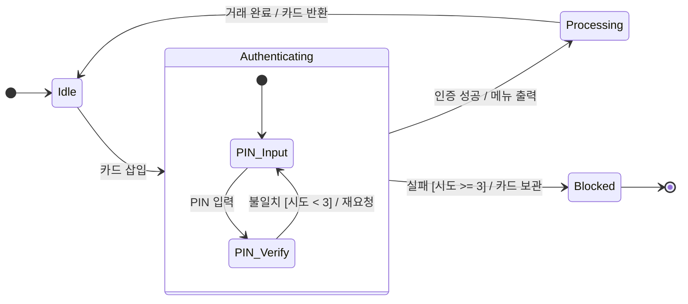

# 상태 머신 다이어그램 (State Machine Diagram)

---

## I. 이벤트에 따른 객체의 상태 변화, 상태 머신 다이어그램의 개요

### 가. 정의

- 한 객체가 생명주기 동안 **이벤트에 따라 어떤 상태로 전이하고 어떤 동작을 수행하는지를 표현**하는 [[UML]] 행위 다이어그램 (유한 상태 기계 기반, Harel Statechart 확장)

### 나. 특징

| 구분 | 내용 |
| --- | --- |
| 이벤트 주도 | 트리거·가드 조건·동작으로 반응 방식 명세 |
| 단일 객체 관점 | 한 객체(또는 시스템)의 상태 변화에 집중 |
| 계층 · 병행 | 복합 상태와 직교 영역으로 복잡도 관리 |
| 활용 | 임베디드 제어, 통신 [[프로토콜]], UI 상태, 워크플로 설계 |

---

## II. 표기 예시 및 구성요소

### 가. ATM 상태 머신 예시

- 전이는 `이벤트 [가드] / 동작` 형식으로 표기하며, Authenticating처럼 하위 상태를 가진 복합 상태로 세부 흐름을 묶음

### 나. 구성요소

| 구분 | 요소 | 설명 |
| --- | --- | --- |
| 상태 | 상태 (State) | 객체가 조건을 만족하거나 이벤트를 기다리는 상황 (둥근 사각형), entry·do·exit 활동 포함 가능 |
| | 시작 · 종료 | 시작 의사 상태(검은 원), 종료 상태(테두리 원 안의 검은 원) |
| 전이 | 전이 (Transition) | 상태 간 이동 (화살표) |
| | 이벤트 (Trigger) | 전이를 유발하는 자극 (신호, 호출, 시간, 변화 이벤트) |
| | 가드 조건 | 전이가 일어나기 위한 조건 (`[ ]`) |
| | 동작 (Effect) | 전이 시 수행하는 동작 (`/` 뒤) |
| 확장 | 복합 상태 | 하위 상태를 포함하는 상태 |
| | 직교 영역 | 한 상태 안에서 동시에 진행되는 독립 영역 |
| | 히스토리 의사 상태 | 복합 상태 재진입 시 마지막 하위 상태 복원 (H, H*) |

---

## III. 비교 및 동향

### 가. 상태 머신 vs 활동 다이어그램

| 비교 항목 | 상태 머신 다이어그램 | 활동 다이어그램 |
| --- | --- | --- |
| 관점 | 객체의 상태 변화 | 작업·제어 흐름 |
| 핵심 요소 | 상태, 이벤트, 전이 | 액션, 분기, Fork·Join |
| 전이 계기 | 외부 이벤트 발생 | 이전 액션 완료 |
| 모델링 대상 | 실시간 시스템, 프로토콜, UI 상태 | 업무 프로세스, 유스케이스 흐름, [[알고리즘]] |

### 나. 동향

- 프론트엔드에서 XState 등 상태 기계 라이브러리로 불가능한 상태 조합을 원천 차단
- AWS Step Functions 등 워크플로 서비스가 상태 기계 모델로 분산 처리·보상 트랜잭션([[SAGA패턴]]) 구현
- 모델 기반 테스트에서 상태 전이 커버리지로 테스트 케이스 자동 도출

---

### 🔗 연관 토픽

- **소속 도메인**: [[00_소프트웨어공학_MOC|🏗️ 소프트웨어공학]]
- **세부 분류**: `3. 요구사항 공학 & UML 객체지향 분석/설계`
- **핵심 연관 토픽**:
  - [[UML|UML (정적, 동적 다이어그램)]]
  - [[순차 다이어그램|순차 다이어그램 (Sequence Diagram)]]
  - [[Interaction overview diagram]]
  - [[블랙박스 테스트]]
  - [[SAGA패턴]]
