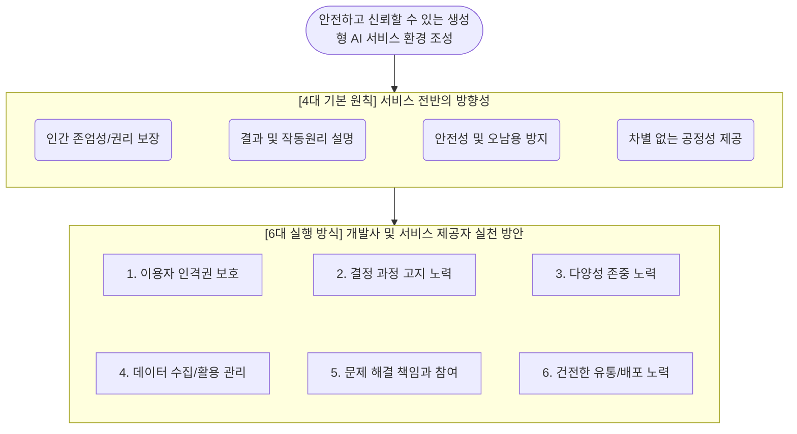

# 생성형 인공지능 서비스 이용자 보호 가이드라인

---

## I. 안전한 AI 생태계 조성, 생성형 인공지능 서비스 이용자 보호 가이드라인의 개요

### 가. 생성형 인공지능 서비스 이용자 보호 가이드라인의 정의
- 텍스트, 이미지 등 생성형 AI 서비스 이용 과정에서 발생할 수 있는 딥페이크 오남용, 허위정보 및 편향성 피해를 예방하고 이용자 권익을 보장하기 위해 방송통신위원회가 제정한 자율 실천 지침(2025.02)이다.

### 나. 가이드라인의 제정 배경 및 주요 특징

| 구분 | 주요 내용 |
| --- | --- |
| 제정 배경 | 생성형 AI의 일상화에 따른 딥페이크 성범죄, 가짜뉴스 유포, 프라이버시 침해 등 역기능에 대한 선제적 안전망 구축 |
| 기본 체계 | 인간 존엄성, 투명성, 안전성, 공정성의 '4대 기본 원칙'과 기업 현장 적용을 위한 '6대 실행 방식' 제시 |
| 연성 규범 성격 | 법적 처벌 조항이 없는 권고적 소프트 로(Soft Law) 형태이나, 향후 제정될 인공지능 법률의 기초 표준 역할 |
| 이용자 권리 강화 | AI 생성물 고지(워터마크), 프롬프트 학습 활용에 대한 명시적 옵트아웃(Opt-out) 권리 보장 요구 |

---

## II. 가이드라인의 프레임워크 및 핵심 구성 요소

### 가. 생성형 인공지능 서비스 이용자 보호 가이드라인의 개념도

* 안전한 AI 생태계라는 지향점 달성을 위해 4대 기본 원칙을 수립하고, 이를 현장에 적용하기 위한 6가지 구체적 실행 방식(프랙티스)을 개발사와 제공자에게 요구함.

### 나. 가이드라인의 핵심 실천 요소 (6대 실행 방식 중심)

| 구분 | 핵심 실천 요소 (키워드) | 세부 설명 |
| --- | --- | --- |
| **실행 방식 1** | **이용자 인격권 보호** | 타인의 권리 침해 요소를 발견 및 통제할 [[알고리즘]] 구축, 모니터링 체계와 직관적 이용자 신고 [[프로세스]] 마련 |
| **실행 방식 2** | **결정·과정 알림 (투명성)** | 산출물이 AI로 생성되었음을 알리는 워터마크 고지, 결정 과정 이해를 돕기 위한 출처 표기 및 설명 제공 |
| **실행 방식 3** | **다양성 존중 ([[편향]] 최소화)** | 알고리즘 설계 시 차별과 편향 감소 노력, 부적절한 결과에 대한 필터링 기능 제공 및 편향성 신고 채널 운영 |
| **실행 방식 4** | **데이터 수집·활용 관리** | 이용자의 프롬프트(입력) 데이터를 학습용으로 활용 시 사전 고지 및 동의/거부([[OPT\|Opt]]-out) 선택 절차 의무화 |
| **실행 방식 5** | **책임 및 참여 (문제 해결)** | 서비스 제공자와 이용자 간의 명확한 책임 범위 정의, 이용약관 내 오남용으로 인한 문제 발생 시 이용자 책임 명시 |
| **실행 방식 6** | **건전한 유통 및 배포** | 딥페이크, 음란물 등 청소년 유해 정보 차단, 프롬프트 입력값 및 산출물에 대한 윤리적 기준 점검 및 관리 |
| **관리 체계** | **위험관리 전담 조직** | 인지하지 못한 피해 최소화를 위해 위험관리를 전담하는 내부 책임자 선정 및 상시 점검(모니터링) 시스템 구축 |
| **사후 점검** | **주기적 타당성 검토** | 방송통신위원회는 시행일(2025.3.28) 기준 매 2년마다 기술 발전 속도를 반영하여 가이드라인 타당성 검토 후 개선 |

---

## III. 연성 규범과 강행 법률 비교 및 향후 산업 대응 전망

### 가. 연성 규범(가이드라인) vs 강행 규범(인공지능기본법) 비교

| 비교 항목 | 생성형 AI 이용자 보호 가이드라인 | 인공지능 발전과 신뢰 기반 조성 등에 관한 법률 (인공지능기본법) |
| --- | --- | --- |
| **법적 성격** | 자율 준수 권고 (Soft Law) | 법적 구속력을 지닌 강행 법률 (Hard Law) |
| **주관 부처** | 방송통신위원회 | 과학기술정보통신부 및 범정부 관계부처 |
| **적용 범위** | 대민 생성형 AI 서비스 제공 사업자 | AI 연구개발, 서비스 제공, 고위험 AI 활용 사업자 전반 |
| **위반 시 제재** | 행정지도, 개선 권고 (직접 처벌 없음) | 시정명령, 과태료 부과 및 법적 손해배상 책임 |
| **핵심 의무 사항** | 6대 실행 방식(투명성 고지, 옵트아웃, 인격권 보호) | 고위험 AI 안전성 인증, 생성물 워터마크 표시, 위험관리 보고 |

### 나. 향후 전망 및 산업계 대응 방향
- **[[AI 거버넌스]] 전 주기 내재화**: 모델 기획·개발 단계부터 레드팀(Red Teaming) 모의 침투를 수행하여 편향성, 프롬프트 탈옥, 개인정보 유출 취약점을 상시 모니터링하는 내부 통제 체계 구축.
- **프라이버시 강화 기술(PET) 및 가드레일 도입**: 이용자의 프롬프트 내 개인 식별 정보(PII) 자동 마스킹 및 입출력 양방향 가드레일을 구축하여 유해 콘텐츠 생성을 원천 필터링.
- **하드 로(Hard Law) 전환 대비 컴플라이언스 선제 정비**: 가이드라인의 6대 실행 방식을 선제적으로 충족하여 향후 입법화될 인공지능 서비스 이용자보호법 및 글로벌 규제(EU AI Act)에 대한 규제 대응 리스크 최소화.

---

### 🔗 연관 토픽

- **소속 도메인**: [[00_인공지능_MOC|🤖 인공지능]]
- **세부 분류**: `4. 거대언어모델 (LLM) & 생성형 AI`
- **핵심 연관 토픽**:
  - [[AI 거버넌스|AI 거버넌스 (AI Governance)]]
  - [[프롬프트 인젝션|프롬프트 인젝션(Prompt Injection)]]
  - [[편향]]
  - [[알고리즘]]
  - [[인공지능]]
