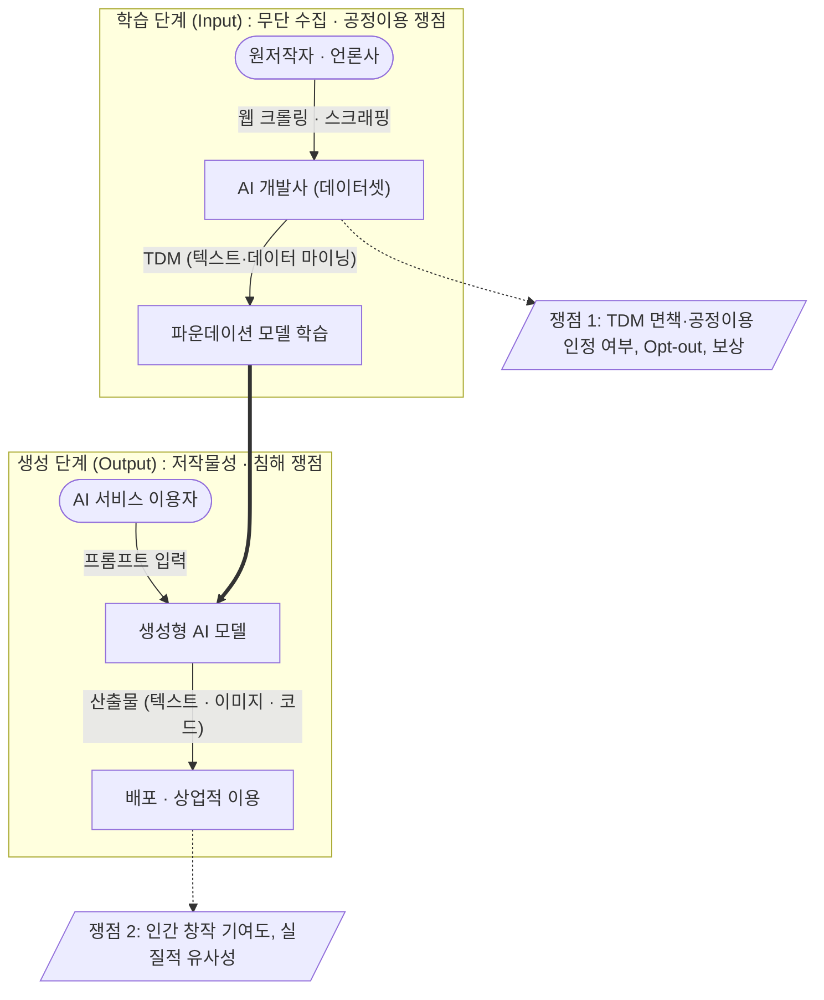

# 생성형 인공지능 저작권 이슈 및 대응방안

---

## I. AI 혁신과 창작자 권리의 충돌, 생성형 AI 저작권의 개요

### 가. 생성형 인공지능 저작권 이슈의 정의
- 생성형 AI 모델의 학습(Input) 단계에서 원저작물의 무단 크롤링 및 TDM 면책 여부와, 산출물(Output)의 독자적 저작물성 인정 및 타인 저작권 침해를 둘러싼 법적·기술적 종합 쟁점이다.

### 나. 등장 배경 및 주요 쟁점

| 구분 | 내용 |
| --- | --- |
| 학습 단계 충돌 | 대규모 웹 크롤링으로 [[파운데이션 모델]]을 학습, AI 기업은 공정이용(Fair Use)을, 언론사·창작자는 침해를 주장 (NYT vs OpenAI 등) |
| 산출 단계 한계 | 저작물은 '인간의 사상·감정을 표현한 창작물'이므로 프롬프트만으로 만든 결과물은 원칙적으로 보호되지 않음 |
| 침해 위험 | 과적합(암기)으로 기존 저작물과 실질적으로 유사한 결과물 생성 가능 |
| 규제화 | EU AI Act 등으로 학습 데이터 요약 공개, AI 생성물 표시 의무화 추세 |

---

## II. 쟁점 구조 및 대응 요소

### 가. 쟁점 개념도

- **Input**: 대규모 데이터 마이닝(TDM)의 합법성과 Opt-out 보장이 핵심
- **Output**: 원본 종속성(암기 현상) 방지와 이용자의 창작적 기여 인정 범위가 핵심

### 나. 핵심 제도 및 기술

| 구분 | 요소 | 설명 |
| --- | --- | --- |
| 법·제도 | TDM 예외 | 데이터 분석 목적의 복제를 저작권 침해에서 면책 (국가별 범위 상이, EU는 Opt-out 조건부) |
| | 공정이용 (Fair Use) | 변형적 이용, 영리성, 시장 대체 효과 등을 따져 허락 없는 이용 허용 |
| | 실질적 유사성 · 의거성 | 기존 저작물과 유사하고 원본에 의거했으면 침해 성립 |
| 사전 방어 | Opt-out | robots.txt·메타태그로 AI 크롤러(GPTBot 등)의 수집 차단 |
| | 데이터 정제 | 학습 데이터에서 저작권 민감 데이터·개인정보 사전 제거 |
| 사후 식별 | [[C2PA]] / CAI | 생성·편집·유통 이력(Provenance)을 서명된 메타데이터로 기록 |
| | AI 워터마킹 | 비가시적 패턴을 삽입해 AI 생성 여부 식별 (SynthID 등) |
| 아키텍처 | RAG | 저작물을 가중치에 학습시키지 않고 검색으로 참조, 출처 표시·라이선스 관리 용이 |
| | 가드레일 | 저작권 침해 소지가 있는 입력·출력을 실시간 차단 |

---

## III. 단계별 비교 및 동향

### 가. 학습 단계 vs 산출 단계

| 비교 항목 | 학습 단계 (Input) | 산출 단계 (Output) |
| --- | --- | --- |
| 주요 쟁점 | 무단 수집·이용, 보상 체계 부재 | 산출물의 저작권 인정 여부, 타인 권리 침해 |
| 판단 기준 | 공정이용, TDM 면책 성립 여부 | 인간의 창작적 기여, 실질적 유사성 |
| 분쟁 주체 | AI 개발사 vs 원저작권자 | AI 이용자 vs 제3자(기존 저작자) |
| 기술 대응 | Opt-out, 라이선스 필터링, 머신 언러닝 | 워터마킹, C2PA, [[딥페이크]] 탐지, 가드레일 |

### 나. 동향

- **투명성 의무화**: EU AI Act는 범용 AI 모델의 학습 데이터 요약 공개를 의무화, 국내도 [[AI 기본법|인공지능 기본법]]과 저작권법 개정 논의로 제도 기반 마련 중
- **라이선싱 시장 형성**: AI 기업과 언론사·이미지 플랫폼(Getty Images 등) 간 유상 데이터 계약 확대
- **기업용 Safe AI**: 퍼블릭 [[초거대 언어 모델\|LLM]]의 침해·유출 위험을 피하려 검증된 자사 데이터 기반 [[sLLM (Smaller Large Language Model)\|sLLM]]과 RAG를 결합

---

### 🔗 연관 토픽

- **소속 도메인**: [[00_인공지능_MOC|🤖 인공지능]]
- **세부 분류**: `4. 거대언어모델 (LLM) & 생성형 AI`
- **핵심 연관 토픽**:
  - [[파운데이션 모델|파운데이션 모델(Foundation Model)]]
  - [[초거대 언어 모델|초거대 언어 모델(Large Language Model)]]
  - [[sLLM (Smaller Large Language Model)]]
  - [[C2PA]]
  - [[딥페이크|딥페이크(Deepfake)]]
