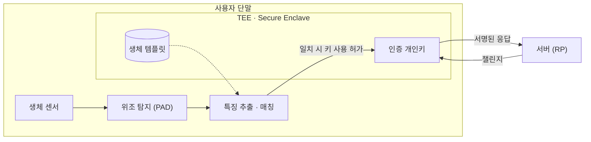

# 생체 인증 (텔레바이오 인증)

---

## I. 몸이 곧 열쇠, 생체 인증의 개요

### 가. 정의

- 지문·얼굴·홍채·정맥 등 **신체적 특징이나 행동적 특징으로 본인을 확인**하는 인증 방식이며, 텔레바이오 인증은 이를 **정보통신망을 통해 원격으로 수행**하는 것 (ITU-T X.1081 등 텔레바이오 표준)

### 나. 특징

| 구분 | 내용 |
| --- | --- |
| 편의성 | 기억·소지 부담 없이 인증, 패스워드리스 실현 |
| 변경 불가 | 유출 시 비밀번호처럼 바꿀 수 없어 보호가 핵심 |
| 확률적 판정 | 오인식률(FAR)·오거부율(FRR) 사이의 임계값 조정 |
| 위조 위협 | 실리콘 지문, 사진·3D 마스크, 딥페이크 영상 |
| 민감정보 | 개인정보보호법상 민감정보로 별도 동의·암호화 의무 |

---

## II. 동작 구조 및 구성요소

### 가. 단말 매칭(FIDO) 구조

- 생체 정보는 단말 보안 영역에서만 매칭하고, 서버에는 개인키 서명 응답만 전송해 생체 정보 유출을 막음

### 나. 구성요소

| 구분 | 요소 | 설명 |
| --- | --- | --- |
| 생체 정보 | 신체적 특징 | 지문, 얼굴, 홍채, 정맥, 음성 |
| | 행동적 특징 | 서명, 키 입력 리듬, 걸음걸이 |
| | 생체 신호 | 심전도(ECG), 뇌파 등 |
| 위조 방어 | PAD (ISO/IEC 30107) | 라이브니스 검사로 위조 생체 판별 |
| 보안 환경 | TEE·보안 칩 | 템플릿과 키를 OS와 분리된 영역에 저장 |
| 템플릿 보호 | 취소 가능 생체 | 변환 템플릿 사용, 유출 시 폐기·재발급 |
| | 동형 암호 매칭 | 암호화된 템플릿끼리 비교 ([[동형 암호]]) |
| 원격 인증 | [[FIDO]]·WebAuthn | 생체로 로컬 인증 후 공개키 서명으로 원격 인증 |
| 지속 인증 | 행위 기반 인증 | 세션 중 행동 패턴으로 지속 검증 |

---

## III. 비교 및 동향

### 가. 서버 매칭 vs 단말 매칭

| 비교 항목 | 서버 매칭 | 단말 매칭 (FIDO) |
| --- | --- | --- |
| 매칭 위치 | 서버 | 사용자 단말 보안 영역 |
| 템플릿 저장 | 중앙 DB | 각 단말 |
| 전송 데이터 | 암호화된 템플릿·특징값 | 챌린지 서명 |
| 유출 영향 | 대규모 유출 위험 | 단일 기기 한정 |
| 활용 | 출입국 심사, 출입 통제, 1:N 식별 | 모바일 결제, 웹 로그인 |

### 나. 동향

- **딥페이크 대응**: 주입 공격(가상 카메라) 탐지와 라이브니스 고도화, 비대면 실명확인 강화
- **분산 저장**: 금융권의 바이오정보 분산 관리(금융결제원 분산관리센터)와 단말 매칭 확산
- **제도**: [[생체정보 보호 안내서(24.12)|생체정보 보호 안내서]]로 수집·저장·파기 기준 정비, [[패스키]]와 결합한 패스워드리스 확대

---

### 🔗 연관 토픽

- **소속 도메인**: [[00_보안_MOC|🛡️ 보안]]
- **세부 분류**: `2. 현대 암호학 & 키 관리 · 전자서명`
- **핵심 연관 토픽**:
  - [[FIDO]]
  - [[패스키|패스키(Passkey)]]
  - [[생체정보 보호 안내서(24.12)]]
  - [[딥보이스 피싱|딥보이스(Deep Voice) 피싱]]
  - [[동형 암호|동형 암호 (Homomorphic Encryption)]]
