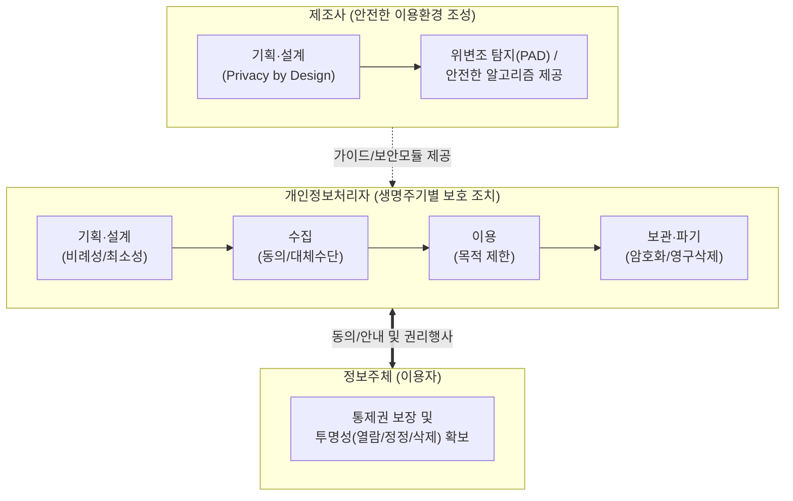

# 생체정보 보호 안내서

---

## I. 안전한 생체정보 활용의 이정표, 생체정보 보호 안내서의 개요

생체정보 보호 안내서는 지문, 얼굴, 음성 등 생체인식정보의 고유성 및 불변성(유출 시 변경 불가) 특성을 반영하여 기획부터 수집·이용·보관·파기까지 전 생명주기에 걸쳐 개인정보처리자와 제조사가 준수해야 할 기술적·관리적 보호 조치 원칙을 제시한 가이드라인이다(2024.12, 개인정보보호위원회 개정).

| 구분 | 내용 |
| :--- | :--- |
| **정의** | 생체인식정보의 전 생명주기(기획~파기)에 걸쳐 준수해야 할 보호 원칙을 규정한 공적 실무 가이드라인 |
| **개정 배경** | 스마트폰·AI 생체인증 급증, 딥페이크 위·변조 위협 증가, 2024년 3월 개정 개인정보 보호법 반영 |
| **핵심 기제** | 설계 단계 프라이버시(PbD), 대체 인증 수단(Fallback) 제공 의무, 단방향 암호화 및 안전 영역(TEE) 저장 |

---

## II. 생체정보 보호 생명주기 모델 및 핵심 보호 조치

### 가. 생체정보 보호 생명주기 및 아키텍처

### 나. 생체정보 보호 핵심 조치 요소

| 구분 | 요소기술(키워드) | 세부 설명 |
| :--- | :--- | :--- |
| **기획·설계** | PbD ([[개인정보보호 중심 설계\|Privacy by Design]]) | 서비스 기획 단계부터 프라이버시 침해 요인 분석, 최소한의 정보만 수집하도록 통제 체계 설계 |
| **수집** | 명확한 동의 / 대체 수단 | 별도 동의 획득 의무화 및 동의 거부 시 비밀번호, 패턴 등 대체 인증 수단(Fallback) 필수 제공 |
| **이용** | 목적 외 이용 금지 | 최초 인증·식별 목적으로 수집한 정보를 다른 용도(예: 무단 AI 학습 데이터 전용 등)로 활용 금지 |
| **보관** | 단방향 [[암호화]] / 분리 보관 | 생체 특징점 정보는 복원 불가한 단방향 [[알고리즘]] 적용, 원시 정보와 특징점 정보는 안전하게 분리 보관 |
| **보관** | 안전 영역(TEE/SE) 활용 | 단말기 내부 처리 시, 일반 OS와 격리된 하드웨어 기반 신뢰 실행 환경(TEE) 내에 생체 템플릿 저장 |
| **파기** | 복구 불가능한 영구 파기 | 인증 목적 달성 또는 보유기간 경과 시 지체 없이 파기하며, 복원 불가능한 기술적 삭제 절차 수행 |
| **제조사 역할** | 위변조 탐지 (PAD) | 딥페이크, 3D 마스크 등 인공적인 위조 생체정보 유입을 판별하는 활성 탐지(Liveness) 기술 적용 권장 |
| **상시 점검** | 맞춤형 자율점검표 운영 | 개인정보처리자, 제조사, 이용자 대상별 특화된 자율점검표를 통한 상시 취약점 통제 및 법규 준수 확인 |

---

## III. 생체정보 저장 방식 비교 및 차세대 보안 동향

### 가. 서버 저장 방식 vs 온디바이스(On-Device) FIDO 방식 비교

| 비교 항목 | 중앙 서버 집중 저장 방식 | 온디바이스([[FIDO]]) 분산 저장 방식 |
| :--- | :--- | :--- |
| **저장 위치** | 기업/기관의 중앙 DB 서버 | 사용자 단말의 하드웨어 보안 영역(TEE/SE) |
| **유출 위험** | 서버 침해 시 대규모 생체 템플릿 유출 | 단말 분실 시에도 TEE 암호화로 대규모 유출 불가 |
| **인증 방식** | 생체 데이터를 서버로 전송 후 매칭 | 로컬 매칭 후 PKI 기반 전자서명 결과만 서버 전송 |
| **변경 불가성 대책** | 취약 (원시 특징점 유출 시 재발급 불가) | 안전 (서버에는 개인키 서명 검증 공개키만 보관) |

### 나. 향후 기술 동향 및 발전 전망
- **변형 생체인식(Cancelable Biometrics) 적용 확대**: 생체 템플릿 유출 시 변경 불가능한 한계를 극복하기 위해, 원본 특징점에 일방향 수학적 변환을 적용하여 유출 시 즉시 폐기 및 재발급이 가능한 구조 확산.
- **[[FIDO]] 기반 패스키(Passkey) 결합 온디바이스 인증 표준화**: 생체정보 원본을 외부로 전송하지 않고 온디바이스에서 로컬 매칭한 뒤 공개키 서명값만 교환하는 패스키 생태계가 웹/앱 전반의 표준으로 정착.
- **동형암호([[동형 암호|동형암호]]) 및 행위 지속 인증(Continuous Authentication)**: 클라우드 매칭이 불가피한 경우 암호화된 상태로 특징점을 비교하는 기술과 함께, 마우스 궤적·키보드 타이핑 등 동적 행위 기반 연속 인증 결합.

---

### 🔗 연관 토픽

- **소속 도메인**: [[00_보안_MOC|🛡️ 보안]]
- **세부 분류**: `6. 개인정보보호 & 프라이버시 강화 기술`
- **핵심 연관 토픽**:
  - [[암호화|암호화 (Encryption)]]
  - [[동형 암호|동형 암호 (Homomorphic Encryption)]]
  - [[개인정보보호법]]
  - [[FIDO]]
  - [[개인정보보호 중심 설계|개인정보보호 중심 설계(Privacy by Design)]]
