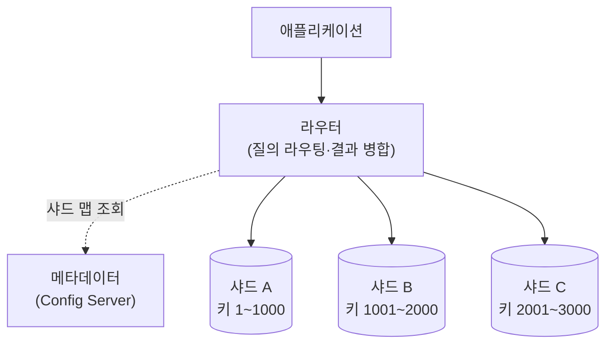

# 샤딩 (Sharding)

---

## I. 데이터를 여러 서버로 쪼개기, 샤딩의 개요

### 가. 정의

- 테이블을 **샤드 키 기준으로 수평 분할해 서로 다른 DB 서버(샤드)에 나누어 저장·처리하는 수평 확장 기법**

### 나. 특징

| 구분 | 내용 |
| --- | --- |
| 확장성 | 서버 추가로 저장 용량·처리량 확장 (Scale-Out) |
| 장애 격리 | 한 샤드 장애의 영향 범위 축소 |
| 성능 | 질의·쓰기 부하 분산 |
| 비용 | 샤드 간 조인·트랜잭션, 재분배·운영 복잡도 증가 |

---

## II. 구조 및 구성요소

### 가. 샤딩 구조

- 라우터가 샤드 키로 대상 샤드를 찾고, 키가 없는 질의는 모든 샤드에 보내(Scatter-Gather) 결과를 병합

### 나. 구성요소

| 구분 | 요소 | 설명 |
| --- | --- | --- |
| 기준 | 샤드 키 | 분배 기준 컬럼, 카디널리티가 높고 고르게 분포해야 함 |
| 구성 | 라우터 | 질의 전달·결과 병합 (예: MongoDB mongos, Vitess VTGate) |
| | 메타데이터 서버 | 키 범위·샤드 매핑 보관 |
| | 복제 세트 | 샤드별 복제로 가용성 확보 |
| 분할 방식 | 범위 샤딩 | 연속 범위로 분할, 범위 조회 유리, 핫스팟 위험 |
| | 해시 샤딩 | 해시값으로 균등 분산, 범위 조회 불리 |
| | 디렉터리 샤딩 | 룩업 테이블로 매핑, 유연하지만 조회 비용 |
| 재분배 | 리밸런싱 | 청크 이동·분할, 일관된 해싱으로 이동량 최소화 |
| 문제 | 교차 샤드 처리 | 샤드 간 조인·분산 트랜잭션 비용 |

---

## III. 비교 및 동향

### 가. 샤딩 vs 파티셔닝

| 비교 항목 | 샤딩 | [[파티셔닝]] |
| --- | --- | --- |
| 위치 | 서로 다른 서버 | 한 DB 인스턴스 안 |
| 확장 | Scale-Out | 단일 서버 자원 내 |
| 장애 영향 | 일부 샤드로 한정 | 인스턴스 장애 시 전체 |
| 조인·트랜잭션 | 교차 샤드 시 비용 큼 | 같은 서버라 상대적으로 쉬움 |
| 목적 | 처리량·용량 확장 | 대용량 테이블 관리·프루닝 |

### 나. 동향

- **자동 샤딩**: Spanner·[[CockroachDB]] 등 [[New SQL|NewSQL]]은 범위 자동 분할·이동으로 애플리케이션 샤딩 부담 제거
- **미들웨어 샤딩**: MySQL용 Vitess, PostgreSQL용 Citus로 기존 RDBMS 수평 확장
- **블록체인 샤딩**: 이더리움은 데이터 가용성 샤딩(Danksharding) 로드맵, 2024년 EIP-4844(Proto-Danksharding) 적용

---

### 🔗 연관 토픽

- **소속 도메인**: [[00_데이터베이스_MOC|🗄️ 데이터베이스]]
- **세부 분류**: `4. 물리 저장 구조 & 인덱스 최적화`
- **핵심 연관 토픽**:
  - [[파티셔닝|파티션]]
  - [[분산 데이터베이스|분산 데이터베이스 (Distributed Database)]]
  - [[New SQL]]
  - [[쿼리오프로딩]]
  - [[NoSQL 데이터모델링 패턴]]
