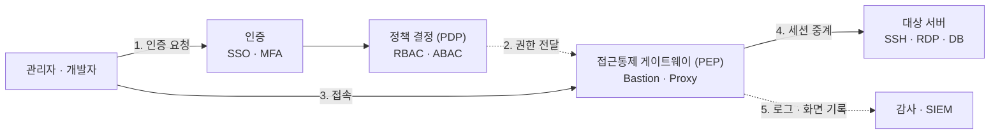

# 서버 접근 통제 (Server Access Control)

---

## I. 관리자 계정을 지키는 관문, 서버 접근 통제의 개요

### 가. 정의

- **인가된 사용자만 정해진 경로와 권한으로 서버(OS·DB·애플리케이션)에 접속하도록 통제하고, 모든 접속과 명령 이력을 기록·감사**하는 보안 체계

### 나. 필요성 및 특징

| 구분 | 내용 |
| --- | --- |
| 내부자·계정 탈취 대응 | 관리자 계정 도용, 크리덴셜 스터핑, 내부자 오남용 방지 |
| 컴플라이언스 | [[ISMS-P]] 접근권한 관리·접속기록 보관 요건 충족 |
| AAA 기반 | 인증(Authentication)·인가(Authorization)·기록(Accounting) |
| 최소 권한 | 업무에 필요한 최소 권한만, 필요한 시간에만 부여 |

---

## II. 통제 구조 및 구성요소

### 가. 게이트웨이 기반 통제 구조

- 사용자는 서버에 직접 접속하지 못하고 게이트웨이를 거쳐서만 접속하며, 게이트웨이가 정책 적용과 세션 기록을 담당

### 나. 구성요소

| 구분 | 요소 | 설명 |
| --- | --- | --- |
| 인증 | MFA | 비밀번호 + OTP·[[FIDO]] 등 다중 인증 |
| | SSO | 한 번 인증으로 여러 서버 접속 |
| 인가 | [[RBAC]] | 직무·역할 기반 권한 부여 |
| | ABAC | 사용자·시간·위치·단말 속성 기반 동적 권한 |
| 접근 통제 | Bastion Host·게이트웨이 | 서버 접속을 단일 경로로 집중 |
| | JIT 접근 | 상시 권한 대신 승인된 시간에만 임시 권한 부여 |
| | 계정 관리 (PAM) | 특권 계정 비밀번호 금고·자동 변경 |
| 감사 | 세션 기록 | SSH 명령어·RDP 화면 녹화 |
| | 명령어 통제 | `rm -rf`, `DROP TABLE` 등 위험 명령 차단·세션 종료 |

---

## III. 비교 및 동향

### 가. 경계 기반 vs 제로 트러스트 기반

| 비교 항목 | 경계 기반 접근 통제 | [[제로 트러스트 보안모델\|제로 트러스트]] 기반 (ZTNA) |
| --- | --- | --- |
| 신뢰 기준 | 내부망 위치 | 신원·단말 상태를 매번 검증 |
| 접근 방식 | [[VPN]] + Bastion | Identity-Aware Proxy |
| 접근 범위 | 서브넷 단위 | 서버·애플리케이션 단위 ([[세그멘테이션\|마이크로 세그멘테이션]]) |
| 권한 수명 | 상시 권한 | JIT 임시 권한 |

### 나. 동향

- **CIEM**: 멀티 클라우드의 과도한 권한을 식별해 회수하는 클라우드 권한 관리 연동
- **패스워드리스**: FIDO2·단기 인증서 기반 SSH 접속으로 비밀번호 탈취 위험 제거
- **UEBA**: 관리자 접속 시간·명령 패턴을 학습해 이상 행위 탐지

---

### 🔗 연관 토픽

- **소속 도메인**: [[00_보안_MOC|🛡️ 보안]]
- **세부 분류**: `1. 정보보안 원칙 & 거버넌스 · 인증`
- **핵심 연관 토픽**:
  - [[접근 제어 접근 통제|접근 제어/접근 통제(Access Control)]]
  - [[RBAC]]
  - [[IAM]]
  - [[제로 트러스트 보안모델|제로 트러스트 (Zero Trust) 보안모델]]
  - [[ISMS-P]]
