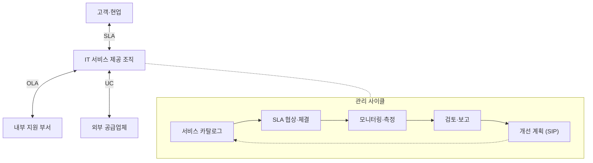

# 서비스 수준 관리 (SLM)

---

## I. 합의한 품질을 측정·유지하는, 서비스 수준 관리의 개요

### 가. 정의

- 고객과 **서비스 수준 목표를 합의([[SLA]])하고, 이를 측정·보고·개선**해 IT 서비스 품질을 비즈니스 요구에 맞게 유지하는 관리 활동 (ITIL 프랙티스)

### 나. 필요성 및 특징

| 구분 | 내용 |
| --- | --- |
| 가시성 | 모호한 서비스 품질을 정량 지표로 측정 |
| 기대치 조정 | 고객 요구와 제공자 역량의 차이를 협상으로 조정 |
| 계층적 협약 | 고객 SLA ← 내부 OLA ← 외부 UC로 책임 연결 |
| 진화 | 가동률 중심 → SRE의 SLO·오류 예산, 체감 경험 중심 XLA |

---

## II. SLM의 구조 및 구성요소

### 가. 협약 구조와 관리 사이클

- 고객 SLA를 달성할 수 있도록 내부 OLA와 외부 UC를 맞춰 정하고, 측정·보고·개선 사이클을 반복

### 나. 구성요소

| 구분 | 요소 | 설명 |
| --- | --- | --- |
| 협약 | SLA (Service Level Agreement) | 제공자–고객 간 서비스 수준 합의 |
| | OLA (Operational Level Agreement) | 제공 조직 내부 부서 간 지원 수준 합의 |
| | UC (Underpinning Contract) | 외부 공급업체와의 지원 계약 |
| 기준 | 서비스 카탈로그 | 제공 서비스 목록, 기본 수준, 비용 |
| 지표 (SRE) | SLI (Service Level Indicator) | 실제 측정 지표 (가용성, [[응답시간]], 오류율) |
| | SLO (Service Level Objective) | SLI의 목표치 (예: 월 가용성 99.9%) |
| | 오류 예산 (Error Budget) | 1 − SLO, 허용 가능한 실패 범위 (배포 속도와 안정성 균형) |
| 개선 | SIP (Service Improvement Plan) | 미달 원인 분석과 개선 계획 |

---

## III. 전통적 SLM vs SRE 기반 SLM 및 동향

### 가. 비교

| 구분 | 전통적 SLM | SRE 기반 SLM |
| --- | --- | --- |
| 목표 | 합의된 가용성 보장 | 안정성과 배포 속도의 균형 |
| 핵심 지표 | SLA 준수율 | SLI, SLO, 오류 예산 |
| 품질 관점 | 시스템 관점 (장애 시간) | 사용자 체감 (지연, 오류) |
| 위반 시 조치 | 페널티, 보고서 | 신규 배포 중단, 안정성 작업 우선 |

### 나. 동향

- **XLA (eXperience Level Agreement)**: 가동률 대신 사용자 체감 경험·만족도를 목표로 합의
- **관측성·AIOps**: 메트릭·로그·트레이스 기반으로 SLO 위반을 사전 예측하고 자동 확장·복구
- **클라우드 SLA 관리**: [[CSP]] SLA(서비스 크레딧) 범위와 자사 SLA 간 격차를 다중 리전·이중화로 보완

---

### 🔗 연관 토픽

- **소속 도메인**: [[00_경영전략_MOC|📈 경영전략]]
- **세부 분류**: `3. 비즈니스 프로세스 혁신 & 디지털 전환 (DX)`
- **핵심 연관 토픽**:
  - [[SLA|SLA (Service Level Agreement)]]
  - [[SRE (Site Reliability Engineering)]]
  - [[ITSM(Information Technology Service Management)]]
  - [[ITIL(IT Infrastructure Library) 4.0]]
  - [[신뢰성]]
