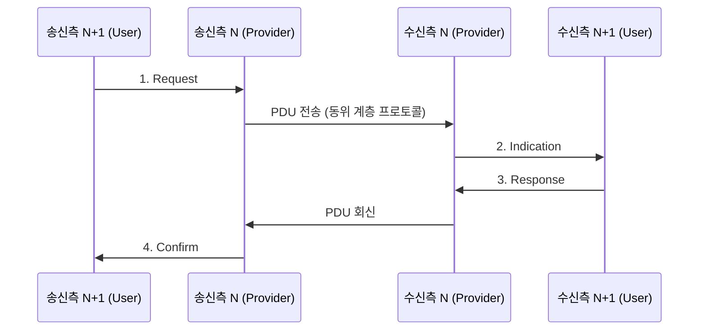

# 서비스 프리미티브 (Service Primitive)

---

## I. 인접 계층 간 상호작용의 추상 단위, 서비스 프리미티브의 개요

### 가. 정의

- OSI 참조 모델에서 **인접 계층(N+1 계층과 N 계층)이 SAP(Service Access Point)를 통해 서비스를 요청·제공하기 위해 주고받는 추상적 명령 단위**

### 나. 필요성 및 특징

| 구분 | 내용 |
| --- | --- |
| [[모듈화]]·독립성 | 각 계층의 내부 구현을 숨기고 표준 인터페이스만 노출해 [[프로토콜]] 변경 영향 최소화 |
| [[추상화]] | 동위 계층 간 PDU 교환을 인접 계층 간 상호작용으로 표현 |
| 언어 독립성 | 특정 언어·OS에 종속되지 않는 개념적 규격 |
| 4대 연산 | Request, Indication, Response, Confirm |

---

## II. 동작 원리 및 구성요소

### 가. 4가지 프리미티브 흐름

### 나. 구성요소

| 구분 | 요소 | 설명 |
| --- | --- | --- |
| 프리미티브 | Request | 송신측 상위 → 하위, 서비스 수행 요청 (예: CONNECT.request) |
| | Indication | 수신측 하위 → 상위, 상대의 요청·이벤트 도착 알림 |
| | Response | 수신측 상위 → 하위, Indication에 대한 수락·거절 응답 |
| | Confirm | 송신측 하위 → 상위, 최초 요청의 최종 결과 통보 |
| 접점 | SAP | 인접 계층 간 논리적 접속점 |
| 데이터 | SDU · PCI · PDU | 상위에서 받은 데이터(SDU) + 제어 정보(PCI, 헤더) = PDU |

---

## III. 서비스 유형 비교 및 동향

### 가. 확인형 vs 비확인형 서비스

| 비교 항목 | 확인형 (Confirmed) | 비확인형 (Unconfirmed) |
| --- | --- | --- |
| 사용 프리미티브 | Request, Indication, Response, Confirm (4개) | Request, Indication (2개) |
| 동작 | 수신측 응답이 Confirm으로 돌아와야 완료 | 요청 후 응답을 기다리지 않음 |
| [[신뢰성]] / 속도 | 높음 / 오버헤드 큼 | 낮음 / 빠름 |
| 예시 | [[TCP]] 연결 설정, 파일 전송 | UDP 전송, 실시간 스트리밍 |

### 나. 동향

- 요청–응답 프리미티브 사상은 [[MSA (Micro Service Architecture)\|MSA]]의 REST API 설계로 계승
- 이벤트 기반 아키텍처([[EDA]])의 Pub/Sub, gRPC 스트리밍 등 비동기 상호작용으로 확장 ([[OSI 7 Layer]] 참고)

---

### 🔗 연관 토픽

- **소속 도메인**: [[00_네트워크_MOC|🌐 네트워크]]
- **세부 분류**: `1. OSI 7계층 & 데이터링크 계층 (L1/L2)`
- **핵심 연관 토픽**:
  - [[OSI 7 Layer]]
  - [[프로토콜]]
  - [[TCP]]
  - [[세션]]
  - [[EDA|EDA (Event-Driven Architecture)]]
