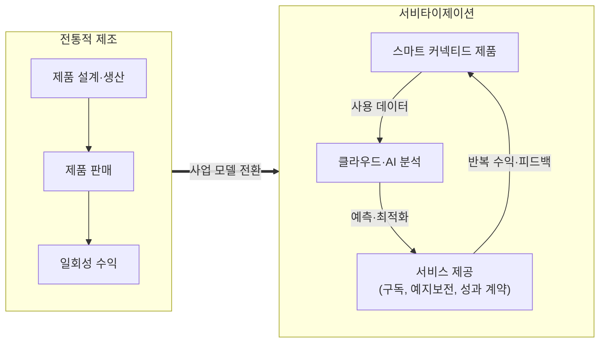

# 서비타이제이션 (Servitization)

---

## I. 제품 판매에서 성과 제공으로, 서비타이제이션의 개요

### 가. 정의

- 제조 기업이 제품에 **서비스를 결합하거나 제품 자체를 서비스로 제공(Product-as-a-Service)** 하여 고객 가치와 지속적 수익을 창출하는 사업 모델 전환 (Vandermerwe & Rada, 1988 명명)

### 나. 특징

| 구분 | 내용 |
| --- | --- |
| 가치 중심 이동 | 소유(Ownership) → 사용(Usage) → 결과(Result) |
| 수익 구조 | 일회성 판매 → 구독·사용량 기반 반복 수익 |
| 고객 관계 | 거래 중심 단기 관계 → 데이터 기반 장기 관계, 고객 고착(Lock-in) |
| 디지털 기반 | IoT·클라우드·AI로 제품 사용 데이터를 수집해 서비스화 |

---

## II. 서비타이제이션의 구조 및 구성요소

### 가. 개념도

- 제품에서 수집한 데이터를 분석해 예지보전·성과 보장 등 서비스를 제공하고, 그 피드백으로 제품을 개선하는 순환 구조

### 나. 구성요소

| 구분 | 요소 | 설명 |
| --- | --- | --- |
| 사업 유형 (PSS, Tukker 2004) | 제품 지향 (Product-oriented) | 소유권은 고객, 유지보수·소모품 등 부가 서비스 결합 |
| | 사용 지향 (Use-oriented) | 소유권은 제공자, 렌탈·리스·공유로 사용권만 제공 |
| | 결과 지향 (Result-oriented) | 성과에 과금 (예: 롤스로이스 Power by the Hour, 엔진 비행시간당 과금) |
| 기반 기술 | IoT | 장비 상태·사용 패턴 실시간 수집 |
| | 예지보전 (Predictive Maintenance) | 고장 징후 사전 탐지로 가동률 향상 |
| | [[디지털 트윈]] | 물리 자산의 가상 모델로 모니터링·시뮬레이션 |
| | 클라우드·[[XaaS]] | 대량 기기 데이터 처리와 서비스 배포 기반 |
| 과금 | 구독·사용량 과금 | 정액제 또는 Pay-per-use로 예측 가능한 현금 흐름 |

---

## III. 전통적 제조 비교 및 동향

### 가. 전통적 제조 vs 서비타이제이션

| 구분 | 전통적 제조 | 서비타이제이션 |
| --- | --- | --- |
| 가치 제안 | 제품 기능·품질 | 문제 해결, 가동률·성과 보장 |
| 소유권 | 고객 | 제공자 유지 (사용·결과 지향) |
| 수익 모델 | 판매 시점 일회성 수익 | 구독·렌탈·사용량 기반 반복 수익 |
| 핵심 역량 | 대량 생산, 원가 절감 | 데이터 분석, 서비스 운영, 고객 경험 |

### 나. 동향

- **XaaS 확산**: 모빌리티(MaaS), 로봇(Robot-as-a-Service), 배터리(BaaS) 등으로 서비스화 확장 ([[구독경제]])
- **서비타이제이션 역설**: 서비스 매출 확대에도 운영 비용 증가로 수익성이 떨어지는 사례가 있어 원가·과금 설계가 관건
- **데이터 보안**: 고객 현장 데이터 수집이 늘어 [[제로 트러스트 보안모델|제로 트러스트]] 적용과 개인정보 규제 준수 필요

---

### 🔗 연관 토픽

- **소속 도메인**: [[00_경영전략_MOC|📈 경영전략]]
- **세부 분류**: `1. 경영 환경 분석 & 전략 수립 프레임워크`
- **핵심 연관 토픽**:
  - [[디지털 트윈|디지털 트윈 (Digital Twin)]]
  - [[XaaS|XaaS(Everything as a Service)]]
  - [[구독경제|구독경제 (Subscription Economy)]]
  - [[유지보수]]
  - [[디지털 전환|디지털 전환(DX)]]
