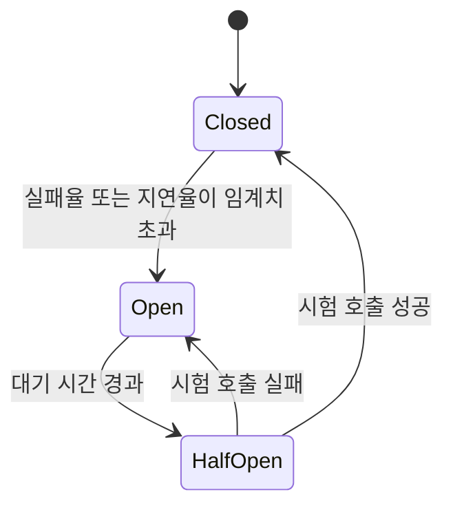

# 서킷 브레이커 (Circuit Breaker)

---

## I. 장애 전파를 끊는 차단기, 서킷 브레이커의 개요

### 가. 정의

- 원격 호출의 **실패율·지연이 임계치를 넘으면 호출을 차단(Open)하고 대체 응답(Fallback)을 반환해 연쇄 장애를 막는** 분산 시스템 회복성(Resilience) 패턴 (M. Nygard, *Release It!*)

### 나. 필요성 및 특징

| 구분 | 내용 |
| --- | --- |
| 등장 배경 | [[MSA (Micro Service Architecture)\|MSA]]에서 한 서비스의 지연이 스레드·커넥션 고갈로 전체에 전파 (Cascading Failure) |
| 빠른 실패 | 장애 서비스 호출을 즉시 실패시켜 자원 점유 방지 |
| 상태 머신 | Closed·Open·Half-Open 상태 전이로 트래픽 제어 |
| 자동 복구 | 대기 후 시험 호출로 회복을 확인해 자동 재개 |

---

## II. 상태 전이 및 구성요소

### 가. 상태 전이

- Closed에서 지표를 수집하다 임계치를 넘으면 Open으로 차단하고, 대기 후 Half-Open에서 일부 요청으로 회복을 확인

### 나. 구성요소

| 구분 | 요소 | 설명 |
| --- | --- | --- |
| 상태 | Closed (정상) | 요청을 그대로 전달하며 성공·실패 지표 수집 |
| | Open (차단) | 요청을 대상에 보내지 않고 즉시 실패 또는 Fallback |
| | Half-Open (시험) | 제한된 수의 요청만 통과시켜 복구 여부 확인 |
| 지표 | 슬라이딩 윈도우 | 최근 N건(Count) 또는 T초(Time) 호출 결과로 실패율 계산 |
| | 임계치 | 예: 실패율 50%, 느린 호출 비율 50% 초과 시 Open |
| 대응 | Fallback | 기본값·캐시 데이터·안내 메시지 등 대체 응답 |
| 연계 패턴 | [[Timeout]] · Retry · Bulkhead | 대기 시간 제한, 재시도, 자원 격리와 함께 적용 |
| 구현 | 애플리케이션 레벨 | Resilience4j (Netflix Hystrix는 2018년 유지보수 모드 전환) |
| | 인프라 레벨 | [[서비스 매쉬\|서비스 메시]](Istio·Envoy)의 커넥션 풀 제한·이상 호스트 제외(Outlier Detection) |

---

## III. 비교 및 동향

### 가. 애플리케이션 레벨 vs 인프라 레벨

| 비교 항목 | 애플리케이션 레벨 (Resilience4j) | 인프라 레벨 (Istio·Envoy) |
| --- | --- | --- |
| 적용 위치 | 코드 내부 (메서드 단위) | 사이드카 프록시 |
| 언어 종속 | 언어별 라이브러리 필요 | 언어 무관 (Polyglot) |
| Fallback | 비즈니스 맞춤 대체 응답 가능 | 주로 HTTP 503 등 오류 반환 |
| 설정 변경 | 코드 수정·재배포 | YAML 설정으로 동적 변경 |

### 나. 동향

- 인프라 레벨에서 연결 장애를 차단하고 애플리케이션 레벨에서 업무별 Fallback을 담당하는 이중 적용
- 트래픽 패턴에 따라 임계치를 동적으로 조정하는 적응형 서킷 브레이커·부하 차단(Load Shedding)
- Spring Cloud CircuitBreaker 같은 [[추상화]] 계층으로 구현 라이브러리 교체 용이

---

### 🔗 연관 토픽

- **소속 도메인**: [[00_소프트웨어공학_MOC|🏗️ 소프트웨어공학]]
- **세부 분류**: `2. 애자일(Agile) & 지속적 통합/배포(CI/CD)`
- **핵심 연관 토픽**:
  - [[MSA (Micro Service Architecture)]]
  - [[Timeout]]
  - [[서비스 매쉬|서비스 매쉬 (Service Mesh)]]
  - [[API Gateway]]
  - [[SRE (Site Reliability Engineering)]]
