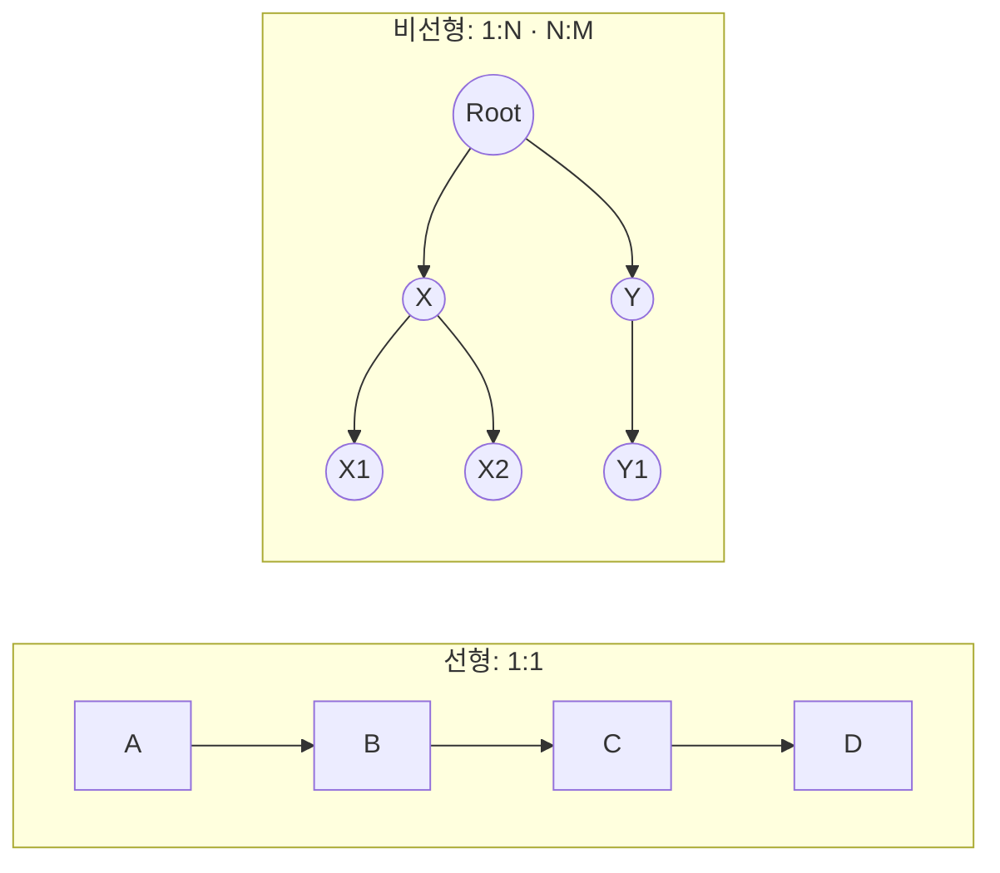

# 선형 자료구조와 비선형 자료구조

---

## I. 데이터 간 관계로 나눈, 선형·비선형 자료구조의 개요

### 가. 정의

- 데이터 원소 사이의 관계가 **일렬(1:1 전후 관계)이면 선형 자료구조, 계층(1:N)이나 망(N:M) 관계이면 비선형 자료구조**

### 나. 특징

| 구분 | 내용 |
| --- | --- |
| 선형 | 앞뒤 원소가 하나씩, 순차 순회, 구현 단순 |
| 비선형 | 한 원소가 여러 원소와 연결, 계층·네트워크 표현 |
| 선택 기준 | 접근 패턴(순차·임의·탐색), 삽입·삭제 빈도, 관계 구조 |

---

## II. 구조 및 구성요소

### 가. 구조 비교

- 선형은 하나의 경로로 끝까지 순회, 비선형은 여러 갈래의 경로를 DFS·BFS 등으로 탐색

### 나. 구성요소

| 구분 | 요소 | 설명 |
| --- | --- | --- |
| 선형 | [[배열]] | 연속 메모리, 인덱스로 O(1) 임의 접근 |
| | [[링크드 리스트\|연결 리스트]] | 포인터 연결, 위치를 알면 삽입·삭제 O(1) |
| | [[Stack]] | LIFO, 함수 호출·수식 계산·DFS |
| | [[Queue]] | [[FIFO]], 버퍼·작업 대기열·BFS, 덱(Deque) 포함 |
| 비선형 | 트리 | 1:N 계층, [[이진 탐색 트리]]·[[힙]]·[[AVL 트리]] |
| | 그래프 | N:M, 정점·간선(Edge), 인접 행렬·인접 리스트 표현 |
| 응용 | B+ 트리 | 디스크 기반 [[RDBMS 인덱스(index)\|RDBMS 인덱스]] |
| | 트라이 (Trie) | 문자열 접두사 검색, 자동 완성 |
| | HNSW | 계층형 근접 그래프, [[벡터 데이터베이스]]의 근사 최근접 탐색 |

---

## III. 비교 및 동향

### 가. 선형 vs 비선형

| 비교 항목 | 선형 | 비선형 |
| --- | --- | --- |
| 관계 | 1:1 | 1:N, N:M |
| 순회 | 단일 경로 순차 순회 | 전위·중위·후위, DFS·BFS |
| 탐색 | O(n) (정렬 배열 이진 탐색은 O(log n)) | 균형 트리 O(log n), 그래프 O(V+E) |
| 구현 | 단순 | 재귀·포인터로 복잡 |
| 활용 | 버퍼, Undo(스택), 작업 큐 | 인덱스, 라우팅, 소셜 네트워크 |

### 나. 동향

- **벡터 검색용 그래프**: RAG 등에서 HNSW 그래프 인덱스가 [[벡터 데이터베이스]]의 주된 탐색 구조로 사용
- **그래프 DB·지식 그래프**: Neo4j 등 속성 그래프로 추천·이상거래 탐지(FDS) 활용
- **캐시 친화 구조**: 포인터 기반 트리를 배열 기반 암시적 트리·B-트리 계열로 바꿔 [[지역성]] 향상

---

### 🔗 연관 토픽

- **소속 도메인**: [[00_컴퓨터구조_MOC|💻 컴퓨터구조]]
- **세부 분류**: `2. 캐시 & 메모리 계층 구조 · 스토리지`
- **핵심 연관 토픽**:
  - [[배열]]
  - [[링크드 리스트|링크드 리스트(Linked List)]]
  - [[Stack]]
  - [[Queue]]
  - [[그래프 순회|그래프 순회 (Graph Traversal)]]
