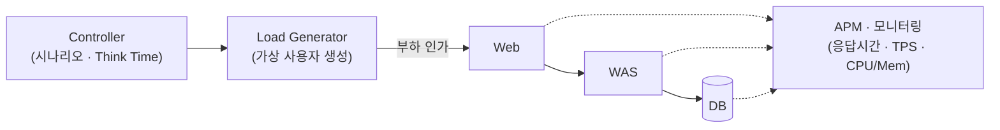

# 성능 테스트 (Performance Testing)

---

## I. 부하 속에서의 응답과 처리량 검증, 성능 테스트의 개요

### 가. 정의

- 시스템에 **목표 부하를 인가해 [[응답시간]]·[[처리량]]·자원 사용률 등 성능 요구사항 충족 여부와 병목을 검증**하는 비기능 테스트

### 나. 필요성

| 구분 | 내용 |
| --- | --- |
| 장애 예방 | 이벤트·트래픽 급증 시 서비스 중단 사전 차단 |
| 병목 식별 | 웹·WAS·DB 등 구간별 지연 원인 규명 |
| 용량 계획 | 증설 규모·오토스케일링 임계치 산정 근거 |
| 요구 검증 | [[소프트웨어 품질 속성 시나리오\|품질 속성 시나리오]]의 성능 목표 확인 |

---

## II. 수행 구조 및 구성요소

### 가. 수행 구조

- 컨트롤러가 부하 생성기로 가상 사용자 트래픽을 만들고, APM으로 계층별 응답시간과 자원을 수집해 병목 분석

### 나. 구성요소

| 구분 | 요소 | 설명 |
| --- | --- | --- |
| 지표 | TPS | 초당 처리 트랜잭션 수 (처리 용량) |
| | 응답시간 | 요청부터 응답 완료까지의 시간 (평균보다 95·99 백분위 중시) |
| | 자원 사용률 | CPU·메모리·I/O·커넥션 풀 사용량 |
| 유형 | 부하 테스트 (Load) | 목표·최대 예상 부하에서 정상 동작 확인 |
| | 스트레스 테스트 (Stress) | 한계 초과 부하로 임계점과 장애·복구 동작 확인 |
| | 스파이크 테스트 (Spike) | 순간 폭증 트래픽 대응 확인 |
| | 내구성 테스트 (Soak) | 장시간 부하로 메모리 누수·자원 고갈 확인 |
| 수행 요소 | 가상 사용자 (VU) | 사용자 행위를 스크립트로 재현 |
| | Think Time · Pacing | 사용자 대기 시간과 반복 간격으로 현실성 부여 |

---

## III. 비교 및 동향

### 가. 전통적 성능 테스트 vs 지속적 성능 테스트

| 비교 항목 | 전통적 | 지속적 (Shift-Left) |
| --- | --- | --- |
| 수행 시점 | 오픈 직전 통합 완료 후 | CI/CD 파이프라인에서 상시 |
| 도구 | LoadRunner, JMeter (GUI 중심) | k6, Gatling, Locust (코드 기반) |
| 환경 | 운영 유사 전용 환경 | 필요 시 [[컨테이너]] 환경 동적 생성 |
| 목적 | 최종 성능 목표 충족 확인 | 코드 변경에 따른 성능 회귀 조기 발견 |

### 나. 동향

- 성능 베이스라인을 학습해 이상 지연과 원인을 자동 추정하는 AIOps
- 부하와 장애 주입을 함께 수행하는 [[카오스 엔지니어링]]으로 회복력까지 검증
- 운영 트래픽을 복제·재생하는 섀도 테스트 활용

---

### 🔗 연관 토픽

- **소속 도메인**: [[00_소프트웨어공학_MOC|🏗️ 소프트웨어공학]]
- **세부 분류**: `3. 요구사항 공학 & UML 객체지향 분석/설계`
- **핵심 연관 토픽**:
  - [[성능 테스트 도구]]
  - [[응답시간]]
  - [[시스템 테스트]]
  - [[소프트웨어 품질 속성 시나리오]]
  - [[카오스 엔지니어링|카오스 엔지니어링 (Chaos Engineering)]]
