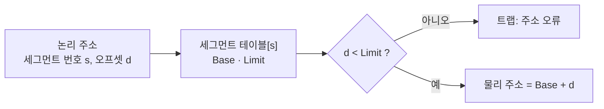

# 세그멘테이션 (Segmentation)

---

## I. 논리 단위로 나누는 메모리 관리, 세그멘테이션의 개요

### 가. 정의

- 프로그램을 **코드·데이터·스택 등 논리적 의미 단위(세그먼트)의 가변 크기로 나누어** 메모리에 적재하고, 세그먼트 테이블로 주소를 변환하는 [[메모리 관리]] 기법

### 나. 특징

| 구분 | 내용 |
| --- | --- |
| 사용자 관점 | 프로그래머가 보는 논리 구조와 일치 |
| 보호·공유 | 세그먼트 단위로 읽기·쓰기·실행 권한 부여, 코드 세그먼트 공유 용이 |
| 외부 [[단편화]] | 가변 크기 할당과 해제 반복으로 빈 공간이 흩어짐 |
| 한계 검사 | 오프셋이 세그먼트 크기를 넘으면 트랩 |

---

## II. 주소 변환 및 구성요소

### 가. 주소 변환

- 예: 세그먼트 1의 Base 2500, Limit 400이면 (1, 100) → 2600, (1, 500) → 트랩

### 나. 구성요소

| 구분 | 요소 | 설명 |
| --- | --- | --- |
| 주소 | [[논리 주소]] (s, d) | 세그먼트 번호 + 세그먼트 내 오프셋 |
| 매핑 | 세그먼트 테이블 | 세그먼트별 Base(시작 [[물리 주소]]), Limit(길이), 보호 비트 |
| 레지스터 | STBR | 세그먼트 테이블의 메모리 위치 |
| | STLR | 세그먼트 개수, s ≥ STLR이면 오류 |
| 보호 | 보호 비트 | 읽기·쓰기·실행 권한 |
| 단편화 대책 | 통합·압축 (Compaction) | 인접 빈 공간 합치기, 사용 중 영역을 한쪽으로 이동 |
| 배치 | First / Best / Worst-fit | 가변 크기 빈 공간 중 적재 위치 선택 |

---

## III. 비교 및 동향

### 가. 세그멘테이션 vs 페이징

| 비교 항목 | 세그멘테이션 | 페이징 |
| --- | --- | --- |
| 분할 | 가변 크기, 논리 단위 | 고정 크기 |
| 단편화 | 외부 단편화 | 내부 단편화 |
| 테이블 항목 | Base + Limit | 프레임 번호 |
| 보호·공유 | 논리 단위라 용이 | 페이지 단위라 상대적으로 복잡 |
| 빈 공간 관리 | 배치 알고리즘 필요, 복잡 | 빈 프레임 목록으로 단순 |

### 나. 동향

- **페이지드 세그멘테이션**: 세그먼트를 다시 페이지로 나눠 보호·공유 이점과 외부 단편화 제거를 함께 얻는 방식 (MULTICS, x86 32비트 보호 모드)
- **현대 OS는 페이징 중심**: x86-64 롱 모드에서는 세그먼트를 사실상 쓰지 않는 Flat 모델이며(FS·GS는 스레드 로컬 저장용), 보호는 페이지 권한 비트로 처리

---

### 🔗 연관 토픽

- **소속 도메인**: [[00_컴퓨터구조_MOC|💻 컴퓨터구조]]
- **세부 분류**: `2. 캐시 & 메모리 계층 구조 · 스토리지`
- **핵심 연관 토픽**:
  - [[메모리 관리]]
  - [[가상 메모리]]
  - [[단편화|메모리 단편화 (Fragmentation)]]
  - [[물리 주소]]
  - [[MMU(Memory Management Unit)]]
