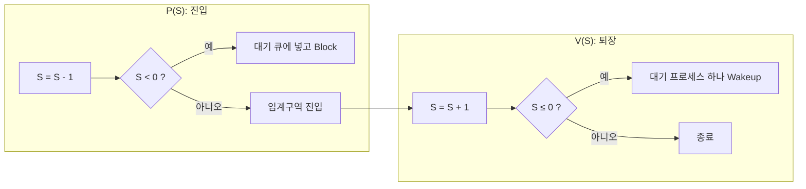

# 세마포어 (Semaphore)

---

## I. 정수와 두 연산으로 동시성을 제어하는, 세마포어의 개요

### 가. 정의

- **정수 변수 S와 원자적 연산 P(wait)·V(signal)로 공유 자원 접근을 제어**해 상호배제와 프로세스 간 동기화를 구현하는 [[OS(운영체제)|운영체제]] 기법 (E. W. Dijkstra, 1965)

### 나. 특징

| 구분 | 내용 |
| --- | --- |
| Block & Wakeup | 자원이 없으면 대기 큐에서 잠들어 바쁜 대기(Busy Waiting) 회피 |
| 계수 제어 | 자원 1개(이진) 또는 N개(계수) 접근 제어 |
| 원자성 | P·V는 중간에 끊기지 않는 연산으로 [[커널]]이 보장 |
| 순서 동기화 | 초기값 0 세마포어로 "A 다음 B" 같은 실행 순서 제어 |

---

## II. 동작 및 구성요소

### 가. P·V 연산 동작

- 이 구현에서 S가 음수면 그 절댓값이 대기 중인 [[프로세스]] 수

### 나. 구성요소

| 구분 | 요소 | 설명 |
| --- | --- | --- |
| 변수 | S | 사용 가능한 자원 수 (초기값 = 자원 개수) |
| 연산 | P (Proberen, wait·down) | S 감소, 자원이 없으면 대기 |
| | V (Verhogen, signal·up) | S 증가, 대기 프로세스가 있으면 깨움 |
| 유형 | 이진 세마포어 | 0·1만 사용, 상호배제용 |
| | 계수 세마포어 | 0 이상 정수, 같은 자원 N개 관리 (예: 연결 풀) |
| 대기 구조 | 대기 [[Queue]] | Block된 프로세스의 PCB([[PCB(Process Control Block)\|Process Control Block]]) 목록 |
| 원자성 보장 | 하드웨어 지원 | 인터럽트 금지(단일 코어), Test-and-Set·CAS 명령(멀티코어) |
| 응용 | 고전 동기화 문제 | 생산자-소비자, 읽기-쓰기, 식사하는 철학자 |

---

## III. 비교 및 동향

### 가. 세마포어 vs 뮤텍스

| 비교 항목 | 세마포어 | 뮤텍스 |
| --- | --- | --- |
| 자원 수 | 1개 또는 N개 | 1개 |
| 소유권 | 없음 (다른 스레드가 V 가능) | 있음 (잠근 스레드만 해제) |
| 목적 | 상호배제 + 실행 순서 동기화(신호) | 상호배제(잠금) |
| 문제 | [[교착상태]], [[우선순위 역전현상]] | 교착상태, 우선순위 역전 (우선순위 상속으로 완화) |

### 나. 동향

- **Futex**: Linux는 경합이 없으면 사용자 공간에서 원자 연산으로 처리하고, 경합 시에만 커널에서 대기하는 Futex 위에 뮤텍스·세마포어 구현
- **Lock-free 자료구조**: CAS 기반 비차단 큐·맵으로 문맥 교환 비용 회피
- **스핀락 혼용**: 짧은 임계구역의 멀티코어 커널 코드는 [[스핀락]]이 Block·Wakeup보다 유리해 상황별 혼용

---

### 🔗 연관 토픽

- **소속 도메인**: [[00_컴퓨터구조_MOC|💻 컴퓨터구조]]
- **세부 분류**: `3. 고성능 AI 가속기 & 입출력 시스템`
- **핵심 연관 토픽**:
  - [[우선순위 역전현상]]
  - [[스핀락|스핀락 (Spin Lock)]]
  - [[교착상태]]
  - [[프로세스]]
  - [[OS(운영체제)]]
