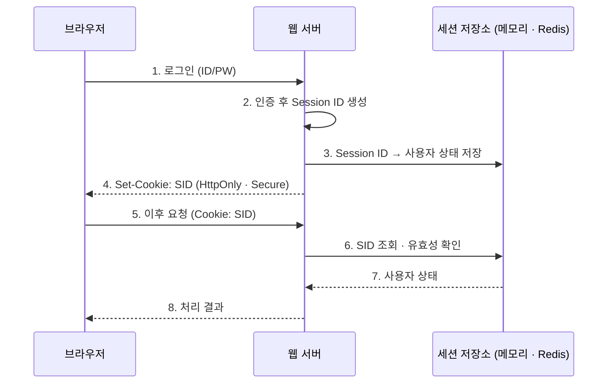

# 세션 (Session)

---

## I. 상태 없는 HTTP에 상태를 더하는, 세션의 개요

### 가. 정의

- 무상태(Stateless)인 HTTP에서 **사용자 상태를 서버에 저장하고, 서버가 발급한 Session ID로 요청마다 사용자를 식별**하는 상태 관리 방식

### 나. 특징

| 구분 | 내용 |
| --- | --- |
| 등장 배경 | 로그인 유지, 장바구니 등 여러 요청에 걸친 상태 유지 필요 |
| 서버 저장 | 민감 정보는 서버에 두고 클라이언트는 ID만 보관 |
| 전달 수단 | 주로 [[쿠키]](Set-Cookie / Cookie 헤더) |
| Stateful | 접속자 수에 비례해 서버 메모리 사용, Scale-out 시 세션 공유 필요 |
| 즉시 무효화 | 서버에서 세션 삭제로 강제 로그아웃 가능 |

---

## II. 동작 구조 및 구성요소

### 가. 세션 인증 흐름

- 서버가 추측 불가능한 Session ID를 만들어 쿠키로 내려주고, 이후 요청의 쿠키로 저장소에서 상태를 찾음

### 나. 구성요소 및 보안

| 구분 | 요소 | 설명 |
| --- | --- | --- |
| 식별 | Session ID | 서버가 발급하는 난수 식별자 (JSESSIONID, PHPSESSID) |
| 저장 | 세션 저장소 | WAS 메모리, 파일, Redis·Memcached |
| 분산 | 세션 클러스터링 · Sticky Session | 서버 간 세션 복제, 또는 같은 서버로 요청 고정 |
| 생명주기 | Timeout · 로그아웃 | 일정 시간 미사용 시 만료, 로그아웃 시 서버 측 삭제 |
| 위협 | 세션 하이재킹 | 스니핑·[[XSS]]로 Session ID 탈취 후 도용 |
| | 세션 고정 (Fixation) | 공격자가 미리 받은 ID를 피해자에게 쓰게 한 뒤 로그인 후 도용 |
| 대응 | HttpOnly · Secure · SameSite | 스크립트 접근 차단, HTTPS 전용 전송, [[CSRF]] 완화 |
| | 로그인 시 ID 재발급 | 인증 성공 시 새 Session ID 발급으로 고정 공격 차단 |

---

## III. 비교 및 동향

### 가. 세션 vs 토큰(JWT)

| 비교 항목 | 세션 | JWT ([[JSON]] Web Token) |
| --- | --- | --- |
| 상태 | Stateful (서버 저장) | Stateless (토큰에 클레임 포함, 서명 검증) |
| 저장 위치 | 서버 저장소, 클라이언트는 ID만 | 클라이언트 (쿠키, Storage) |
| 확장성 | 세션 공유 필요 | 서버 간 공유 불필요, [[MSA (Micro Service Architecture)\|MSA]]에 유리 |
| 무효화 | 서버 삭제로 즉시 | 만료 전 폐기 어려움 (블랙리스트·짧은 만료 필요) |
| 전송 크기 | 작음 (ID) | 큼 (Header·Payload·Signature) |

### 나. 동향

- **세션 외부화**: [[클라우드 네이티브]] 환경에서 Redis 등 외부 저장소에 세션을 두어 WAS를 무상태로 운영
- **하이브리드 인증**: 외부에는 Opaque Token, [[API Gateway]] 내부에서는 JWT로 변환해 무효화와 확장성을 함께 확보
- **쿠키 정책 강화**: 브라우저의 SameSite 기본값(Lax) 적용, 서드파티 쿠키 제한

---

### 🔗 연관 토픽

- **소속 도메인**: [[00_네트워크_MOC|🌐 네트워크]]
- **세부 분류**: `1. OSI 7계층 & 데이터링크 계층 (L1/L2)`
- **핵심 연관 토픽**:
  - [[쿠키]]
  - [[Session Layer|세션 계층 (OSI 5계층)]]
  - [[XSS]]
  - [[CSRF]]
  - [[스위치 (Layer 7 Switch)]]
