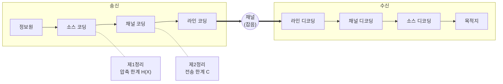

# 소스코딩, 채널코딩, 라인코딩과 샤논 정리

---

## I. 압축과 전송의 한계를 정한, 샤논 정리의 개요

### 가. 정의

- **샤논 정리**: 무손실 압축의 한계는 엔트로피(소스 코딩 정리), 오류 없이 보낼 수 있는 최대 전송률은 채널 용량(채널 코딩 정리)임을 증명한 정보 이론의 기본 정리 (C. Shannon, 1948)
- **3대 코딩**: 이 한계에 다가가기 위해 효율(소스), 신뢰성(채널), 매체 적합성(라인)을 확보하는 부호화 단계 (처리 흐름은 [[전송부호화]] 참고)

### 나. 특징

| 구분 | 내용 |
| --- | --- |
| 제1정리 (소스 코딩) | 평균 부호 길이 L ≥ H(X), 엔트로피보다 짧게 무손실 압축 불가 |
| 제2정리 (채널 코딩) | 전송률 R < C이면 오류 확률을 임의로 작게 하는 부호 존재, R > C면 불가 |
| 섀넌-하틀리 정리 | AWGN 채널 용량 C = B·log2(1 + S/N) |
| 분리 정리 | 소스 코딩과 채널 코딩을 따로 최적화해도 (긴 부호 길이에서) 최적 달성 |
| 라인 코딩 | 샤논 정리보다 매체 특성(DC 성분, 동기, 대역)과 나이퀴스트 기준에 관련 |

---

## II. 구조 및 구성요소

### 가. 통신 시스템과 정리의 대응

- 소스 코딩은 엔트로피까지 잉여성을 줄이고, 채널 코딩은 채널 용량 이하에서 잉여 비트를 더해 오류를 정정

### 나. 구성요소

| 구분 | 요소 | 설명 |
| --- | --- | --- |
| 이론 | 엔트로피 H(X) | 정보원의 평균 정보량, H = −Σ p·log2 p (비트/심볼) |
| | 채널 용량 C | 채널이 오류 없이 전달할 수 있는 최대 전송률 |
| | 나이퀴스트 한계 | 무잡음 채널 최대 심볼 속도 2B, 전송률 2B·log2 M |
| 소스 코딩 | 무손실 | 허프만, 산술 부호화, 런렝스, LZW |
| | 손실 | JPEG, MP3, H.265/HEVC, VVC |
| 채널 코딩 | 블록 · 컨볼루션 | 해밍, Reed-Solomon, 컨볼루션 부호 |
| | 용량 근접 부호 | Turbo(3G·4G), LDPC(5G 데이터), Polar(5G 제어) |
| 라인 코딩 | 기저대역 파형 | NRZ, RZ, AMI, 맨체스터, CMI |
| | 다중 레벨 | PAM4 (심볼당 2비트, 400G·800G 이더넷) |

---

## III. 비교 및 동향

### 가. 3대 코딩 비교

| 비교 항목 | 소스 코딩 | 채널 코딩 | 라인 코딩 |
| --- | --- | --- | --- |
| 목적 | 효율 (압축) | 신뢰성 (오류 정정) | 매체 전송 적합성 |
| 잉여성 | 제거 | 추가 | 파형 특성 부여 |
| 관련 이론 | 샤논 제1정리 | 샤논 제2정리 | 나이퀴스트, 스펙트럼 특성 |
| 주 위치 | 응용·표현 (코덱) | 물리 계층 (FEC) | 물리 계층 |
| 대표 기술 | HEVC, VVC, MP3 | Reed-Solomon, LDPC, Polar | AMI, 맨체스터, PAM4 |

### 나. 동향

- **용량 근접 부호 실용화**: LDPC·Polar로 5G가 섀넌 한계에 근접, 6G는 더 높은 처리량·저지연 복호 연구
- **JSCC·시맨틱 통신**: 분리 정리가 성립하지 않는 짧은 블록·저지연 환경에서 [[딥러닝]]으로 소스·채널 코딩을 결합
- **고속 링크**: AI 클러스터의 800G·1.6T 광 링크에서 PAM4와 강한 FEC 조합이 표준

---

### 🔗 연관 토픽

- **소속 도메인**: [[00_네트워크_MOC|🌐 네트워크]]
- **세부 분류**: `3. 전송 계층 & 트래픽 / 혼잡 제어 (L4)`
- **핵심 연관 토픽**:
  - [[전송부호화]]
  - [[FEC(Forward Error Correction) BEC(Backward Error Correction)]]
  - [[PCM(Pulse-Code Modulation)]]
  - [[QAM(Quadrature Amplitude Modulation)--|QAM]]
  - [[해밍코드]]
