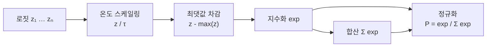

# 소프트맥스 정규화 (Softmax Normalization)

---

## I. 점수를 확률로 바꾸는, 소프트맥스의 개요

### 가. 정의

- 실수 벡터(로짓)를 지수화한 뒤 전체 합으로 나누어 **각 원소가 0~1이고 합이 1인 확률 분포로 변환**하는 함수, $P_i = \frac{e^{z_i}}{\sum_j e^{z_j}}$

### 나. 필요성 및 특징

| 구분 | 내용 |
| --- | --- |
| 확률 해석 | 다중 클래스 분류 출력, 어텐션 가중치 산출 |
| 미분 가능 | argmax의 매끄러운 근사(soft-argmax), 크로스 엔트로피와 결합 시 기울기가 $P - y$로 단순 |
| 상대 강조 | 지수 함수로 큰 값은 더 크게, 작은 값은 0에 가깝게 |
| 이동 불변 | 모든 입력에 같은 상수를 더해도 결과 동일 (수치 안정화의 근거) |

---

## II. 연산 흐름 및 핵심 요소

### 가. 연산 흐름

- 지수 오버플로를 막기 위해 최댓값을 빼고 계산 (Safe Softmax), 온도 τ로 분포의 뾰족함 조절

### 나. 핵심 요소

| 구분 | 요소 | 설명 |
| --- | --- | --- |
| 기본 | Softmax | $P_i = e^{z_i} / \sum_j e^{z_j}$ |
| 수치 안정 | Safe Softmax | $e^{z_i - z_{max}}$로 계산, 손실 계산은 LogSumExp로 log-softmax 직접 산출 |
| 분포 제어 | Temperature | τ > 1이면 완만(다양성↑), τ < 1이면 뾰족(결정적), τ → 0이면 argmax |
| 손실 | 크로스 엔트로피 | 소프트맥스 출력과 원-핫 정답의 음의 로그 우도 |
| 메모리 최적화 | Online Softmax | 최댓값과 합을 블록 단위로 점진 갱신해 한 번의 패스로 계산 |
| 가속 | FlashAttention | $QK^T$·Softmax·$V$ 곱을 타일 단위로 SRAM에서 융합 연산 |
| 하드웨어 | 지수 근사 | [[NPU]]에서 LUT·다항 근사로 exp 연산 비용 절감 |
| 변형 | Sparsemax | 일부 출력을 정확히 0으로 만드는 희소 확률 분포 |

---

## III. 비교 및 동향

### 가. 표준 어텐션 vs FlashAttention의 소프트맥스 처리

| 비교 항목 | 표준 구현 | FlashAttention (Online Softmax) |
| --- | --- | --- |
| 메모리 접근 | $N \times N$ 점수 행렬을 HBM에 쓰고 다시 읽음 | 타일을 SRAM에서 처리, 점수 행렬을 저장하지 않음 |
| 추가 메모리 | $O(N^2)$ | $O(N)$ |
| 병목 | 메모리 대역폭 | 연산 위주로 전환 |
| 결과 | 정확 계산 | 정확 계산 (근사 아님) |
| 적용 | 초기 Transformer 구현 | 현행 LLM 학습·추론 라이브러리 기본 |

### 나. 동향

- **생성 다양성 제어**: LLM 서비스는 Temperature와 Top-k·Top-p를 함께 조절해 창작형·사실형 응답 성향을 조정
- **어텐션 커널 최적화**: FlashAttention-2·3(Hopper GPU 최적화) 등으로 긴 컨텍스트 학습·추론 비용 절감 ([[어텐션 메커니즘]])

---

### 🔗 연관 토픽

- **소속 도메인**: [[00_인공지능_MOC|🤖 인공지능]]
- **세부 분류**: `1. 수학 · 통계학 & 데이터 전처리`
- **핵심 연관 토픽**:
  - [[활성화함수|활성화함수(Activation Function)]]
  - [[손실함수]]
  - [[어텐션 메커니즘|어텐션 메커니즘(Attention Mechanism)]]
  - [[로지스틱회귀분석]]
  - [[트랜스포머|트랜스포머(Transformer)]]
