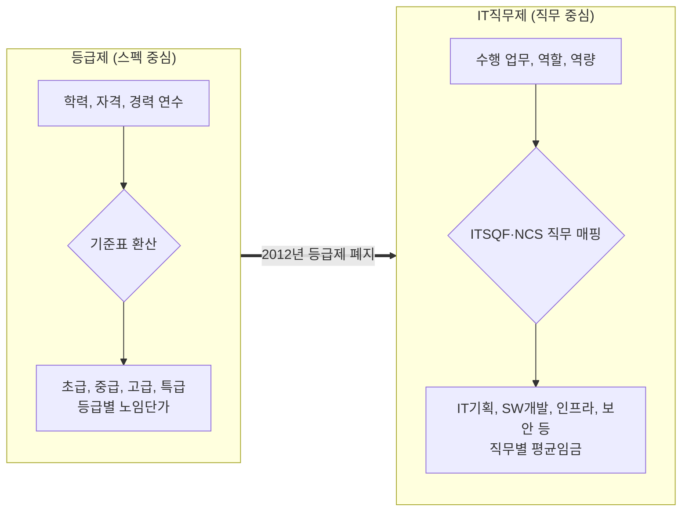

# 소프트웨어 기술자 등급제와 IT직무제

---

## I. 스펙에서 직무로, 기술자 등급제와 IT직무제의 개요

### 가. 정의

- **SW 기술자 등급제**: 학력·자격·경력을 환산해 기술자를 **초급·중급·고급·특급**으로 나누고 등급별 노임단가로 대가를 산정하던 제도 (2012년 폐지)
- **IT직무제**: ITSQF(IT분야 역량체계)·NCS를 바탕으로 기술자가 **수행하는 직무와 역량 수준**에 따라 평가·대가를 산정하는 체계

### 나. 전환 배경 및 특징

| 구분 | 내용 |
| --- | --- |
| 등급제 한계 | 실무 능력과 괴리, 학력·자격 중심 차별, 경력 부풀리기 |
| 제도 변화 | 2012년 SW산업진흥법 개정으로 등급제 폐지, 경력 신고·관리 제도는 유지 |
| 대가 기준 | KOSA가 매년 SW기술자 임금실태조사로 직무별 평균임금 공표 |
| 관점 전환 | '누구인가(Who)'에서 '무엇을 하는가(What)'로 |

---

## II. 전환 구조와 구성요소

### 가. 개념도

- 스펙을 기계적으로 환산하던 방식에서 프로젝트 내 실제 역할 기준으로 대가를 산정하는 방식으로 전환

### 나. 구성요소

| 구분 | 요소 | 설명 |
| --- | --- | --- |
| 기준 체계 | ITSQF | IT 산업 직무를 능력 단위·수준별로 체계화한 역량체계 |
| | NCS 연계 | 직무별 지식·기술·태도 기준을 국가직무능력표준과 연결 |
| 직무 분류 | SW 직무 | IT기획, 컨설팅, 아키텍트, 개발, UI/UX, 품질, 보안, 운영 등 |
| 대가 산정 | 직무별 평균임금 | KOSA 임금실태조사로 공표, 투입 공수 방식 대가 산정에 활용 |
| | [[SW사업 대가산정 가이드]] | 기능점수·투입공수 방식 등 공공 SW사업 대가 산정 기준 |
| 경력 관리 | SW기술자 경력관리 | KOSA 경력 신고·확인서 발급 |
| | 경력개발경로 (CDP) | 직무 전문성 심화·전환 경로 제시 |

---

## III. 비교 및 동향

### 가. 등급제 vs IT직무제

| 비교 항목 | 기술자 등급제 | IT직무제 |
| --- | --- | --- |
| 평가 기준 | 학력, 자격, 경력 | 수행 직무, 역량 |
| 분류 | 초·중·고·특급 | 직무별 세분 |
| 대가 산정 | 등급별 단가 × 투입 기간 | 직무별 평균임금 기반 |
| 장점 | 산정이 단순 | 실무 역할·전문성 반영 |
| 한계 | 실무 능력 미반영 | 발주 현장에 '고급 N명' 식 등급 관행 잔존 |

### 나. 동향

- **신규 직무 반영**: AI 엔지니어, 데이터 엔지니어, 클라우드 아키텍트 등 신기술 직무를 역량체계·임금 조사에 추가
- **발주 관행 개선**: 제안요청서의 등급 기반 인력 요구를 줄이고 직무·역할 기반 제안·평가로 전환
- **역량 검증 다양화**: 코딩 테스트, 포트폴리오, 수행 이력 중심 검증 확산

---

### 🔗 연관 토픽

- **소속 도메인**: [[00_프로젝트관리_MOC|📋 프로젝트관리]]
- **세부 분류**: `3. 소프트웨어 원가 산정 & 성과 관리 (Cost & EVM)`
- **핵심 연관 토픽**:
  - [[SW사업 대가산정 가이드]]
  - [[SW 규모산정]]
  - [[비용산정 일정관리 모델]]
  - [[공공소프트웨어사업 과업심의 가이드]]
  - [[경제성 분석 기법]]
