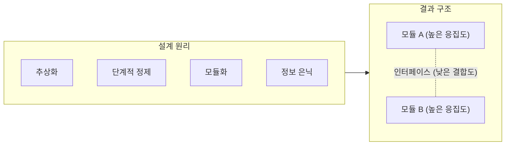

# 소프트웨어 설계의 원리

---

## I. 복잡도를 다루는 설계 지침, 소프트웨어 설계 원리의 개요

### 가. 정의

- 요구사항을 만족하는 소프트웨어 구조를 만들 때 **복잡도를 통제하고 변경에 강하게 하기 위한 추상화·모듈화·정보은닉·단계적 정제 등의 기본 원칙**

### 나. 필요성

| 구분 | 내용 |
| --- | --- |
| 복잡도 통제 | 분할 정복으로 큰 문제를 다룰 수 있는 크기로 축소 |
| 변경 대응 | 변경 영향을 모듈 안으로 국소화 |
| 품질 확보 | 이해·테스트·유지보수가 쉬운 구조 |
| 재사용 | 독립 모듈을 다른 시스템에 재활용 |

---

## II. 원리 구조 및 구성요소

### 가. 원리와 결과 구조

- 추상화와 단계적 정제로 문제를 나누고, 모듈화와 정보 은닉으로 모듈 내부는 응집도를 높이고 모듈 간 결합도는 낮춤

### 나. 구성요소

| 구분 | 요소 | 설명 |
| --- | --- | --- |
| 분해 | [[추상화]] | 본질만 추출 (과정·데이터·제어 추상화) |
| | 단계적 정제 | 추상 수준에서 구체 수준으로 하향식 상세화 (Wirth) |
| | [[모듈화]] | 시스템을 독립 단위로 분할 |
| 은닉 | [[정보은닉]] | 변경될 설계 결정을 모듈 내부에 숨기고 인터페이스만 공개 (Parnas) |
| 평가 척도 | [[결합도]] | 모듈 간 의존 정도, 낮을수록 좋음 (자료 < 스탬프 < 제어 < 외부 < 공통 < 내용) |
| | [[응집도]] | 모듈 내부 관련성, 높을수록 좋음 (기능 > 순차 > 교환 > 절차 > 시간 > 논리 > 우연) |
| 객체지향 | [[객체지향 설계 원리\|SOLID]] | SRP·OCP·LSP·ISP·DIP |
| 생산성 | [[재사용]] | 검증된 모듈·컴포넌트 활용 |

---

## III. 비교 및 동향

### 가. 전통적 설계 vs 클라우드 네이티브 설계

| 비교 항목 | 전통적 (구조적 · 객체지향) | 클라우드 네이티브 (MSA) |
| --- | --- | --- |
| 모듈 단위 | 함수·클래스·컴포넌트 | 독립 배포 서비스 |
| 통신 | 프로세스 내부 호출 | REST·gRPC·메시지 |
| 결합도 관리 | 코드 의존성 | API 계약, 서비스별 DB 분리 |
| 응집 기준 | 기능·데이터 | 도메인 경계 (Bounded Context) |

### 나. 동향

- [[DDD (Domain Driven Design)|DDD]]로 도메인 단위 응집과 [[MSA (Micro Service Architecture)|MSA]] 경계 설계
- 설계 단계부터 [[위협 모델링]]을 적용하는 Secure by Design
- 아키텍처 피트니스 함수로 결합도 규칙 위반을 자동 검출

---

### 🔗 연관 토픽

- **소속 도메인**: [[00_소프트웨어공학_MOC|🏗️ 소프트웨어공학]]
- **세부 분류**: `3. 요구사항 공학 & UML 객체지향 분석/설계`
- **핵심 연관 토픽**:
  - [[모듈화|모듈화 (Modularity)]]
  - [[결합도]]
  - [[응집도]]
  - [[정보은닉|정보은닉 (Information Hiding)]]
  - [[객체지향 설계 원리]]
