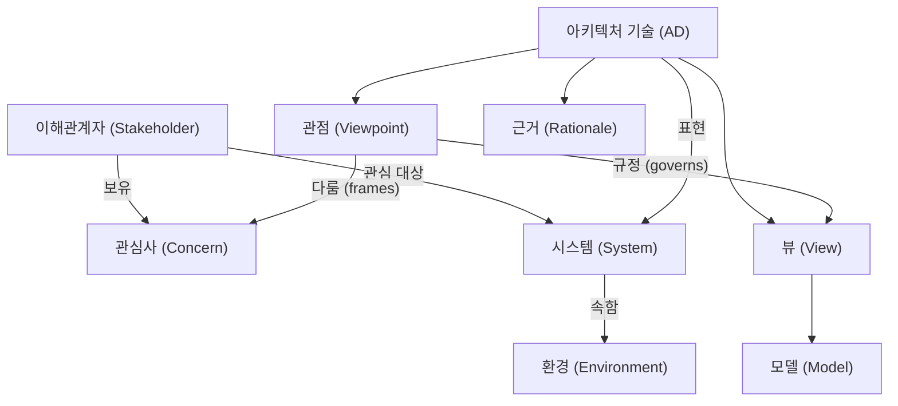

# 소프트웨어 아키텍처 (Software Architecture)

---

## I. 품질 속성을 결정하는 초기 설계, 소프트웨어 아키텍처의 개요

### 가. 정의

- 시스템을 구성하는 **컴포넌트, 컴포넌트 간 관계(커넥터), 환경과의 관계, 그리고 설계·진화를 이끄는 원칙**으로 표현한 시스템의 근본 구조 ([[ISO IEC IEEE 42010 2022|ISO/IEC/IEEE 42010]])

### 나. 역할

| 구분 | 내용 |
| --- | --- |
| 의사소통 | 다양한 이해관계자 간 합의를 위한 공통 표현 |
| 초기 설계 결정 | 성능·[[HA(High Availability)\|가용성]]·보안 등 비기능 요구 달성 여부를 좌우 |
| 재사용 · 제약 | 패턴·[[프레임워크]] 재사용 기반, 하위 설계·구현에 구조적 제약 부여 |
| 평가 기준 | [[ATAM]] 등으로 구현 전에 품질 속성 충족 여부 검증 |

---

## II. 아키텍처 기술 메타모델 및 구성요소

### 가. 아키텍처 기술(AD) 메타모델

- 이해관계자의 관심사를 식별하고, 관심사를 다루는 관점(Viewpoint)의 규칙에 따라 뷰(View)와 모델을 작성해 시스템 구조를 기술 (42010:2022에서는 System을 '관심 대상 엔터티', Model을 '뷰 컴포넌트'로 일반화)

### 나. 구성요소

| 구분 | 요소 | 설명 |
| --- | --- | --- |
| 개념 요소 | 이해관계자 | 사용자·개발자·운영자 등 시스템에 이해관계를 가진 개인·조직 |
| | 관심사 | 성능·보안·유지보수성 등 이해관계자가 중시하는 사항 |
| 기술 요소 | 관점 (Viewpoint) | 특정 관심사를 다루는 뷰 작성 규칙·표기법 (예: [[UML의 4+1 View Model\|4+1 뷰]]의 논리·물리 관점) |
| | 뷰 (View) | 관점에 따라 시스템을 표현한 결과물 (예: 배치도, [[클래스 다이어그램]]) |
| 구조 요소 | 컴포넌트 | 인터페이스를 가진 독립 실행·배포 단위 |
| | 커넥터 | 컴포넌트 간 데이터·제어 흐름, [[프로토콜]] 등 상호작용 [[추상화]] |
| 설계 근거 | 품질 속성 | 가용성·확장성·보안성 등 달성 목표 ([[소프트웨어 품질 속성 시나리오\|품질 속성 시나리오]]로 구체화) |
| | 근거 (Rationale) | 대안 중 특정 설계 결정을 택한 이유와 트레이드오프 |

---

## III. 비교 및 동향

### 가. 아키텍처 형태 비교

| 비교 항목 | 모놀리식 | [[MSA (Micro Service Architecture)\|MSA]] | 컴포저블 (MACH) |
| --- | --- | --- | --- |
| 구조 | 단일 코드베이스·배포 단위 | 도메인 단위 독립 서비스 | 패키지형 비즈니스 역량(PBC) 조합 |
| [[결합도]] | 모듈 간 강결합 | API 기반 약결합 | API-First, 헤드리스 분리 |
| 확장 | 전체 단위 Scale-out | 서비스 단위 개별 확장 | 역량 단위 교체·확장 |
| 특징 | 초기 개발 빠름, 규모 커지면 복잡 | 장애 격리, 폴리글랏, 운영 복잡 | MACH = Microservices·API-first·Cloud-native·Headless |

### 나. 동향

- 진화적 아키텍처: 피트니스 함수(Fitness Function)로 결합도·성능 등 품질 속성을 자동 테스트로 상시 검증
- Architecture as Code: C4 Model, Structurizr 등으로 다이어그램을 코드로 관리하고 CI에 통합
- LLM이 아키텍처 대안 도출과 안티패턴 탐지를 보조

---

### 🔗 연관 토픽

- **소속 도메인**: [[00_소프트웨어공학_MOC|🏗️ 소프트웨어공학]]
- **세부 분류**: `1. 소프트웨어 개발 생명주기(SDLC) & 방법론`
- **핵심 연관 토픽**:
  - [[ISO IEC IEEE 42010 2022|ISO/IEC/IEEE 42010:2022]]
  - [[소프트웨어 아키텍처 스타일]]
  - [[SW Architecture 평가]]
  - [[UML의 4+1 View Model]]
  - [[MSA (Micro Service Architecture)]]
