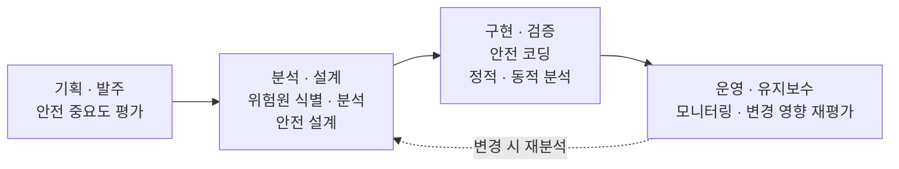

# 소프트웨어 안전 확보를 위한 지침

---

## I. SW 결함으로부터 생명·재산 보호, 소프트웨어 안전 확보 지침의 개요

### 가. 정의

- SW 오작동으로 인한 **인명·신체·재산 피해를 예방하기 위해 생명주기 전반의 안전 활동 기준과 절차를 정한 과학기술정보통신부 고시** (근거: 「소프트웨어 진흥법」 제30조 소프트웨어안전 확보)

### 나. 필요성 및 특징

| 구분 | 내용 |
| --- | --- |
| 등장 배경 | 자동차·의료·항공 등 [[CPS]] 확산으로 SW 결함이 물리적 사고로 직결 |
| 생명주기 적용 | 기획·분석·설계·구현·운영 단계별 안전 활동 수행 |
| 위험 기반 | 위험원 식별·분석([[FMEA (Failure Mode and Effects Analysis)\|FMEA]], [[FTA (Fault Tree Analysis)\|FTA]])으로 선제 통제 |
| 추적성 | 안전 요구사항부터 시험까지 양방향 추적으로 누락 방지 |

---

## II. 생명주기별 안전 활동 및 구성요소

### 가. 생명주기별 안전 활동

- 기획 단계에서 피해 심각도에 따라 안전 중요도를 정하고, 위험 분석 결과로 도출한 안전 요구사항을 구현·시험 단계에서 추적성 매트릭스로 검증

### 나. 구성요소

| 구분 | 요소 | 설명 |
| --- | --- | --- |
| 위험 분석 | 위험원 식별 | [[HAZOP (Hazard and Operability Study)\|HAZOP]], [[STPA]] 등으로 위험 상황 도출 |
| | FMEA · FTA | 고장 모드 영향 분석(상향식), 결함 트리 분석(하향식) |
| 안전 설계 | Fail-Safe | 고장 시 안전 상태(Safe State)로 전이 |
| | Fool-Proof | 사용자 실수에도 위험한 동작이 일어나지 않도록 방어 |
| 안전 구현 | 코딩 표준 | MISRA C 등 고신뢰 코딩 규칙, 오버플로·0 나눗셈 등 런타임 오류 차단 |
| 안전 검증 | 추적성 매트릭스 | 요구사항-설계-코드-테스트 케이스 간 양방향 추적 |
| | [[정적 분석 도구\|정적 분석]] · [[코드 커버리지\|커버리지]] | 코드 결함 검출, 안전 기능 시험 충분성 확인 |
| 운영 안전 | 변경 통제 | 패치 시 안전 영향 재평가, [[리그레션 테스트\|회귀 테스트]]와 [[형상 관리]] |

---

## III. 비교 및 동향

### 가. SW 안전(Safety) vs SW 보안(Security)

| 비교 항목 | SW 안전 | SW 보안 |
| --- | --- | --- |
| 보호 대상 | 사람·환경 | 데이터·시스템 |
| 위협 원인 | 내부 결함, 고장, 우발적 실수 | 해커·악성코드 등 의도적 공격 |
| 주요 기법 | 결함 허용, 이중화, Fail-Safe | [[암호화]], 접근 통제, 시큐어 코딩 |
| 관련 표준 | [[IEC 61508]], [[ISO 26262]], SW 안전 확보 지침 | ISO/IEC 27001, [[ISMS-P]], SW 개발보안 가이드 |

### 나. 동향

- 커넥티드카 등에서 보안 침해가 곧 안전 사고로 이어져 Safety·Security 통합 설계 확산 (ISO/SAE 21434가 SAE J3061 대체)
- Log4j 사태 이후 SW 공급망 관리가 강조되어 [[SBOM]] 도입 확대 (미국 행정명령 14028, 국내 SW 공급망 보안 가이드라인 2024)
- AI 기반 정적 분석으로 안전 결함 예측·수정안 제시 시도

---

### 🔗 연관 토픽

- **소속 도메인**: [[00_소프트웨어공학_MOC|🏗️ 소프트웨어공학]]
- **세부 분류**: `1. 소프트웨어 개발 생명주기(SDLC) & 방법론`
- **핵심 연관 토픽**:
  - [[SW 안전성(SW Safety) 및 분석 개념]]
  - [[기능안전 표준]]
  - [[FTA (Fault Tree Analysis)]]
  - [[SBOM]]
  - [[형상 관리]]
