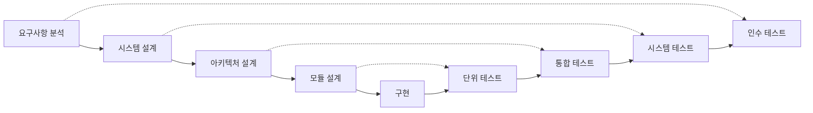

# 소프트웨어 테스트 (Software Test)

---

## I. 결함 발견과 품질 확인, 소프트웨어 테스트의 개요

### 가. 정의

- 소프트웨어를 실행하거나 산출물을 검토하여 **결함을 찾고, 명세 충족(검증, Verification)과 사용자 요구 충족(확인, Validation)을 평가**하는 품질 활동

### 나. 목적

| 구분 | 내용 |
| --- | --- |
| 결함 발견 | 운영 전 결함을 찾아 수정 비용 최소화 |
| 품질 확인 | 기능·비기능 요구사항 충족 여부 평가 |
| 위험 감소 | 릴리스 판단을 위한 객관적 정보 제공 |
| 신뢰 확보 | 사용자와 이해관계자의 [[신뢰성]] 확신 |

---

## II. 테스트 레벨 및 구성요소

### 가. V-모델 기반 테스트 레벨

- 개발 단계의 산출물이 대응하는 테스트 레벨의 기준이 되며, 단위~시스템 테스트는 명세 충족(검증), 인수 테스트는 사용자 요구 충족(확인)에 초점

### 나. 구성요소

| 구분 | 요소 | 설명 |
| --- | --- | --- |
| 테스트 레벨 | [[단위 테스트\|단위]] · [[통합 테스트\|통합]] | 모듈 기능, 모듈 간 인터페이스 검증 |
| | [[시스템 테스트\|시스템]] · [[인수 테스트\|인수]] | 전체 시스템의 기능·비기능, 사용자 요구·업무 적합성 확인 |
| 설계 기법 | [[블랙박스 테스트\|명세 기반]] | 동등 분할, 경계값 분석, 결정 테이블, 상태 전이 |
| | [[화이트박스 테스트\|구조 기반]] | 구문·결정·조건·MC/DC 커버리지 |
| | [[경험기반 테스트\|경험 기반]] | [[탐색적 테스트]], 오류 추정 |
| 테스트 유형 | 기능 · 비기능 | 기능 적합성, [[성능 테스트\|성능]]·보안·사용성 |
| | 변경 관련 | 확인 테스트(재테스트), [[리그레션 테스트\|회귀 테스트]] |
| 원리 | [[소프트웨어 테스트 원리\|테스트 7원리]] | 결함 집중, 살충제 패러독스, 완벽한 테스트 불가능 등 |
| 프로세스 | [[Test Process\|테스트 프로세스]] | 계획·분석·설계·구현·실행·완료 |

---

## III. 비교 및 동향

### 가. 정적 테스트 vs 동적 테스트

| 비교 항목 | 정적 테스트 | 동적 테스트 |
| --- | --- | --- |
| 실행 여부 | 실행하지 않음 | 프로그램 실행 |
| 기법 | 리뷰·인스펙션·워크스루, [[정적 분석 도구\|정적 분석]] | 명세·구조·경험 기반 테스트 |
| 적용 시점 | 요구·설계·코드 작성 직후 | 구현 이후 |
| 발견 대상 | 명세 결함, 코딩 표준 위반, 잠재 결함 | 실행 시 고장(Failure) |

### 나. 동향

- 요구·설계 단계부터 테스트를 시작하는 Shift-Left, CI/CD에 내장한 지속적 테스트
- LLM이 요구사항에서 테스트 케이스·스크립트·데이터를 생성
- 운영 환경 장애 주입으로 복원력을 검증하는 [[카오스 엔지니어링]] (Shift-Right)

---

### 🔗 연관 토픽

- **소속 도메인**: [[00_소프트웨어공학_MOC|🏗️ 소프트웨어공학]]
- **세부 분류**: `2. 애자일(Agile) & 지속적 통합/배포(CI/CD)`
- **핵심 연관 토픽**:
  - [[소프트웨어 테스트 원리|테스트 원리]]
  - [[Test Process]]
  - [[블랙박스 테스트]]
  - [[화이트박스 테스트]]
  - [[리그레션 테스트|Regression Test]]
