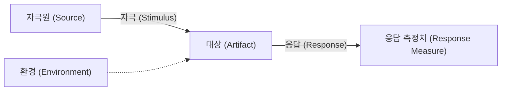

# 소프트웨어 품질 속성 시나리오 (Quality Attribute Scenario)

---

## I. 비기능 요구를 측정 가능하게, 품질 속성 시나리오의 개요

### 가. 정의

- 성능·가용성·보안 등 품질 속성 요구를 **자극원·자극·대상·환경·응답·응답 측정치의 6요소로 구체화한 측정 가능한 명세** (SEI, Bass·Clements·Kazman)

### 나. 특징

| 구분 | 내용 |
| --- | --- |
| 정량화 | "빨라야 한다" → "피크 시 요청의 95%를 2초 이내 응답" |
| 합의 수단 | 이해관계자가 같은 기준으로 품질 목표 합의 |
| 평가 기준 | [[ATAM]]·[[CBAM]] 등 아키텍처 평가의 입력 |
| 트레이드오프 식별 | 품질 속성 간 상충 지점 발견 |

---

## II. 구조 및 구성요소

### 가. 시나리오 구조

- 특정 환경에서 자극원이 대상에 자극을 주었을 때 시스템의 응답과 이를 판정할 측정 기준을 함께 기술

### 나. 6요소

| 구분 | 요소 | 설명 |
| --- | --- | --- |
| 입력 | 자극원 (Source) | 자극을 발생시키는 주체 (사용자, 외부 시스템, 공격자) |
| | 자극 (Stimulus) | 시스템에 도달하는 사건 (요청, 장애, 공격) |
| 맥락 | 대상 (Artifact) | 자극을 받는 대상 (시스템 전체, 컴포넌트) |
| | 환경 (Environment) | 자극 발생 시 시스템 상태 (정상, 과부하, 장애) |
| 결과 | 응답 (Response) | 시스템이 취하는 동작 (처리, 기록, 페일오버) |
| | 응답 측정치 | 응답의 정량 판정 기준 (응답시간, 가용률, 복구 시간) |
| 도출 | [[유틸리티 트리]] | 품질 속성 → 세부 속성 → 시나리오로 계층화하고 중요도·난이도 평가 |
| 유형 | 일반 · 구체 시나리오 | 시스템 독립적 일반 시나리오, 특정 시스템용 구체 시나리오 |

---

## III. 비교 및 동향

### 가. 품질 속성 시나리오 vs 유스케이스

| 비교 항목 | 품질 속성 시나리오 | 유스케이스 |
| --- | --- | --- |
| 명세 대상 | 비기능 요구 | 기능 요구 |
| 관심 | 얼마나 잘 하는가 | 무엇을 하는가 |
| 구성 | 자극원·자극·대상·환경·응답·측정치 | 액터, 사전·사후 조건, 기본·대안 흐름 |
| 검증 | ATAM, [[성능 테스트]] | 기능 테스트, [[인수 테스트]] |
| 아키텍처 영향 | 구조 결정에 직접 영향 | 주로 컴포넌트 내부 로직 |

### 나. 동향

- 탄력성·확장성 시나리오를 [[카오스 엔지니어링]] 실험 가설로 활용
- LLM 시스템에 지연·정확도·환각 비율 등을 측정치로 하는 시나리오 적용

---

### 🔗 연관 토픽

- **소속 도메인**: [[00_소프트웨어공학_MOC|🏗️ 소프트웨어공학]]
- **세부 분류**: `3. 요구사항 공학 & UML 객체지향 분석/설계`
- **핵심 연관 토픽**:
  - [[ATAM]]
  - [[유틸리티 트리|유틸리티 트리 (Utility Tree)]]
  - [[SW Architecture 평가]]
  - [[ISO IEC 25010 2023|ISO/IEC 25010:2023]]
  - [[성능 테스트]]
