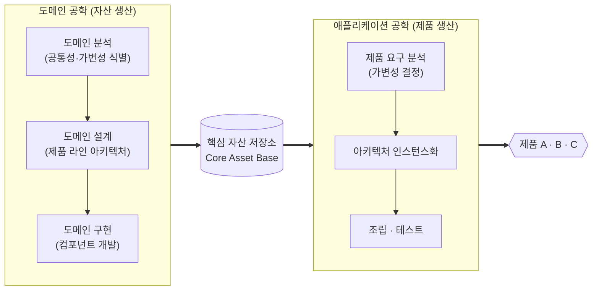

# 소프트웨어 프로덕트 라인 (Software Product Line, SPL)

---

## I. 제품군 단위의 대규모 재사용, SPL의 개요

### 가. 정의

- 공통 요구를 가진 **소프트웨어 제품군(Product Family)** 을 핵심 자산(Core Asset)의 계획적 [[재사용]]으로 체계적으로 생산하는 소프트웨어 공학 패러다임

### 나. 필요성 및 특징

| 구분 | 내용 |
| --- | --- |
| 필요성 | 기종별 펌웨어·가전 SW 등 유사 제품을 개별 개발할 때의 중복 비용과 [[유지보수]] 복잡성 해소, Time-to-Market 단축 |
| 생명주기 전반 재사용 | 코드뿐 아니라 요구사항·아키텍처·테스트 케이스까지 재사용 |
| 공통성·가변성 분석 | 모든 제품에 공통인 부분과 제품별로 달라지는 부분을 구분 |
| 이중 생명주기 | 도메인 공학(자산 생산)과 애플리케이션 공학(제품 생산) 분리 |

---

## II. SPL 구조 및 핵심 기술

### 가. 이중 생명주기 (Two Life Cycle)

### 나. 핵심 기술 요소

| 구분 | 요소 | 설명 |
| --- | --- | --- |
| 분석 | 공통성 (Commonality) | 제품군 전체가 공유하는 기능·품질 특성 |
| | 가변성 (Variability) | 제품별로 변경·확장·생략되는 특성 |
| 모델링 | 특성 모델 (Feature Model) | 필수(Mandatory)·선택(Optional)·대안(Alternative) 특성을 트리로 표현 |
| 아키텍처 | 제품 라인 아키텍처 (PLA) | 다양한 변형을 수용하도록 설계된 공통 [[소프트웨어 아키텍처]] |
| 가변성 기법 | 가변점 (Variation Point) | 산출물에서 가변성이 실제로 발생하는 위치 |
| | 바인딩 시점 | 컴파일·링크·런타임 중 가변성이 결정되는 시점 |
| 자산 관리 | 핵심 자산 저장소 | 승인된 아키텍처·컴포넌트·[[요구사항 명세서]]·테스트 스위트 보관 |

---

## III. 비교 및 동향

### 가. 개별 개발 vs SPL

| 비교 항목 | 개별 개발 (One-off) | SPL |
| --- | --- | --- |
| 관점 | 단일 제품 | 제품군 전체 |
| 재사용 | 제한적 (코드 일부 복사) | 계획적·전사적 대규모 재사용 |
| 초기 투자 | 낮음 | 높음 (핵심 자산·PLA 선행 구축) |
| 유지보수 | 제품 증가 시 파편화로 비용 급증 | 공통 자산 수정이 제품군 전체에 반영 |
| 출시 속도 | 후속 제품 단축 효과 미미 | 자산 조립으로 신제품 신속 출시 |

### 나. SPL vs CBD

| 비교 항목 | SPL | CBD (컴포넌트 기반 개발) |
| --- | --- | --- |
| 재사용 범위 | 제품군, 생명주기 전체 산출물 | 개별 애플리케이션, 컴포넌트 |
| 접근 방식 | 사전 계획된 하향식 | 필요 시 조립하는 상향식 |
| 초점 | 공통성·가변성 기반 대량 맞춤 생산 | 낮은 [[결합도]]·높은 [[응집도]]의 블랙박스 부품 |

### 다. 동향

- **경량 도입**: 높은 초기 투자 장벽을 줄이기 위해 점진적 도메인 분석과 [[Agile]]을 결합
- **서비스 프로덕트 라인**: SaaS 멀티테넌트 환경과 [[MSA (Micro Service Architecture)\|MSA]]에서 기능 토글·설정 관리로 가변성 구현
- **동적 SPL (DSPL)**: 런타임에 가변성을 동적으로 바인딩하는 연구 확산

---

### 🔗 연관 토픽

- **소속 도메인**: [[00_소프트웨어공학_MOC|🏗️ 소프트웨어공학]]
- **세부 분류**: `3. 요구사항 공학 & UML 객체지향 분석/설계`
- **핵심 연관 토픽**:
  - [[재사용]]
  - [[소프트웨어 아키텍처|소프트웨어 아키텍쳐]]
  - [[결합도]]
  - [[응집도]]
  - [[MSA (Micro Service Architecture)]]
