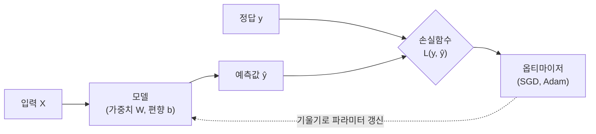

# 손실함수 (Loss Function)

---

## I. 학습이 줄여야 할 값, 손실함수의 개요

### 가. 정의

- 모델의 **예측값과 정답의 차이를 하나의 스칼라 값으로 수치화**하여, 최적화가 최소화할 대상이 되는 함수

### 나. 필요성 및 특징

| 구분 | 내용 |
| --- | --- |
| 최적화 기준 | [[경사하강법]]이 손실을 줄이는 방향으로 파라미터 갱신 |
| 역전파 시작점 | 손실의 기울기를 [[역전파]]해 가중치·편향 갱신 (미분 가능해야 함) |
| 태스크 의존 | 회귀·분류·순위 등 문제 유형에 맞는 함수 선택 |
| 손실 vs 비용 | 손실은 표본 1개의 오차, 비용(Cost)은 전체 데이터의 평균(+정규화 항) |

---

## II. 동작 구조 및 주요 유형

### 가. 개념도

- 순전파로 예측 → 손실 계산 → 역전파로 기울기 계산 → 옵티마이저가 파라미터 갱신을 반복

### 나. 주요 유형

| 구분 | 요소 | 설명 |
| --- | --- | --- |
| 회귀 | MSE | $\frac{1}{n}\sum (y-\hat{y})^2$, 큰 오차에 큰 벌점, [[이상치]]에 민감 |
| | MAE | $\frac{1}{n}\sum \lvert y-\hat{y}\rvert$, 이상치에 강건, 0에서 미분 불가 |
| | Huber | 오차가 작으면 제곱, 크면 선형, MSE·MAE 절충 |
| 분류 | 이진 크로스 엔트로피 (BCE) | Sigmoid 출력과 0/1 정답, 베르누이 음의 로그 우도 |
| | 범주형 크로스 엔트로피 (CCE) | [[소프트맥스 정규화\|Softmax]] 출력과 다중 클래스 정답 |
| | Focal Loss | 쉬운 표본의 가중치를 낮춰 [[클래스 불균형]] 완화 |
| 마진·순위 | Hinge | [[서포트 벡터 머신\|SVM]]의 마진 기반 손실 $\max(0, 1 - y\hat{y})$ |
| | Contrastive·Triplet | 유사 쌍은 가깝게, 비유사 쌍은 멀게 하는 임베딩 학습용 |
| 분포 | KL Divergence | 두 확률분포 차이, VAE·지식 증류에 사용 |

---

## III. 비교 및 동향

### 가. MSE vs 크로스 엔트로피

| 비교 항목 | MSE | 크로스 엔트로피 |
| --- | --- | --- |
| 용도 | 회귀 (연속값) | 분류 (확률) |
| 출력층 | 선형 | Sigmoid, Softmax |
| 확률적 해석 | 가우시안 잡음 가정의 MLE | 베르누이·카테고리 분포의 MLE |
| 기울기 특성 | Sigmoid와 결합 시 포화 구간에서 기울기 작아짐 | Softmax와 결합 시 기울기 $\hat{y} - y$, 오답일수록 크게 학습 |
| 수식 | $\frac{1}{n}\sum (y - \hat{y})^2$ | $-\sum y \log \hat{y}$ (원-핫·레이블 스무딩 모두 가능) |

### 나. 동향

- **다중 작업 손실**: 객체 탐지는 분류 손실 + 박스 회귀 손실(IoU 계열: GIoU, CIoU)을 가중 합산
- **LLM 학습**: 사전학습은 다음 토큰 크로스 엔트로피, 선호 정렬은 보상 모델 기반 RLHF나 선호쌍 손실을 직접 쓰는 DPO 활용
- **강건 손실**: 레이블 잡음에 강한 손실(Generalized CE, Symmetric CE) 연구 ([[강화학습]] 보상 설계와 함께 학습 목표 설계가 핵심 이슈)

---

### 🔗 연관 토픽

- **소속 도메인**: [[00_인공지능_MOC|🤖 인공지능]]
- **세부 분류**: `1. 수학 · 통계학 & 데이터 전처리`
- **핵심 연관 토픽**:
  - [[경사하강법|경사하강법 (Gradient Descent Algorithm)]]
  - [[역전파|역전파(Backpropagation)]]
  - [[최적화 알고리즘|최적화 알고리즘 (Optimization Algorithm)]]
  - [[소프트맥스 정규화]]
  - [[서포트 벡터 머신|서포트 벡터 머신 SVM(Support Vector Machine)]]
