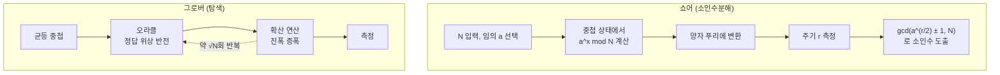

# 쇼어(Shor) 및 그로버(Grover) 알고리즘

---

## I. 양자 컴퓨터의 암호 위협, 쇼어·그로버 알고리즘의 개요

### 가. 정의

- **쇼어 알고리즘**: 양자 푸리에 변환으로 주기를 찾아 **소인수분해와 이산대수 문제를 다항 시간에 푸는** 양자 알고리즘 (1994)
- **그로버 알고리즘**: 진폭 증폭으로 **정렬되지 않은 N개 후보에서 해를 $O(\sqrt{N})$번 질의로 찾는** 양자 탐색 알고리즘 (1996)

### 나. 특징

| 구분 | 내용 |
| --- | --- |
| 공개키 위협 (쇼어) | [[RSA (Rivest Shamir Adleman)\|RSA]], [[ECC]], DH, [[DSA]]의 안전성 근거를 무력화 |
| 대칭키 위협 (그로버) | 키 전수조사가 $2^n$ → $2^{n/2}$로 줄어 실효 강도 절반 |
| 양자 특성 활용 | 중첩·간섭·얽힘을 이용한 병렬 상태 처리 |
| 현실 제약 | 수천 개 이상의 논리 큐비트(오류 정정 포함)가 필요해 아직 실현 전 |
| 선제 대응 필요 | 지금 수집하고 나중에 해독(HNDL) 위협으로 조기 전환 필요 |

---

## II. 동작 원리 및 구성요소

### 가. 동작 흐름

- 쇼어는 모듈러 지수 함수의 주기를 QFT로 구해 고전 연산(최대공약수)으로 인수를 얻고, 그로버는 오라클과 진폭 증폭을 약 $\frac{\pi}{4}\sqrt{N}$회 반복해 정답 확률을 높임

### 나. 구성요소

| 구분 | 요소 | 설명 |
| --- | --- | --- |
| 쇼어 | 양자 푸리에 변환 (QFT) | 상태 진폭을 주파수 영역으로 변환해 주기 추출 |
| | 주기 찾기 | 위상 추정으로 $a^x \bmod N$의 주기 r 검출 |
| | 복잡도 | 약 $O((\log N)^3)$, 고전 최선(GNFS)은 준지수 시간 |
| 그로버 | 오라클 | 정답 상태의 위상만 반전시키는 함수 |
| | 진폭 증폭 | 평균 기준 반전으로 정답 진폭 증가 |
| | 복잡도 | $O(N)$ → $O(\sqrt{N})$ 이차 가속 |
| 공통 | 중첩·간섭 | 여러 상태를 동시에 표현하고 간섭으로 원하는 결과 강화 |

---

## III. 비교 및 동향

### 가. 쇼어 vs 그로버

| 비교 항목 | 쇼어 | 그로버 |
| --- | --- | --- |
| 해결 문제 | 소인수분해, 이산대수 | 비정형 탐색, 역상 찾기 |
| 가속 | 지수적 (준지수 → 다항) | 이차적 ($N$ → $\sqrt{N}$) |
| 위협 대상 | 공개키 암호 (RSA, ECC, DH, DSA) | 대칭키 ([[AES]]), 해시 역상 |
| 영향 | 알고리즘 자체 붕괴 | 강도 절반 |
| 대응 | [[양자내성암호]]로 교체 | 키·출력 길이 2배 (AES-256, SHA-384 이상) |

### 나. 동향

- **PQC 표준**: NIST FIPS 203(ML-KEM)·204(ML-DSA)·205(SLH-DSA) 확정(2024.8), HQC 추가 선정(2025)
- **전환 일정**: NIST IR 8547 초안은 RSA·ECC를 2030년 이후 비권고, 2035년 폐기 목표 제시
- **[[양자 암호]](QKD)**: 물리 법칙 기반 키 분배로 국방·금융 등 일부 구간에 적용

---

### 🔗 연관 토픽

- **소속 도메인**: [[00_보안_MOC|🛡️ 보안]]
- **세부 분류**: `1. 정보보안 원칙 & 거버넌스 · 인증`
- **핵심 연관 토픽**:
  - [[양자내성암호]]
  - [[양자 암호|양자 암호(Quantum Cryptography)]]
  - [[RSA (Rivest Shamir Adleman)]]
  - [[ECC|ECC(Elliptic Curve Cryptography)]]
  - [[암호학적 보안 강도|암호학적 보안 강도(Security Strength)]]
