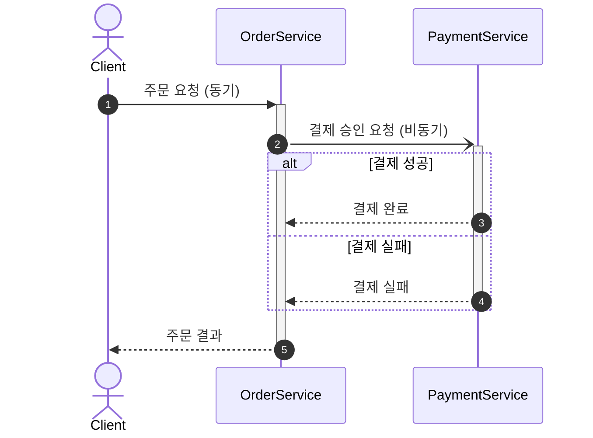

# 순차 다이어그램 (Sequence Diagram)

---

## I. 시간 순서로 본 객체 협력, 순차 다이어그램의 개요

### 가. 정의

- 객체(참여자) 간에 **주고받는 메시지를 시간 순서에 따라 수직 축으로 배치해 상호작용을 표현**하는 [[UML]] 상호작용 다이어그램

### 나. 특징

| 구분 | 내용 |
| --- | --- |
| 유스케이스 실현 | 유스케이스를 객체 간 협력 흐름으로 구체화 |
| 시간 축 | 위에서 아래로 메시지 순서 표현 |
| 제어 흐름 | 복합 프래그먼트로 조건·반복·병렬 표현 |
| 분산 설계 | [[MSA (Micro Service Architecture)\|MSA]]의 서비스 간 API 호출 흐름 설계 |

---

## II. 표기 예시 및 구성요소

### 가. 주문·결제 예시

- 생명선 위 활성 구간으로 제어권을 표시하고, 동기·비동기·반환 메시지와 alt 프래그먼트로 분기를 표현

### 나. 구성요소

| 구분 | 요소 | 설명 |
| --- | --- | --- |
| 참여자 | 생명선 (Lifeline) | 참여자 이름 상자와 아래로 이어지는 점선 |
| | 활성 구간 (Activation) | 참여자가 동작을 수행 중인 구간 (좁은 사각형) |
| | 생성 · 소멸 | 생성 메시지, 생명선 끝의 X 표시 |
| 메시지 | 동기 | 응답까지 대기 (실선 + 채운 화살촉) |
| | 비동기 | 대기 없이 진행 (실선 + 열린 화살촉) |
| | 반환 | 결과 반환 (점선 + 열린 화살촉) |
| 복합 프래그먼트 | alt · opt | 조건 분기(if-else), 조건부 실행(if) |
| | loop · par | 반복, 병렬 수행 |
| | ref · break | 다른 상호작용 참조, 중단 시나리오 |

---

## III. 비교 및 동향

### 가. 순차 다이어그램 vs 커뮤니케이션 다이어그램

| 비교 항목 | 순차 다이어그램 | 커뮤니케이션 다이어그램 |
| --- | --- | --- |
| 관점 | 시간 순서 | 객체 간 연결 구조 |
| 메시지 표현 | 수직 시간 축 위 순서 배치 | 링크 위에 순번(1, 1.1 …) 부여 |
| 강점 | 실행 순서·로직 파악 | 협력 경로·구조 파악 |
| UML 1.x 명칭 | 동일 | 협력(Collaboration) 다이어그램 |

### 나. 동향

- Mermaid·PlantUML로 다이어그램을 코드로 작성해 Git으로 관리하는 Docs as Code
- Jaeger·Zipkin 분산 추적 결과를 순차 형태로 시각화해 서비스 간 병목 분석

---

### 🔗 연관 토픽

- **소속 도메인**: [[00_소프트웨어공학_MOC|🏗️ 소프트웨어공학]]
- **세부 분류**: `3. 요구사항 공학 & UML 객체지향 분석/설계`
- **핵심 연관 토픽**:
  - [[UML|UML (정적, 동적 다이어그램)]]
  - [[Interaction overview diagram]]
  - [[유즈케이스 다이어그램]]
  - [[클래스 다이어그램|클래스 다이어그램 (Class Diagram)]]
  - [[상태 머신 다이어그램|상태 머신 다이어그램 (State Machine Diagram)]]
