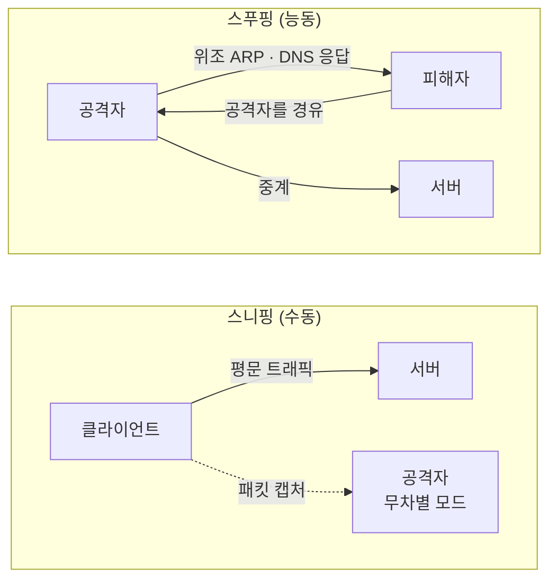

# 스니핑(Sniffing)과 스푸핑(Spoofing)

---

## I. 엿듣기와 위장하기, 스니핑과 스푸핑의 개요

### 가. 정의

- **스니핑**: 네트워크를 지나는 **패킷을 몰래 수집·도청**하여 [[기밀성]]을 침해하는 수동적 공격
- **스푸핑**: MAC·IP·[[DNS(Domain Name System)|DNS]] 등 **식별 정보를 위조해 신뢰된 대상으로 위장**하는 능동적 공격

### 나. 특징

| 구분 | 내용 |
| --- | --- |
| 프로토콜 취약점 | [[TCP]]/IP·ARP·DNS의 인증 부재와 평문 전송 악용 |
| 연계 공격 | 스푸핑으로 트래픽을 우회시킨 뒤 스니핑하는 중간자 공격(MITM) |
| 정찰 수단 | 계정·세션 정보 수집 후 후속 침투에 활용 |
| 위협 확장 | 딥페이크 음성·얼굴로 신원을 위장하는 생체 스푸핑 등장 |

---

## II. 공격 구조 및 기법

### 가. 공격 구조

- 스니핑은 트래픽을 조용히 복제해 엿보고, 스푸핑은 위조 응답으로 트래픽 경로를 공격자 쪽으로 바꿈

### 나. 기법 및 대응

| 구분 | 요소 | 설명 |
| --- | --- | --- |
| 스니핑 | 무차별 모드 | 목적지 MAC과 무관하게 모든 프레임 수신 |
| | 스위치 재밍·포트 미러링 악용 | MAC 테이블 범람으로 허브처럼 동작시키거나 SPAN 포트로 복제 |
| 스푸핑 | [[ARP]] 스푸핑 | 위조 ARP Reply로 게이트웨이 MAC을 공격자 MAC으로 변조 |
| | IP 스푸핑 | 출발지 IP 위조로 ACL 우회, [[DRDOS\|반사 공격]]에 악용 |
| | DNS 스푸핑 | 위조 응답·캐시 포이즈닝으로 피싱 사이트 유도 |
| 대응 | 암호화 | TLS 1.3, [[IP Sec\|IPsec]], SSH로 스니핑해도 내용 보호 |
| | DAI·포트 보안 | 스위치에서 ARP 검증, 포트당 MAC 제한 |
| | Ingress·Egress 필터링 | 위조 출발지 IP 패킷 차단 (BCP 38) |
| | [[DNSSEC(Domain Name System Security Extension)\|DNSSEC]] | 전자서명으로 DNS 응답 출처·무결성 검증 |

---

## III. 비교 및 동향

### 가. 스니핑 vs 스푸핑

| 비교 항목 | 스니핑 | 스푸핑 |
| --- | --- | --- |
| 공격 성격 | 수동적 | 능동적 |
| 침해 요소 | 기밀성 | [[무결성]], 인증 |
| 목적 | 계정·금융 정보 수집 | MITM, 세션 하이재킹, 피싱 유도 |
| 탐지 | 트래픽 변화가 없어 어려움 | ARP 테이블 변화, 중복 응답으로 비교적 쉬움 |
| 대표 대응 | 암호화, 무차별 모드 탐지 | 패킷 필터링, 정적 ARP, 강한 인증 |

### 나. 동향

- **ECH (Encrypted Client Hello)**: TLS 1.3에서도 평문인 SNI 노출을 막기 위한 IETF 표준화·브라우저 적용
- **생체 스푸핑 대응**: 딥페이크 대응을 위한 라이브니스 검사, [[FIDO]] 기반 피싱 저항 인증
- **[[제로 트러스트 보안모델|제로 트러스트]]**: 내부망 침투 후 횡적 이동을 마이크로 세그멘테이션과 지속 인증으로 차단

---

### 🔗 연관 토픽

- **소속 도메인**: [[00_보안_MOC|🛡️ 보안]]
- **세부 분류**: `1. 정보보안 원칙 & 거버넌스 · 인증`
- **핵심 연관 토픽**:
  - [[ARP]]
  - [[DNSSEC(Domain Name System Security Extension)]]
  - [[SSL-TLS]]
  - [[IP Sec]]
  - [[기밀성]]
