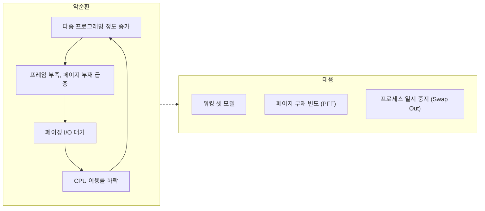

# 스레싱 (Thrashing)

---

## I. 실행보다 페이지 교체가 많은, 스레싱의 개요

### 가. 정의

- 프로세스에 할당된 프레임이 부족해 **페이지 부재(Page Fault)와 교체가 끊임없이 반복되고, 실제 실행보다 페이징 I/O에 더 많은 시간을 쓰면서 [[CPU]] 이용률이 급락**하는 현상

### 나. 원인 및 특징

| 구분 | 내용 |
| --- | --- |
| 원인 | 다중 프로그래밍 정도(Degree of Multiprogramming) 과다로 프로세스별 프레임 부족 |
| | 각 프로세스 워킹 셋(Working Set) 합이 물리 메모리 초과 |
| | 전역 교체 정책에서 프로세스끼리 프레임을 빼앗는 연쇄 페이지 부재 |
| 증상 | CPU 이용률 급락, 스왑 디스크 I/O 포화, 응답 지연 |
| 악순환 | OS가 낮은 CPU 이용률을 보고 프로세스를 더 투입 → 프레임 부족 심화 |

---

## II. 발생 구조 및 방지 기법

### 가. 스레싱 악순환과 대응

- 다중 프로그래밍 정도가 임계점을 넘으면 CPU 이용률이 오히려 떨어지므로, 프로세스별 필요 프레임을 보장하거나 실행 프로세스 수를 줄여 차단

### 나. 방지 기법

| 구분 | 요소 | 설명 |
| --- | --- | --- |
| 프레임 할당 | 워킹 셋 (Working Set) | 최근 Δ 시간 동안 참조한 페이지 집합을 메모리에 유지 ([[지역성]] 기반, Denning 제안), 합이 메모리를 넘으면 프로세스 중지 |
| | 페이지 부재 빈도 (PFF) | 부재율이 상한을 넘으면 프레임 추가, 하한 미만이면 회수 |
| | 지역 교체 (Local Replacement) | 자기 프레임 안에서만 교체해 다른 프로세스로 스레싱 확산 방지 |
| 부하 제어 | 다중 프로그래밍 정도 조절 | 중기 스케줄러가 일부 프로세스를 Swap Out |
| 현대 OS | zswap·zram | 스왑 전 메모리 안에서 압축해 디스크 I/O 감소 |
| | Linux PSI | CPU·메모리·I/O 자원 대기 시간 비율을 측정해 메모리 압박 조기 감지 |
| | cgroup v2·systemd-oomd | `memory.high`로 사용량 제한, PSI 임계 초과 시 해당 cgroup 정리 |

---

## III. 비교 및 동향

### 가. 워킹 셋 vs PFF

| 비교 항목 | 워킹 셋 | PFF |
| --- | --- | --- |
| 기준 | 최근 Δ 동안 참조한 페이지 수 | 페이지 부재 발생 간격(빈도) |
| 측정 | 참조 비트 주기 검사, 비용 큼 | 부재 발생 시에만 계산, 비용 작음 |
| 조정 | 워킹 셋 크기만큼 프레임 유지 | 상·하한 임계치로 프레임 증감 |
| 특징 | 지역성 변화를 정확히 추적 | 구현 단순, 직접적 제어 |

### 나. 동향

- **컨테이너 환경**: [[쿠버네티스]] 메모리 limit·Eviction과 PSI 기반 압박 감지로 노드 수준 스레싱 방지
- **GPU 메모리**: CUDA Unified Memory 초과 할당 시 GPU-호스트 간 페이지 이동이 반복되는 스레싱 발생 → 프리페치·메모리 힌트로 완화
- **[[CXL]] 메모리 계층화**: 저렴한 CXL 메모리를 추가 계층으로 붙여 스왑 이전 단계의 용량 확보

---

### 🔗 연관 토픽

- **소속 도메인**: [[00_운영체제_MOC|⚙️ 운영체제]]
- **세부 분류**: `1. 프로세스 & 스레드 관리`
- **핵심 연관 토픽**:
  - [[가상 메모리]]
  - [[지역성|지역성(Locality)]]
  - [[페이지 교체 알고리즘]]
  - [[Belady's Anomaly]]
  - [[메모리 관리]]
