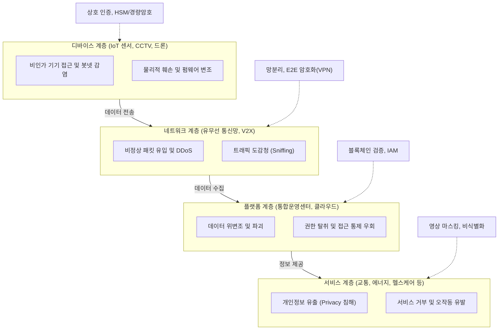

# 스마트시티 보안취약점 및 대응방안

---

## I. 초연결·초지능 도시 인프라 보호를 위한, 스마트시티 보안의 개요

스마트시티 보안은 도시 전역의 사물인터넷(IoT), 5G/V2X 통신망, 클라우드 데이터 플랫폼, 지능형 시민 서비스가 유기적으로 연계된 초연결 CPS(사이버-물리 시스템) 환경에서, 시스템 마비 및 대규모 개인정보 유출을 방지하기 위한 다계층 융합 보안 체계이다.

| 구분 | 내용 |
| :--- | :--- |
| **정의** | 도시 인프라(IoT·통신·플랫폼·서비스)를 사이버 침해 및 물리적 마비로부터 보호하는 융합 보안 체계 |
| **특수 환경** | 사이버 침해가 물리적 도시 마비(교통·전력·의료)로 전이되는 CPS 융합성, 인프라 간 상호의존성 |
| **핵심 목표** | 대규모 시민 프라이버시 보호, 사이버 회복탄력성(Resilience) 확보, 통합 관제 거버넌스 수립 |

---

## II. 스마트시티 보안취약점 발생 계층 및 핵심 대응 기술

### 가. 스마트시티 계층별 보안 위협 및 방어 개념도

### 나. 스마트시티 핵심 보안취약점 및 대응 요소 기술

| 계층 구분 | 취약점 및 위협 요소 | 세부 대응 방안 및 요소 기술 |
| :--- | :--- | :--- |
| **디바이스** | 기기 훼손, 펌웨어 변조, 정보 탈취 | 자원 제약 IoT 대상 경량 암호(LEA), HSM/TEE 하드웨어 보안 모듈 및 EAP-TLS 상호 인증 |
| **네트워크** | 무선 패킷 도청, 중간자 공격, DDoS | 전송 구간 E2E 암호화(VPN, TLS 1.3), 5G 네트워크 슬라이싱 격리 및 제로 트러스트 ZTNA |
| **플랫폼** | 빅데이터 위·변조, 관리자 계정 탈취 | [[블록체인]] 기반 무결성 검증, 통합 계정권한관리([[IAM]]), MFA 및 역할 기반 최소 권한 통제 |
| **서비스** | CCTV 영상 및 위치 프라이버시 침해 | AI 안면·차량번호 실시간 마스킹, 프라이버시 강화 기술(PET), 가명·익명 [[비식별화]] |
| **통합 관제** | 이종 인프라 연쇄 장애 침해사고 | 물리-정보 보안 통합관제(PSIM), AI 이상 징후 탐지, [[SOAR (Security Orchestration, Automation and Response)\|SOAR]] 기반 자율 격리 |

---

## III. 전통적 IT 보안과의 비교 및 향후 기술 동향

### 가. 전통적 IT 보안 vs 스마트시티 CPS 융합 보안 비교

| 비교 항목 | 전통적 기업 IT 보안 | 스마트시티 CPS 융합 보안 |
| :--- | :--- | :--- |
| **보호 대상** | 기업 내부 서버, DB, PC, 업무 데이터 | 도시 인프라(교통, 상하수도, 에너지), 시민 생명·안전 |
| **침해 영향** | 정보 유출, 재무적 손실, 업무 중단 | 도시 기능 마비, 물리적 시설 파괴, 대규모 인명 피해 |
| **핵심 가치** | 기밀성(Confidentiality) 최우선 | 가용성(Availability) 및 안전성(Safety) 최우선 |
| **보안 패러다임** | 소프트웨어 패치 및 경계 방어 중심 | 초연결 실시간 관제 및 사이버 회복력([[사이버 레질리언스]]) 중심 |

### 나. 향후 기술 동향 및 발전 전망
- **디지털 트윈 기반 가상 침해 모의 훈련**: 도시 운영 인프라의 가상 복제본(Digital Twin)을 구축하여 사이버 공격 전파 시나리오를 시뮬레이션하고 사전 방어책 검증.
- **AI 융합 보안 자동화([[SOAR (Security Orchestration, Automation and Response)|SOAR]]) 자율 방어**: 초연결 IoT 센서와 지능형 CCTV에서 유입되는 방대한 이벤트를 AI가 자율 분석하여 악성 트래픽을 즉시 격리.
- **Security by Design 기반 공급망 전주기 검증**: 스마트시티에 납품되는 서드파티 디바이스 및 소프트웨어에 대해 기획 단계부터 SBOM 제출과 무결성 검증 의무화.

---

### 🔗 연관 토픽

- **소속 도메인**: [[00_보안_MOC|🛡️ 보안]]
- **세부 분류**: `4. 웹 & 애플리케이션 보안 · 취약점 점검`
- **핵심 연관 토픽**:
  - [[암호화|암호화 (Encryption)]]
  - [[AES]]
  - [[암호 알고리즘]]
  - [[무결성]]
  - [[비식별화]]
