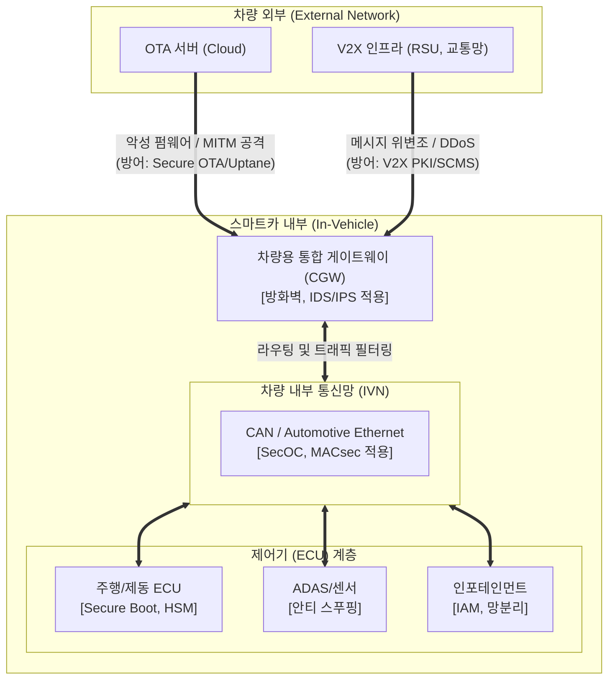

# 스마트카 보안 취약점 및 대응방안

---

## I. 운전자의 생명과 직결된 사이버 물리 시스템, 스마트카 보안의 개요

스마트카 보안은 커넥티드 카 및 자율주행차 환경에서 차량 내부 네트워크(CAN, Automotive Ethernet)와 외부 무선 접점(V2X, OTA, IVI)을 통한 사이버 공격으로부터 차량 제어권과 운전자 생명 및 프라이버시를 보호하는 사이버-물리 융합 보안 체계이다.

| 구분 | 내용 |
| :--- | :--- |
| **정의** | 자율주행·커넥티드 차량의 내·외부 접점을 통한 제어권 탈취 및 위협을 방어하는 차량 융합 보안 |
| **등장 배경** | ECU 조향/제동 장치 해킹 시 운전자 생명 직결, OTA/V2X 확대로 공격 표면(Attack Surface) 급증 |
| **핵심 기제** | 차량 내 침입탐지(CAN-IDS), SecOC 무결성 인증, 하드웨어 보안 칩(HSM), 국제 표준(ISO 21434, UNECE) |

---

## II. 스마트카의 아키텍처 및 핵심 보안 기술 요소

### 가. 스마트카 계층별 보안 위협 및 방어 개념도

* 외부 망(V2X, OTA)을 통한 침투 후 내부망(CAN)을 거쳐 최종 ECU 제어권을 탈취하는 연쇄 공격 방어
* 심층 방어(Defense in Depth) 관점에서 단말(ECU)-내부망(IVN)-외부망 전 구간에 [[암호화]] 및 인증 적용

### 나. 스마트카 핵심 보안 기술 요소

| 구분 | 요소 기술 | 세부 설명 |
| --- | --- | --- |
| **외부 통신** | **V2X PKI (SCMS)** | 차량 간(V2V), 차량-인프라 간(V2I) 통신 시 인증서 기반 상호 인증 및 메시지 [[무결성]] 보장 |
| **외부 통신** | **Secure OTA** | 무선 펌웨어 업데이트 시 코드 서명(Code Signing), 롤백 방지 및 Uptane [[프레임워크]] 적용 |
| **내부 통신** | **SecOC (Secure Onboard Comm)** | AUTOSAR 표준 기반으로 CAN 메시지에 인증 식별자([[MAC]])를 추가하여 위변조 방지 및 재전송 공격 차단 |
| **내부 통신** | **차량용 [[방화벽]] / IDS** | [[게이트웨이]](CGW)에서 비정상 패킷, 주기 이상 메시지, 비인가 접근을 실시간 탐지 및 필터링 |
| **단말(제어기)** | **Secure Boot (안전 부팅)** | ECU 부팅 시 펌웨어의 전자 서명을 검증하여, 인가되지 않거나 변조된 OS의 실행을 원천 차단 |
| **단말(제어기)** | **HSM (Hardware Security Module)** | 암호키 생성, 저장 및 암호화 연산을 독립적으로 수행하는 하드웨어 기반 위변조 방지 칩셋 |
| **어플리케이션** | **망분리 및 [[IAM]]** | 인포테인먼트(IVI)와 핵심 제어(차량 구동) 영역의 논리적/물리적 망분리 및 엄격한 접근 권한 통제 |
| **거버넌스** | **TARA (위협 및 위험 분석)** | ISO/SAE 21434 기반으로 자산 식별, [[위협 모델링]], 위험 수준 평가 및 완화 조치 도출 체계 |

---

## III. 스마트카 보안 글로벌 컴플라이언스 및 향후 전망

### 가. 스마트카 주요 사이버보안 국제 표준 및 규제 동향

| 규제 / 표준명 | 제정 기관 | 핵심 내용 및 의의 |
| --- | --- | --- |
| **UNECE R155** | 유엔유럽경제위원회 | **CSMS(사이버보안 관리체계) 인증 의무화** (유럽 진출 신차 대상 필수 요구사항) |
| **UNECE R156** | 유엔유럽경제위원회 | **SUMS(소프트웨어 업데이트 관리체계)**, 무선 업데이트(OTA) 안전성 및 이력 관리 규정 |
| **ISO/SAE 21434** | ISO / SAE 공동 | **차량 사이버보안 엔지니어링 국제 표준**, 설계부터 폐기까지 E2E([[End-to-End]]) 사이버보안 [[프로세스]] 명시 |

### 나. 향후 전망 및 기술 진화 방향
- **SDV(Software Defined Vehicle) 중심 Zonal 보안 아키텍처 진화**: 중앙 집중형 HPC 및 Zonal 제어기 도입에 따라 이종 도메인 간 트래픽을 통제하는 차량 통합 보안 게이트웨이(Security Gateway)의 역할 증대.
- **차량 내 [[제로 트러스트 보안모델|제로 트러스트 (Zero Trust)]] 및 마이크로 세그멘테이션**: 차량 내부 네트워크(Automotive Ethernet)의 모든 제어 노드 간 상호 검증 및 인포테인먼트(IVI)와 핵심 주행 제어망 간의 물리적·논리적 격리 강제.
- **양자내성암호(PQC) 및 [[블록체인]] 기반 DID 연계**: 차량 수명주기(10~15년)를 고려한 OTA 무선 펌웨어 서명의 PQC 조기 전환과 함께, 스마트카 결제·충전 인프라 연계를 위한 분산 신원 증명(DID) 도입.

---

### 🔗 연관 토픽

- **소속 도메인**: [[00_보안_MOC|🛡️ 보안]]
- **세부 분류**: `4. 웹 & 애플리케이션 보안 · 취약점 점검`
- **핵심 연관 토픽**:
  - [[위협 모델링|위협 모델링(Threat Modeling) - Secure SDLC]]
  - [[무결성]]
  - [[End-to-End]]
  - [[IAM]]
  - [[암호화|암호화 (Encryption)]]
